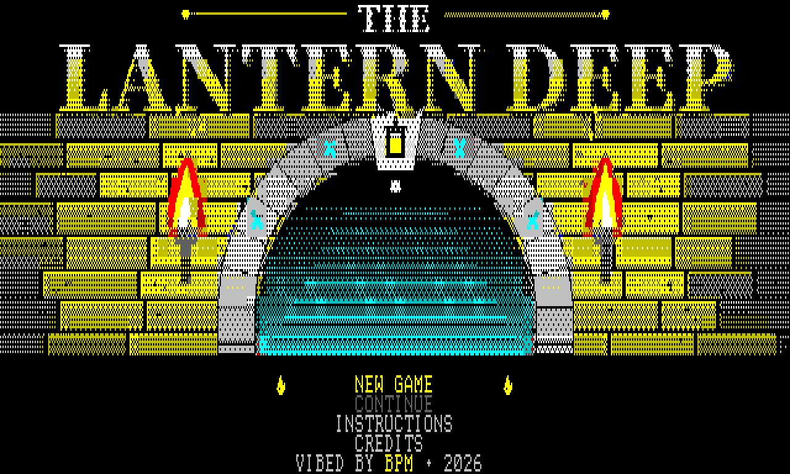

# The Lantern Deep

An original dungeon adventure for the Microbee Premium Plus. The great Lantern at the Heart of the Deep has gone out, and you carry the last flame down through five regions and twenty rooms to rekindle it. Your lantern lights the way you face, and the game has colour and monochrome (green/amber/white) display modes.

**Version 12** · VIBED BY BPM · 2026

## You need
- Microbee Premium Plus with 1MB RAM

## Starting
Boot `release/LANTERN.DS8` (on a Premium Plus without a DS8 drive, boot the image from SD). It goes straight to the `A>` prompt. Type:

    LANTERN

Choose **C** for a colour monitor or **M** for monochrome.

## Keys
| | |
|---|---|
| Arrows or Q A O P (W S) | walk |
| SPACE or Z | strike / open / read / take |
| F or X | fire bolt (uses a magic orb) |
| M | journal and map (press S there to save to disk) |
| ESC | back to the title |

A Microbee joystick works too.

## Folders
- `release/`: the bootable disk image
- `src/`: Z80 source, Python world/art/audio tools, `build.sh`, `DESIGN.md`
- `screenshots/`: colour and mono screens, plus an animated gameplay clip
- `NOTES.TXT`: the full manual

*Rebuilding the disk needs the Microbee boot tracks, `CCP.SYS` and the BN60 boot ROM. These are Microbee system files, so they're not included here; copy them from your own Microbee system disk into `src/resources/`.*
