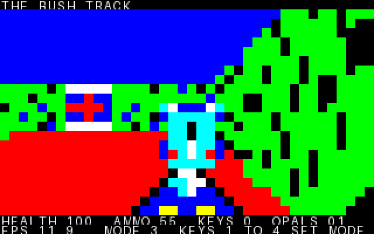
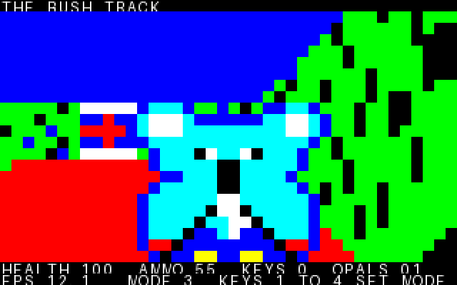
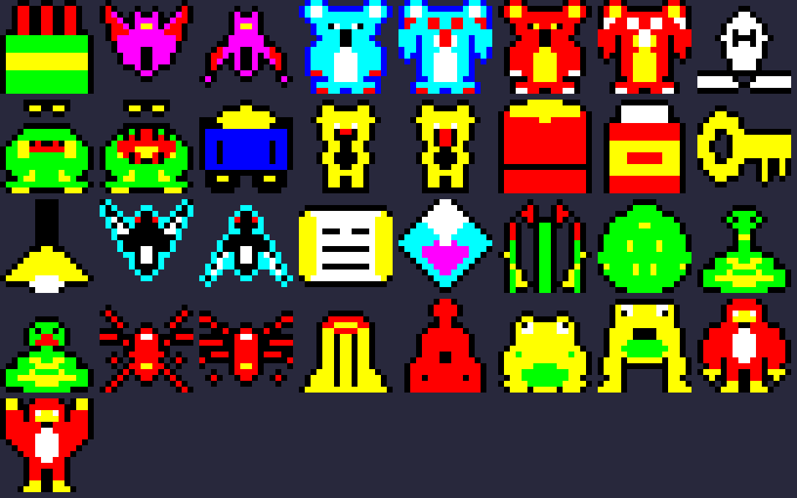

# DROPBEAR 3D for the Sharp MZ-700 (MZRAY)

A WolfenDoom-style game for the Sharp MZ-700, converted from the VZ300 game DROPBEAR 3D.
It's a work in progress: there's a raycaster benchmark, and a playable test of the game with
creatures and shooting.

VIBED BY BPM 2026

## DROPBEAR 3D test v0.2: creatures and shooting
Load `release/DROPBEAR.MZT` through UniCMT (load address 1200h, starts automatically, 32K).

All nine areas of DROPBEAR 3D: The Homestead, The Bush Track, Gum Tree Maze, The Old Mine,
Big Fellas Den, The Billabong, Bunyips Pool, The Ridge and Yowies Lair. Each area theme has its
own wall textures and sky and ground colours.

**What works:**
- All ten creatures, including the three bosses. They sleep until you get close, chase you,
  bite, flinch when shot and drop when beaten. Bosses open their gates.
- Pickups you can see: Vegemite, ammo, keys, opals and the map. Furniture too: drums, lamps,
  shrubs, termite mounds, carts, stumps, reeds and bones.
- A chunky blaster with a muzzle flash, and simple 8253 sounds.
- Doors, ways out between areas, locked doors and keys, lever switches and gates, and cracked walls
  that hide secrets. Each area remembers what you've opened and beaten.
- It's forgiving: if you go down, you start again at the door you came in by, with full health.

**Not yet:** creatures don't explode into pieces, the sound is placeholder beeps, and there's no
automap, title music or attract mode.

| Key | Action |
|---|---|
| W / S or cursor up / down | Walk |
| A / D or cursor left / right | Turn |
| Q / E | Strafe |
| SPACE | Fire |
| 1 2 3 4 | Render mode (20 rays direct, 20 buffered, 40 direct, 40 buffered) |

The bottom line shows the live frame rate and the render mode. Sprites are drawn into each wall
column as it's drawn, so they don't flicker in the fast direct modes.

 

## MZRAY BENCH v0.1: raycaster benchmark
Load `release/MZRAY.MZT` (load address 1200h, 10K). It runs four timed tests of 32 frames each,
then shows the fields per 32 frames and the fps:

| Test | Rays | Drawing | Simulator fields | Simulator fps |
|---|---|---|---|---|
| 1 | 20 | direct to colour RAM | 51 | 31.3 |
| 2 | 20 | buffered + copy | 58 | 27.5 |
| 3 | 40 | direct | 94 | 17.0 |
| 4 | 40 | buffered | 102 | 15.6 |

The simulator doesn't model MZ-700 VRAM wait states, so real figures will be slower.
On MZ-700 Emulator For Win32 it measured 76 / 85 / 125 / 134 fields (21.0 / 18.8 / 12.8 / 11.9 fps).
It hasn't been measured on a real MZ-700 yet.
Afterwards, press 1–4 to walk about in that mode (cursor keys move and turn), or B to run the benchmark again.

## Renderer
Each 40×22 character cell is a "pixel" coloured by its background colour (colour RAM D800h), so the
renderer doesn't depend on the character ROM (European or Japanese).

## Building
From `src/`, with `PYTHONPATH=tools`:
- `python build.py` writes `MZRAY.MZT` (the benchmark).
- `python build_game.py` writes `DROPBEAR.MZT` (the game).

`tools/runtest.py`, `tools/walktest.py` and `tools/gametest.py` run them on the Z80/MZ-700 simulator.
The developer handover notes are in `CLAUDE.md`, and the porting plan is in `PORTING.md`.
