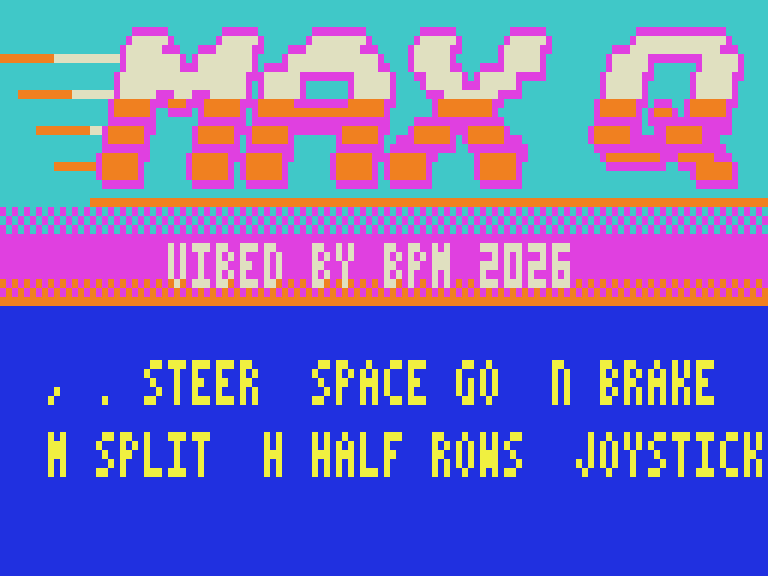
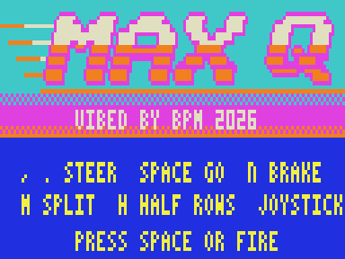

# MAX Q

Real-time solid-polygon 3D racing on the Dick Smith VZ300: an anti-gravity hover racer in the spirit of Wipeout and F-Zero.
Target: VZ300 + BennVenn SD loader + 128K RAM. Mode 1 (128x64, 4 colours).
VIBED BY BPM 2026

**Status: v0.7 — playable.** Three-lap races against three rival hover craft, boost pads, a forgiving energy shield, beeper sound effects, best times, and an attract sequence (title card, best times, demo race).

## Loading

Copy `release/MAXQ.VZ` to the SD card and run it from the loader. The attract sequence runs (title, best times, demo race). Press SPACE or joystick fire to start a race.

`release/BENCH.VZ` is the Stage 2 renderer benchmark.

## Controls

| Key | Action |
|---|---|
| `,` / `.` | Steer left / right |
| SPACE | Start a race (in attract mode); accelerate |
| N | Brake |
| M | HUD strip in colour set 1 on/off. The VZ has no timer, so the split halves the frame rate; it's shown for free on the title card instead |
| H | Half-rate rows on/off (on by default) |
| Joystick 1 | Steer, fire to accelerate |

The HUD floats in the open sky: speed, lap, position, race time, shield bar, and the average fields per frame (`4.8F` = 50 / 4.8 ≈ 10.5 fps; `H` when half-rate rows are on).

## How it works

- The track is a list of cross-sections, stepped along incrementally from the camera and projected with log/exp tables. Distant sections use lower detail.
- Each track strip is rasterised front to back into per-row run lists. Nearer strips hide farther ones, so every pixel is written exactly once.
- The composer turns the run lists into checker-dithered bytes in a back buffer. A field-sync interrupt copies the buffer to video RAM ahead of the beam, so there's no tearing.
- The static top sky and the HUD are only redrawn when they change.
- Every frame the Z80 renderer draws is checked byte for byte against a Python reference (`src/race/ref3.py`).

## Measured speed (v0.7, cycle-exact emulator)

| Mode | Fields per frame | fps |
|---|---|---|
| Half-rate rows on (default) | 4.77 | 10.5 |
| Half-rate rows off | 5.25 | 9.5 |
