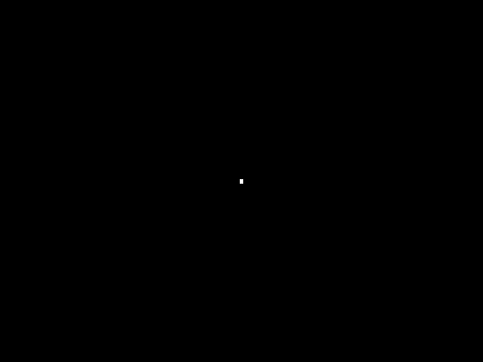

# Microbee Megademo 2026

The first megademo for the **Microbee Premium Plus**. It runs for six minutes and has 14 parts: a twister, plasma, Kefrens bars, a live rotozoomer, a tunnel, a perspective floor, a swirl, a twist and a lit vector torus, all with two-voice beeper music.

VIBED BY BPM 2026.

The Microbee has no sprites, no scroll registers, no copper and no blitter. It has a Z80, a 6545 CRTC, a 1-bit speaker and a megabyte of RAM. Every effect here comes from reprogramming the CRTC in the middle of the picture, in time with the beam, scanline by scanline, while the beeper music keeps playing in the gaps.

**Prepare to stress test your emulators.** The demo depends on scanline-exact 6545 behaviour: start addresses re-read on every line of a character row, row counts compared all the time, and the CPU held whenever it touches video RAM while the screen is drawn. If your emulator rolls, tears or shows a blank screen, it is the emulator.

**Tested on** a real Premium Plus with an amber monochrome monitor. The colour version has only been checked in an emulator so far.

## Running it

1. Boot `release/MEGA.DS8` (double sided, 80 track) on a Premium Plus with 1MB of RAM. Use a real disk, an SD card or a floppy emulator. The disk boots to the CP/M `A>` prompt.
2. Type `MEGA` and press RETURN. Loading takes about 40 seconds (about 600K is loaded).
3. Press **C** for a colour monitor or **M** for monochrome. The mono version draws everything as dot patterns.

SPACE skips to the next part. At the end the demo goes back to the monitor choice.

## The parts

| # | Part | What it is |
|---|---|---|
| 1 | Power on | The picture tube warms up: a dot, a line, a screen. Up to 222 one-line screens a frame. |
| 2 | Self test | A terminal checks the machine, then the picture tears apart row by row. |
| 3 | Title | A copper-bar logo screen with a smooth scroller. |
| 4 | Twister | A twisting bar, 1 pixel accurate. No pixels are drawn: the CRTC picks one of 30 slices for each scanline. |
| 5 | Plasma | 1536 blocks of colour recomputed 25 times a second, inside the scanlines, between the music samples. |
| 6 | Kefrens bars | Racing the beam: every line painted as it is drawn. |
| 7 | Live rotozoomer | Real time, two blocks per scanline. Five textures in turn (the BPM sign, honeycomb, checkers, acid smileys, tartan); each next texture is built in the background while it runs. |
| 8–11 | Tunnel, perspective floor, swirl, twist | Too much maths for a 3.375 MHz Z80, so every block of every frame was computed in advance into the megabyte: 324 pictures, 288K, streamed back at 25 frames a second with colour cycling. |
| 12 | Vector torus | A lit, dithered torus in hi-res PCG pixels: 68 pictures streamed into the hidden PCG bank, four bytes per scanline, double buffered. |
| 13 | Credits | A smooth vertical scroller. |
| 14 | Power off | The tube shrinks to a line, then a dot. |

## Tech specs

- **CPU:** Z80A at 3.375 MHz. Every scanline is exactly 216 T-states.
- **Display:** 6545 CRTC, 64×16 characters of 8×16 PCG glyphs (512×256 pixels), reprogrammed up to every scanline from a "line program" that is rebuilt every frame (two buffers, swapped in the vertical blanking).
- **Tricks:**
  - one-line frames (R9 = 0), so each scanline gets its own start address
  - variable-height frames for fine vertical scrolling
  - extra rows that are never displayed, to get a stable blanking edge in the middle of the frame
  - video RAM writes in one burst per scanline, re-synchronised to the CRTC after the picture
- **Sound:** two-voice 1-bit beeper music (a pulse lead, a square bass and drums), played inside every scanline. About 6 minutes of music in 185 patterns (5.1K).
- **Colour and mono:** every part has both versions.

## Memory used

| | |
|---|---|
| Program, music and tables | 23.7K (8000h–DC8Dh) |
| Variables, two line programs, scratch and stack | about 5K |
| Loaded from disk | 600K: graphics, screens, tiles and text 140K; tunnel 96K; floor, swirl and twist 192K; torus 128K; the rotozoomer's first texture 32K |
| Built while it runs | 160K: four rotozoomer textures, and the plasma's rotated colour ramps |
| **In use** | **about 790K of the 1024K** (plus a 32K staging block while it loads) |
| PCG RAM | 3 banks permanent (the font and two line-pattern banks), up to 5 more reloaded for each part |
| Disk | 628K of the DS80 disk's 784K |

## Folders

- `release/`: `MEGA.DS8`, the plain-text `README.TXT`, `FILE_ID.DIZ` and `YOUTUBE.TXT` (the video description)
- `screenshots/`: 24 pictures from throughout the demo
- `showcase/`: the showcase GIF and `MicrobeeMegademo2026.mp4`, the whole demo with sound (a small 544×408 copy, captured from the emulator)
- `src/`: Z80 source and the Python build tools

## Building

You need Python 3 with numpy and Pillow, and the DejaVu fonts.

    cd src
    mkdir -p build
    python3 tools/fixjr.py

This generates the music, graphics and precomputed effects, assembles the program, and writes `build/MEGA.DS8`. The CP/M system tracks and `CCP.SYS` it puts on the disk are in `src/resources/`.

`src/tools/emu` is the raster-accurate Premium Plus model used for testing (`run.py`, `robust.py`). It needs gcc. `boottest.py` also needs a Microbee boot ROM at `src/resources/rom/bn60.rom`, which isn't included.
