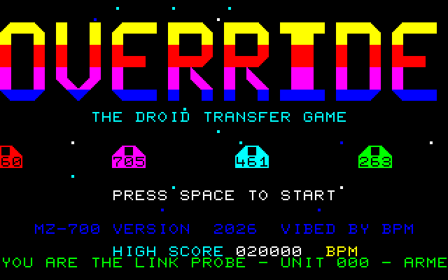
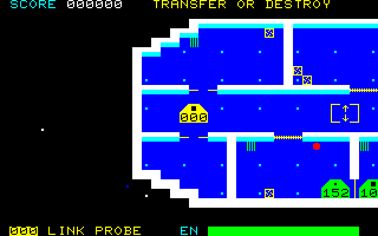
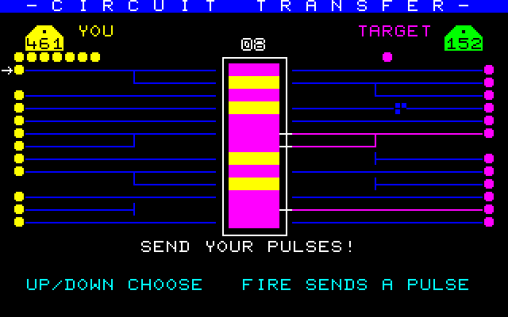
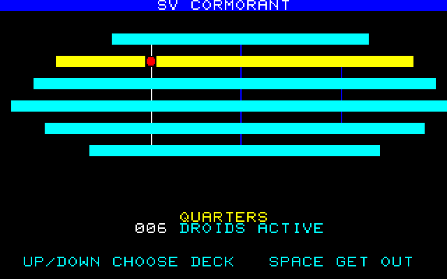

# OVERRIDE

A droid-transfer action game for the **Sharp MZ-700** (64K, PAL, stock
European character ROM, no PCG), loaded from tape or a UniCMT USB cassette
emulator. The MZ-700 version of OVERRIDE, the original Paradroid-style game
also made for the VZ300.

A rogue ship mind has taken over the service droids of three starships. You
are the **link probe, unit 000**. You have no weapons, but you can take over
any droid you touch. Take a droid's body, use its guns, and jump to stronger
hosts before the one you are in burns out. Clear every deck of every ship.

 
 

`docs/title_music.wav` is the title music as recorded from the simulator's
sound chip, so you can hear it without loading the game.

## Running it

- **Real MZ-700 / UniCMT:** copy `release/OVERRIDE.MZF` to the USB stick and
  load it like a tape (`L` from the monitor). It loads at 1200h and starts
  by itself.
- **Emulator:** open `release/OVERRIDE.MZT`. It is the same file with the
  extension MZ700WIN's File > Open expects.

## Controls

| Key | Action |
|---|---|
| Cursor keys or Q / A / O / P | move (two keys for diagonals) |
| SPACE (or Z) + direction | shoot (armed hosts only) |
| hold SPACE still | transfer mode: the probe flashes, then touch a droid |
| SPACE on a lift pad | lift: UP/DOWN to choose a deck, SPACE to get out |
| SPACE next to a console | deck plan and data on your host |
| CR | pause |
| BREAK | quit to the title |
| J (on the title screen) | switch the MZ-1X03 joystick on / off |

### MZ-1X03 joystick

Plug a Sharp MZ-1X03 into joystick socket A, centre the stick, and press
**J** on the title screen. The game calibrates the centre and the idle level
of the buttons, then says `MZ-1X03 JOYSTICK ON`. If nothing answers, it says
`NO JOYSTICK FOUND`. The stick moves, either button fires (stick + button
shoots, holding a button with the stick centred gives transfer mode), and
the keyboard keeps working alongside it. Press J again to switch it off. It
stays off at power-on, because a stock MZ-700 has no joystick.

The stick is read at `$E008` as the 1X03's timing pulses (bits 1 and 2).
They are timed at the start of each VBLANK, and the buttons are read during
the picture. This follows the MiSTer SharpMZ and MAME documentation, so it
has not been tried on a real 1X03.

## Playing

- Each droid shows its **number**. The first digit is its class: higher
  classes are tougher, better armed and worth more points.
- **Transfer duel:** each side has wires running to a centre column of 13
  cells. Move your cursor with UP/DOWN and press SPACE to send a pulse down a
  wire. A pulse that reaches the centre turns that cell your colour and locks
  it for a few seconds. Splitters feed two cells and joiners need both inputs
  live at once. Dead ends do nothing, and boosters lock their cell for
  longer. When the clock reaches zero, the side with more cells wins. Win, and
  the droid becomes your new host with full energy. Lose, and your host burns
  out (or, if you are the bare probe, the game is over).
- Hosts **burn out** over time and get worn down by hits. Stand on an
  **energizer** (the colour-cycling pad) to recharge.
- Destroy or take over every droid on a deck and its lights go down. Clear
  every deck and you board the next ship. There are three ships.

## Attract mode

The title screen has music, a colour-cycling logo, a droid parade and a
scroller. It is followed by the droid databank, the high score table, a how-to
page, and a **demo game** played by an AI pilot. The pilot navigates the
waypoint graph, shoots, takes droids over and fights the circuit duels. Press
any key to leave the demo.

## Building

Needs Python 3 and Pillow (for screenshots only); sjasmplus is in `tools/`.

```
py build.py                      generate data, assemble, write build/ and release/
py tools/run.py 600 300          run 600 fields in the simulator, screenshot field 300
py tools/test_game.py            scripted gameplay checks (all should pass)
py tools/test_joy.py             MZ-1X03 joystick checks (simulated stick)
py tools/test_demo.py 2500 250   watch the demo pilot, screenshots every 250 fields
py tools/perf.py all 600         frame rate under a conservative VRAM wait model
py tools/soak.py 20000           long attract-mode run (crash / stack checks)
py tools/wav.py 40               render the title music to build/title_music.wav
```

The simulator needs the MZ-700 character ROM as `rom/mz700fon.int` (not
included).

| Path | What |
|---|---|
| `src/main.asm` | entry, attract loop, memory map |
| `src/render.asm` | deck view: sprites written into the map, diff against a shadow, HUD |
| `src/deck.asm` | ship and deck loading, doors, energizers, lights, droid persistence |
| `src/droids.asm` | droid AI, shots, explosions, damage |
| `src/player.asm` | controls, transfer mode, camera, demo pilot |
| `src/transfer.asm` | the circuit duel |
| `src/game.asm` | game flow and events |
| `src/screens.asm` | title, attract pages, lift, console, end screens, high scores |
| `src/sound.asm` | one-voice music player and effects |
| `tools/ships.py` | deck generator with waypoint graphs |
| `tools/codes.py` | display codes (character + colour per cell) |
| `tools/music.py` | the songs and sound effects |
| `tools/roster.py` | the droids |

## How it works

- **Display codes.** Every cell of the deck view is one byte that indexes
  three page tables: character, attribute and gameplay flags. Lit and dim
  versions exist for every tile, so a cleared deck's lights go down by
  passing the map through a table once.
- **Rendering.** Each frame, droids, shots and explosions are written into
  the deck map and their old codes are saved. The 40 x 23 window is compared
  with a shadow copy of the screen by an unrolled loop of
  `ld a,(de) / cp (hl) / call nz`, then the map is restored. Only changed
  cells are written to VRAM. That keeps the game at 25 fps while scrolling,
  even when every VRAM access is held for the hblank window.
- **Decks** are stored as 2-bit wall/floor/void runs, one byte per run, plus
  "repeat row k" codes, at about 130 bytes each. Doors, lifts, consoles,
  energizers and props are placed from lists, and wall faces and floor marks
  are added at load time. The generator checks that what the loader rebuilds
  matches the design.
- **AI.** Droids patrol a waypoint graph whose edges are all paths a 3 x 2
  droid can walk. Hunters steer towards you, and armed droids shoot along
  rows, columns and diagonals when the line is clear. The demo pilot uses a
  breadth-first search over the same graph.
- **Sound.** A tracker-style player gives the single 8253 square-wave voice
  to the drums, a short bass pluck and the lead (arpeggios, vibrato) tick by
  tick. Noise is made by re-loading the counter with random values every time
  the code polls for VBLANK.
