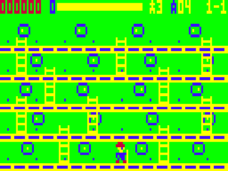
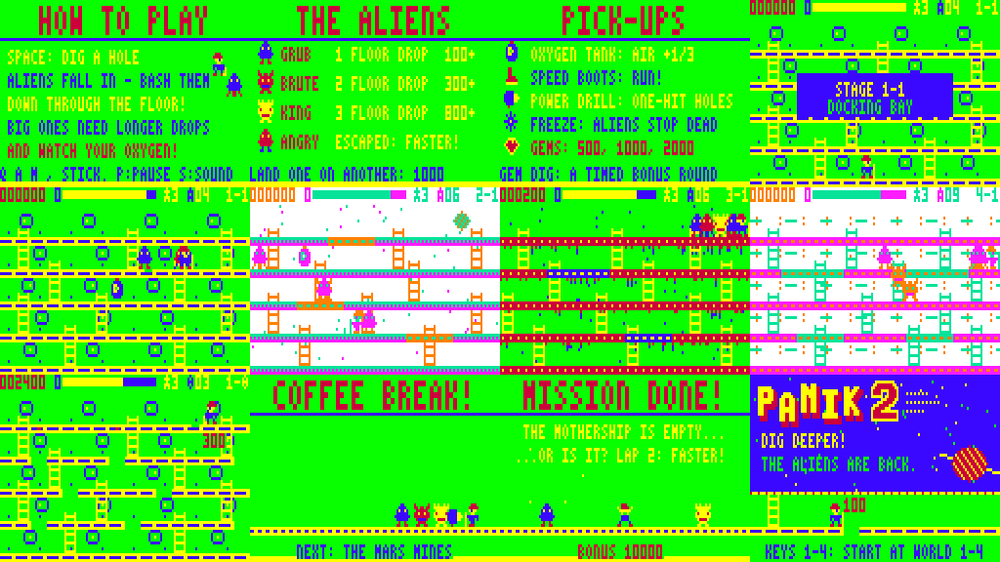

# PANIK 2 — "Dig Deeper!"

Sequel to the VZ200/VZ300 game *PANIK* (VZ-PANIC), for the Dick Smith VZ300 / VZ200 with a BennVenn SD loader and 128K RAM.
ViBED by BPM 2026. All code, graphics and music are original. Nothing from the original game is included.




## Play it

Copy `release/PANIK2.VZ` to the SD card and run it from the BennVenn SD menu. It's a single type F1 machine-code file that loads at $8000 (to $D57F) and starts straight away.

| Action | Keyboard | Joystick |
|---|---|---|
| Move | M left · `,` right (same as the original) | either stick; both work |
| Climb a ladder | Q up · A down (stand by the ladder) | up / down |
| Dig a hole / bash a trapped alien | SPACE (hold to keep digging) | fire |
| Start | SPACE, S, RETURN or fire | fire |
| Start at world 1–4 | keys 1–4 on the title screen | — |
| Pause (X quits while paused) | P | — |
| Sound: music+SFX → SFX only → off | S (in game) | — |
| Initials entry | Q/A change letter, M back, SPACE/fire next, RETURN done | up/down, fire |

## What's in it

**The original's core loop:**
- Run the girders and ladders of a five-floor station.
- **Dig a hole** in the floor in front of you.
- An alien walks in and is trapped. **Bash it** and it drops through the floor.
- An alien that isn't finished off climbs out, wrecks the hole and comes after you **angry** (red, faster).
- Holes fill back in by themselves after a while.
- An alien's touch costs a life. You start with three diggers, as in the original.

**The oxygen** runs down all the time; the HUD bar shows it.
- Below a quarter, the bar turns red, it beeps, and the music speeds up.
- When the air runs out, you lose a life.
- Air left at the end of a stage pays an oxygen bonus.

**The alien cast** comes from the original's three alien grades, now visible and named:

| Alien | Needs a drop of | Points |
|---|---|---|
| **GRUB** (the original's little blue alien) | 1 floor | 100 / 200 / 400 / 800 |
| **BRUTE** (red, horned) | 2 floors | 300 / 600 / 1200 / 2400 |
| **KING** (yellow, crowned) | 3 floors | 800 / 1600 / 3200 / 6400 |

- **Long drops:** line up holes above one another and the alien falls through them all. Every floor past the minimum doubles the score.
- An alien that doesn't fall far enough lands dizzy, then gets angry.
- **Squash combos:** an alien dropped onto another alien (on the floor, or trapped in a hole below) flattens it for 1000.

**Pick-ups** appear on the floors for a few seconds:
- oxygen tank: air +⅓
- speed boots
- power drill: one-hit holes
- freeze: the aliens stop dead and can't hurt you
- gems: 500 → 1000 → 2000

**Stages:** 16 stages in four worlds, plus a **GEM DIG** bonus round after each world.
- **Worlds:**
  - **Space Station**: the original's green look, with portholes
  - **Moon Base**: starfield and Earth
  - **Mars Mines**: red rock and drips
  - **Mothership**: circuitry
- **Stage names:** Docking Bay, Cargo Hold, Reactor Ring, The Bridge, Tranquility, Crater Colony, Low Gravity, Dark Side, Red Dust, The Deep Shaft, Olympus Dig, Canyon Run, The Hangar, Engine Room, Hive and The Queen's Lair.
- Later worlds add undiggable **steel girders**, more and tougher aliens, faster aliens, keener chasing, shorter trap times and faster-draining air.
- **GEM DIG:** gems are buried under sparkling girder spots. Dig them up (300 each) before the air runs out. Find them all for 5000.
- After world 2 there's a **COFFEE BREAK** cartoon. After world 4 comes the ending with a 10,000 bonus, then **lap 2**, which runs faster.
- **Extra diggers** at 20,000, then every 40,000.

**Presentation:**
- **Title screen (Mode 1):** a shaky PANIK logo with a big **2** in deep space. On the deck below, the digger replays the original's intro over and over: dig, trap, bash, drop, "100".
- **Attract cycle:** title → How to Play → The Aliens → Pick-ups → a computer-played demo on the real engine → Hall of Fame with an alien parade. Start works at any point.
- **In game:**
  - stage banners
  - aliens beam in with a sparkle
  - trapped aliens wriggle, and shake just before they climb out
  - splats, particles, score pop-ups and palette flashes
  - a celebrating digger and an oxygen-bonus tally at each clear
- **High scores:** a 5-entry table with 3-letter initials, kept until power-off.
- **Sound:** the two-voice pin-pulse beeper engine (from Ghost Hunter 2 / Penguin 2), with short, separated notes. All tunes are original, in a jumpy A-minor "alarm" style:
  - title theme
  - in-game loop, plus a faster low-oxygen version
  - jingles: start, clear, death, game over, extra digger, high score
  - gem-dig loop, coffee-break tune and ending theme
  - 18 sound effects

  `media/` has the emulator's speaker output for the title music and a stretch of gameplay.



## Hardware notes

**Loading:**
- One .VZ file from the BennVenn SD loader, with no data files.
- It makes no ROM calls and runs with interrupts off (DI throughout).
- Frame timing comes from polling field sync on $68xx bit 7.

**Memory (BennVenn SD + 128K):**

| Range | Use |
|---|---|
| $4000–$5C1F | **BennVenn SRAM window**: sprite shift table and 36 pre-shifted, pre-masked sprites (built at start-up) |
| $7000–$77FF | video RAM |
| $7800–$7AAB | variables |
| $7C00–$7C7F | VRAM commit queue |
| $7FFE | stack (grows down) |
| $8000–$D57F | code and data (the .VZ) |
| $E800–$EFFF | CLEAN: the composed playfield, used to restore under text and pop-ups |
| $F000–$F10F | stage tables: holes, refill timers, floor types, ladders, alien arrival order |
| $F600–$F7FF | sprite mask tables |
| $F800–$FFFF | background buffer |

- **SRAM window:** the game uses the 10K SRAM window at $4000–$67FF *as the SD DOS leaves it* (mapping 1). This is the same way your Cybernoid v1.1 build uses it, and that build runs on your machine.
  - At start-up the game tests the whole window.
  - If the test fails, it selects mapping 1 once with `OUT ($37),1`. That is the only mapper write, and only on that path. Mapping values 1 and 3 were confirmed on your machine by the BIX bank probe.
  - If it still fails, the game shows "PANIK 2 NEEDS THE BENNVENN SD LOADER WITH 128K RAM" instead of crashing.
- **Expansion RAM:** the rest of the expansion is used as plain RAM up to $FFFF (on a VZ300 the 128K card supplies $B800–$FFFF).
- **DOS:** the game doesn't need the DOS after loading.

**Snow-free drawing:**
- Outside vertical blank, the game only draws into the background buffer and queues the changed rectangle. Video RAM is written only in the vblank window after field sync:
  1. queued rectangles, within a per-frame budget that shrinks when the sprite list is busy
  2. sprite erase
  3. sprite draw
- Sprite addresses and shift frames are worked out during the display, so the vblank work is only byte copies:
  - sprites are drawn with POP from (mask, data) pairs, unrolled for all 8 rows
  - the erase uses LDI
- At most 5 aliens are on screen at once. Particles are drawn only while the frame has room. The O2 bar updates only the byte that changed.

**Joysticks:** ports $2C, $29, $2E, $2D, $2B and $27 are all read and combined, so either stick on your custom interface works. Bit 4 is fire.

## Build

You need Python 3 with Pillow, and sjasmplus (https://github.com/z00m128/sjasmplus) on your PATH.

```
cd src
./build.sh          # -> ../build/PANIK2.VZ (a finished copy is in release/)
```

- `gen.py` (with `title_art.py` and `music.py`) writes `data.inc`. It holds the font, sprites, world tiles and backdrops, the 20 stage layouts (as text in `gen.py`), the title picture and the music.
  - It checks every layout: each floor pair has a ladder, and buried gems never sit where a ladder ends.
  - It writes previews to `build/preview/`.
- The assembly is split into:
  - `main.asm`: flow, memory map, variables
  - `core.asm`: frame sync, input, text, sprite engine
  - `sound.asm`: music and effects
  - `game.asm`: gameplay
  - `ai.asm`: the computer player
  - `attract.asm`: title, pages, Hall of Fame, intermission, ending
- `mkvz.py` wraps `panik2.bin` into the .VZ file.

**Tools in `tools/`:**
- `tools/vzemu/` is the small headless VZ300 emulator used for Ghost Hunter 2 and Penguin 2. Build it with `gcc -O2 -o vzemu vzemu.c z80.c`.
  - It has a **snow detector**, which counts any CPU access to video RAM during the active display.
  - It has a **vblank timing marker**, which reports the scanline at which each frame's drawing finished.
  - It uses the superzazu/z80 CPU core (MIT licence, see `LICENSE-z80`).
- `tools/playtest.py` runs the soak test. It pokes test-only RAM flags (`autoplay`, `godmode`, `forceclear`) so the computer player plays through every stage.
- `tools/media.py` captures the screenshots, GIFs and audio.
- `tools/z80dis.py` is the small disassembler used to study the original.

## Testing

**Tested in the emulator only:**
- A 32,000-frame soak through every stage, all four gem digs, the coffee break, the ending and into lap 2: **no video-RAM access during the active display on any frame**, apart from the one-off screen clear at power-on. The latest-finishing frame ended on scanline 80; the picture starts at 81.
- Keyboard play: walking, climbing, digging and holes refilling.
- The full attract cycle and the demo.
- Deaths, out-of-air, game over, initials entry and the Hall of Fame.

**Not yet checked on real hardware:**
- That the SRAM window is free and writable after the BennVenn menu launches a .VZ. This matches your Cybernoid v1.1 result. If it isn't, the game tries mapping 1 and otherwise tells you.
- The exact top-border length of the real machine, which the emulator assumes.
- The sound level on your speaker.
- Joystick feel on your interface.
