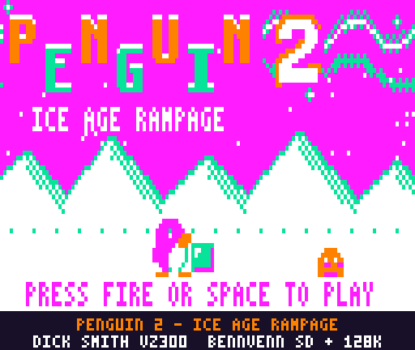
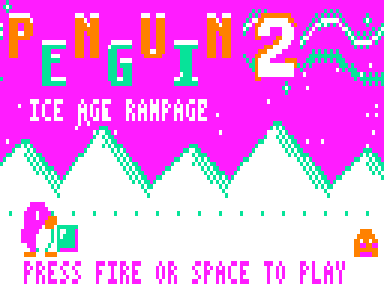
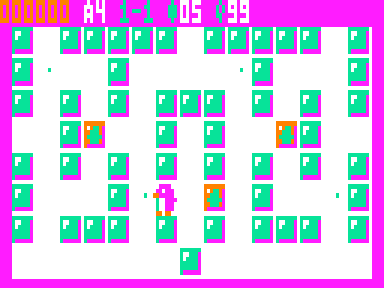
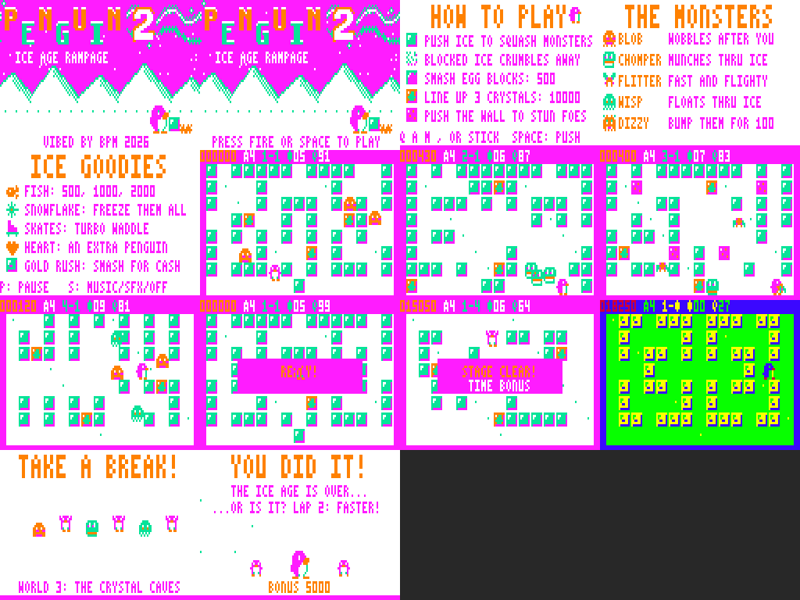

# PENGUIN 2 — "Ice Age Rampage"

Sequel to the VZ200/VZ300 game *PENGUIN* for the Dick Smith VZ300 / VZ200.
ViBED by BPM 2026. Original code, graphics and music. Nothing from the original game is included.



Release blurb with tech specs: [BLURB.md](BLURB.md)







## Play it

Copy `release/PENGUIN2.VZ` to the SD card and load it from the BennVenn SD loader. It's a type F1 binary that loads at $8000 (to $CF7F) and runs from $8000. It needs the **BennVenn 128K** RAM expansion (RAM up to $FFFF).

| Action | Keyboard | Joystick |
|---|---|---|
| Move | Q up · A down · M left · `,` right (same as the original) | either stick; both work |
| Push / smash ice | SPACE | fire |
| Start | SPACE, S, RETURN or fire | fire |
| Start at world 1–4 | keys 1–4 on the title screen | — |
| Pause (X quits while paused) | P | — |
| Sound: music+SFX → SFX only → off | S (in game) | — |
| Initials entry | Q/A change letter, M back, SPACE/fire next, RETURN done | up/down, fire |

## What's in it

**The core loop is the original's:** push a block of ice and it slides until it hits something, crushing every monster in its path. A block that can't move crumbles. A monster's touch costs a life. You start with four lives, as in the original.

**New in the sequel:**
- **Eggs.** Monsters hatch out of ice blocks. The egg blocks flash at the start of each stage, so you can smash them before they hatch (500).
- **Multi-crush chains.** One block flattening several monsters scores 400 / 1600 / 3200 / 6400.
- **Wall shake.** Push against the border wall and every monster touching it is stunned. Walk into a stunned monster to bump it off the board (100).
- **Crystal blocks.** Every stage has three, and they can't be broken. Line them up in a row or column for 10,000 (5,000 if the line touches the wall), which also stuns every monster.
- **Goodies hidden in the ice**, revealed when you crumble a block:
  - fish: 500 → 1000 → 2000
  - snowflake: freezes all monsters
  - skates: double speed
  - heart: extra penguin
- **Time.** The clock counts down from 99, like the original's. When it runs out it's **HURRY UP!** rather than instant death: the monsters speed up and the music races. Seconds left at the clear pay 50 each.
- **Extra lives** at 20,000, then every 40,000.

**The monster cast,** introduced world by world:
- **BLOB** wobbles after you.
- **CHOMPER** munches through ice (the original's "some monsters can make blocks crumble").
- **FLITTER** is fast and flighty.
- **WISP** floats through ice, and can't be crushed or hurt you while it's inside a block.

**Stages:** 16 hand-made stages in four worlds, plus a **GOLD RUSH** bonus round after each world.
- Worlds: Penguin Point, Glacier Gap, Crystal Caves and Aurora Peak.
- Stage names include Snowy Start, Ice Cubes, Slippery, V Z, Chomp Chomp, Igloo, Crossroads, Fish, Rocky Road, Crystal Cave, Snowflake, Zigzag, Wispy Woods, Aurora, The Maze and Ice Age 2.
- Later worlds add unbreakable rock blocks. Layouts are checked by script so the open space is connected.
- **GOLD RUSH** swaps to the original game's green palette and turns the ice to gold. You get 30 seconds to smash as much as you can, at 100 a block, plus 5000 for clearing the lot.
- After world 2 there's a dancing intermission, and after world 4 an ending, then lap 2 runs faster.

**Presentation:**
- **Title screen (Mode 1):** a zig-zag red/yellow-style PENGUIN logo (a nod to the original's sidebar) with a big **2**, aurora ribbons, snowy mountains and falling snow. A penguin pushes an ice block into a blob, and the bottom line cycles through the messages.
- **Attract cycle:** title → How to Play → The Monsters → Ice Goodies → a computer-played demo on the real engine → Hall of Fame with a monster parade. Pages change with blinds wipes, and start works at any point.
- **In game:**
  - stage banners
  - flashing egg blocks
  - crumbling ice animation
  - squash bursts and score pop-ups
  - palette flashes on crushes
  - wall flashes
  - a dancing penguin at each clear
  - a time-bonus tally
- **High scores:** a 5-entry table with 3-letter initials, kept until power-off.
- **Sound:** the two-voice pin-pulse beeper engine from Ghost Hunter 2, with short, separated notes for that gritty sound. All tunes are original:
  - title theme
  - in-game loop and a faster HURRY tune
  - jingles: start, clear, death, game over, crystal fanfare, extra life, high score
  - gold-rush loop, intermission dance and ending theme
  - 16 sound effects

  Effects play over the bass voice, so the tune carries on. `media/` has the emulator's speaker output for the title music and a stretch of gameplay.

## Hardware notes

- **Loading:** a single .VZ file from the BennVenn SD loader, with no extra files. It makes no ROM calls and runs with interrupts off (DI throughout). Frame timing comes from polling field sync on $68xx bit 7.
- **Memory:**
  - It writes no mapper port ($37). It doesn't touch the DOS SRAM window at $4000–$67FF, and doesn't need the DOS after loading.
  - The expansion is used as plain RAM up to $FFFF (on a VZ300 the 128K card supplies $B800–$FFFF; checked against MAME's sdloader model and your RASTEST/XVTEST results).

| Range | Use |
|---|---|
| $7800–$7B52 | variables |
| $7C00–$7CFF | VRAM commit queue + play grid |
| $7FFE | stack (grows down) |
| $8000–$CF7F | code and data (the .VZ) |
| $CF80–$F11F | pre-shifted, pre-masked sprites (built at start-up) |
| $F600–$F7FF | mask tables |
| $F800–$FFFF | background buffer |

- **Snow-free drawing:**
  - Outside vertical blank the game only draws into the background buffer and queues the changed rectangle.
  - Video RAM is written only in the vblank window after field sync:
    1. queued rectangles, within a per-frame budget that shrinks when many sprites are up
    2. sprite erase
    3. sprite draw
  - Sprites are stored as (mask, data) pairs and drawn with POP, about 36 T-states a byte.
  - Palette flashes are applied at the start of vblank.
- **Joysticks:** ports $2C, $29, $2E, $2D, $2B and $27 are all read and combined, so either stick on your custom interface works. Bit 4 is fire.

## Build

Needs Python 3 with Pillow, and sjasmplus (https://github.com/z00m128/sjasmplus) on your PATH.

```
cd src
./build.sh          # -> ../build/PENGUIN2.VZ (a finished copy is in release/)
```

- `gen.py` (with `title_art.py` and `music.py`) writes `data.inc`, which holds the font, sprites, cell tiles, the 20 stage layouts (as text in `gen.py`), the title picture and the music. It also checks the layouts and writes previews to `build/preview/`.
- `mkvz.py` wraps `penguin2.bin` into the .VZ file.

`tools/vzemu/` is the small headless VZ300 emulator from Ghost Hunter 2. Build it with `gcc -O2 -o vzemu vzemu.c z80.c`. For this project it has two extra checks:
- a **snow detector**, which counts any CPU access to video RAM during the active display
- a **vblank timing marker**, which reports the scanline at which each frame's drawing finished

It uses the superzazu/z80 CPU core (MIT licence, see `LICENSE-z80`).

- `tools/playtest.py` runs a soak test. It pokes test-only RAM flags (`autoplay`, `godmode`, `forceclear`) so the demo AI plays a real game through every stage, bonus round, the intermission and the ending.
- `tools/media.py` captures the screenshots, GIFs and audio, and `tools/showcase.py` builds the captioned showcase GIF from emulator captures.

## Testing

Tested **in the emulator only** so far:
- every stage, all four gold rushes, the intermission, the ending and lap 2
- deaths, game over and the high-score table
- the full attract cycle and the demo
- pushes, slides, crumbles, crushes, hatching and sound output

In a 27,000-frame soak of the whole game, drawing finished inside vblank on more than 99.8% of frames. About 40 frames (big multi-crush moments) ran 1–4 scanlines past the start of the picture, which would touch only the very top line of the HUD.

**Not yet checked on real hardware:**
- the exact top-border length of the real machine, which the emulator assumes
- the sound level on your speaker
- joystick feel

The loading method and memory use match builds that already work on your VZ300 (Ghost Hunter 2, Xevious v1.2).

## Sound-effect fix (8 November 2026)

The sound-effect table had 9 bytes per entry, but the code that plays an effect looks entries up 8 bytes apart. So every effect after the first one played the wrong values, and some came out as long, chirpy, lingering sweeps. The table now has 8-byte entries, so every effect plays as designed. Every effect plays at its original length, including the warbly bonus and power-up sounds. Nothing else changed.
