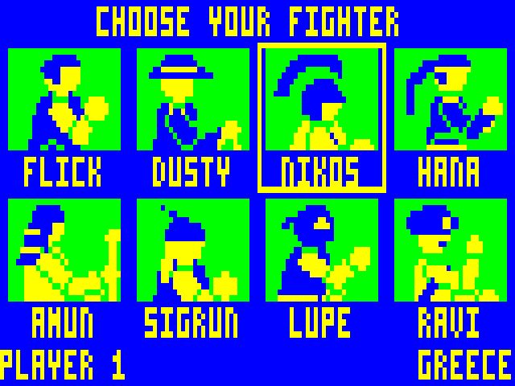
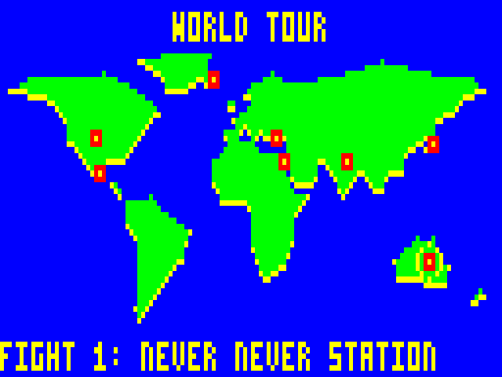
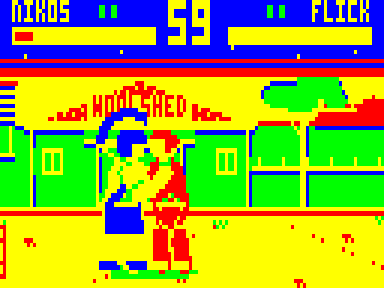
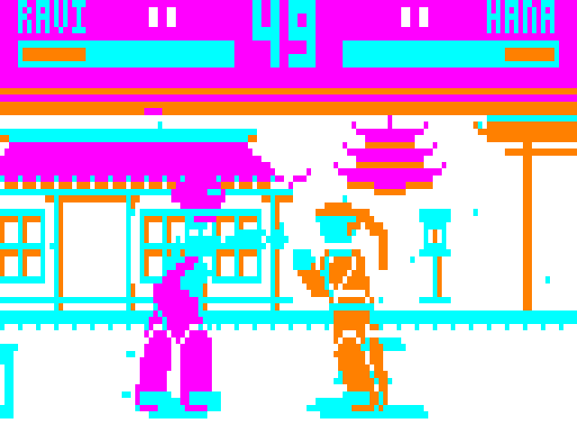
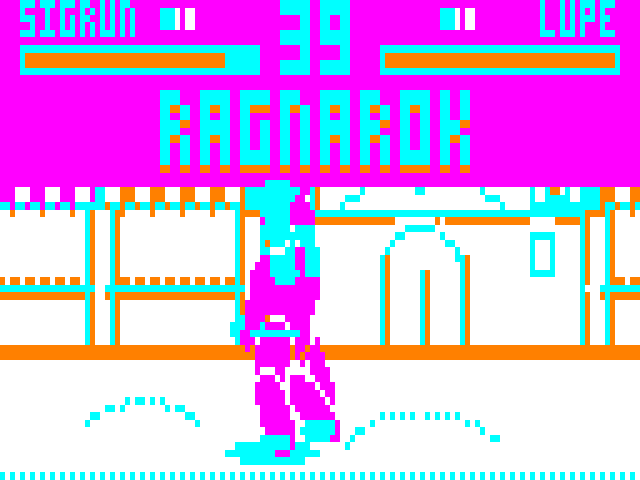

# RED DUST RUMBLE: WORLD TOUR

A one-on-one fighting game for the Dick Smith VZ300, in the style of Street Fighter II. Eight fighters from eight countries, each with a home arena, and a boss waiting at the end of the tour.

VIBED BY BPM 2026

 
 
 

## Status: v0.7 (emulator-tested, not yet run on a real VZ300)

New in v0.7:

- **Eight selectable fighters and a boss.** Maxwell Sable can't be picked; he is the last fight of the tour, in his own circus tent.
- **World tour** (1 player): pick a fighter, then beat the other seven at their homes, then Sable. A world map shows the next stop. Lose and you can try that fight again as often as you like.
- **Idle animations, taunts and finishers** for everyone (see Controls).
- **New kinds of signature move:** thrown things (discus, chakram, sun disc, top hat), flying kicks and presses, slides, armoured charges, a staff and a cane.
- **Nine arenas** with lit, bas-relief buildings and small background animations (a windmill, snow, torches, bunting, a lighthouse, chase lights).
- **Loading from the SD card:** each match loads its two fighters and its arena, in about a second.

## Hardware and files

VZ300 with a BennVenn SD loader and 128K SRAM, plus joysticks (two buttons each) or the keyboard.

Copy **all eleven files** in `release/` to the same folder on the SD card:

- `RUMBLE.VZ` (the game; loads at $8000)
- `RDRUMBL0.DAT` (the fighter-select picture and the world map)
- `RDRUMBL1.DAT` to `RDRUMBL9.DAT` (one fighter and that fighter's home arena each)

Load `RUMBLE.VZ` from the SD menu.

## Controls

| | Player 1 | Player 2 |
|---|---|---|
| Move / jump / crouch | Joystick 1 or `W A S D` | Joystick 2 or `I J K L` |
| A (light) | Joystick 1 fire, or `F` | Joystick 2 fire, or `;` |
| B (heavy) | Joystick 1 second button, or `G` | Joystick 2 second button, or `:` |

In the world tour every joystick and key set controls player 1.

- **Block:** hold away from your opponent. Hold down-away to block low. Jump attacks must be blocked standing; sweeps and slides crouching.
- **Signature move 1:** press A and B together (up to 3 ticks apart).
- **Signature move 2:** hold down and press A+B.
- **Taunt:** hold up and press A+B. It leaves you open for most of a second.
- **Finisher:** win the deciding round with a knock-out on a standing opponent and they go dizzy while FINISH! shows. You have about three seconds to push the stick through your fighter's two directions, then press A+B. Hit them with anything else, or wait, and they simply fall.
- A light attack that connects can be cancelled straight into a signature move.
- `RETURN` pauses (`RETURN` resumes, `Q` quits to the menu). `T` toggles the speed readout.
- On the select screen, the second button or `Q` goes back.

| Fighter | From | A+B | Down + A+B | Finisher (then A+B) |
|---|---|---|---|---|
| Flick | Australia | Blade Run (dash punch) | Tin Roof (rising uppercut) | down, forward: Outback Express |
| Dusty | USA | Whip Crack (hits at the tip) | Ankle Snare (low, knocks down) | back, forward: Last Roundup |
| Nikos | Greece | Discus (thrown) | Bull Rush (charge) | forward, back: Olympic Throw |
| Hana | Japan | Crane Kick (flying kick) | Swallow Slide (low) | down, back: Sakura Storm |
| Amun | Egypt | Sun Disc (thrown, slow) | Cobra Staff (long thrust) | down, down: Pharaoh's Curse |
| Sigrun | Iceland | Glacier Charge (can't be stopped while winding up) | Geyser (rising uppercut) | forward, forward: Ragnarok |
| Lupe | Mexico | Plancha (flying press, block it standing) | Tope Roll (low) | back, back: Gran Final |
| Ravi | India | Chakram (thrown, fast) | Monsoon Rise (rising kick) | forward, down: Monsoon's End |
| Sable | the Big Top | Top Hat (thrown) | Cane Flash (long thrust) | back, down: Curtain Call |

"Forward" and "back" are relative to the way your fighter faces. Each fighter can have one thrown thing in the air at a time.

## Checking it on the real VZ300

This build uses the 128K expansion in a new way, so the first run on the real machine is a test in itself. What each outcome means:

1. **A red screen saying "CANNOT START"** with a number: (1) no SD loader memory found, (2) the second 10K bank is missing, (3) the second high-memory bank is missing. A photo of the number is all I need.
2. **A blue screen saying "CANNOT READ FROM THE SD CARD"** names the file it wanted: check that file is on the card next to `RUMBLE.VZ`.
3. **"A GAME FILE IS DAMAGED"** means a fighter loaded but failed its checksum. If that happens with good files, the SD software is disturbing the second high bank, and I need to know.
4. **CONTROL TEST** (title menu) and the **`T` speed readout** work as before. In the emulator about 3 to 4 ticks in 100 run slow (three fields instead of two), up from under 2 in v0.6, mostly with two tall fighters using their long-reach moves.

## How it works

- **Display:** mode 1 (128×64, 4 colours). Each tick is composed in a shadow screen and copied to video RAM by the frame interrupt at the top of field sync, so the picture never tears. Arenas use one of the VZ's two palettes each.
- **Memory:** the SD software stays in its own bank, so the game can load at any time. Fighter A lives in the second 10K SRAM bank and fighter B in the second 18K high-memory bank, both visible at once while fighting. The arena (192 pixels wide, plus a copy shifted 2 pixels for smooth scrolling) sits in normal high memory and is switched in only while the backdrop is being restored.
- **Safety net:** the part of the program that runs in the second high bank is re-copied there after every SD load, and each fighter file is checksummed.
- **Fighter files:** frames, moves, CPU habits and names in one position-independent block per fighter, relocated after loading. Frames used while moving have a 2-pixel-shifted twin; standing poses are drawn on the 4-pixel grid.
- **Background animation:** each arena file lists the bytes that differ between its two phases; they are swapped about twice a second.

Memory map (port $37: 1 = SD software, 3 = fighter A + arena, 7 = fighter A + fighter B):

- `$4000-$67FF`: bank 0 the SD DOS, bank 1 fighter A
- `$7B00-$7FFF`: stack and interrupt table
- `$8000-$AFFF`: always visible: interrupt, input, sound, SD loader, drawing, CPU opponent, variables
- `$B000-$B7FF`: shadow screen
- normal high memory: `$B800` banked code as loaded, `$D000` arena, `$DA20` shifted arena, `$E440` animation list, `$E600` clean copy of the view, `$EE00-$F9FF` DOS stack and sector buffer
- second high bank: `$B800` fighter B, `$E000` draw tables, `$E800-$FFFF` fight logic and menus

## Building

Needs only Python 3 with Pillow:

```
./build.sh        # -> build/RUMBLE.VZ and build/sd/RDRUMBL0-9.DAT
```

- `tools/fighters.py` draws the nine fighters (posed skeletons with costumes) and holds their moves, CPU habits and finishers.
- `tools/pack.py` builds the SD files: fighter blocks, arenas with the relief lighting pass and animation lists, the select picture and the world map.
- `tools/worldtour.py` and `tools/stage.py` draw the arenas.
- `tools/mktables.py` generates the sprite blitter and lookup tables.
- `emu/` is the test emulator (`gcc -O2 -o vzemu vzemu.c`, run with `-S build/sd`). It models both SRAM banks, the second high bank and the SD file calls.

See [DESIGN.md](DESIGN.md) for the design history.
