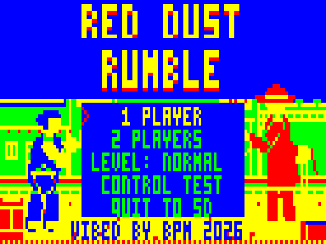
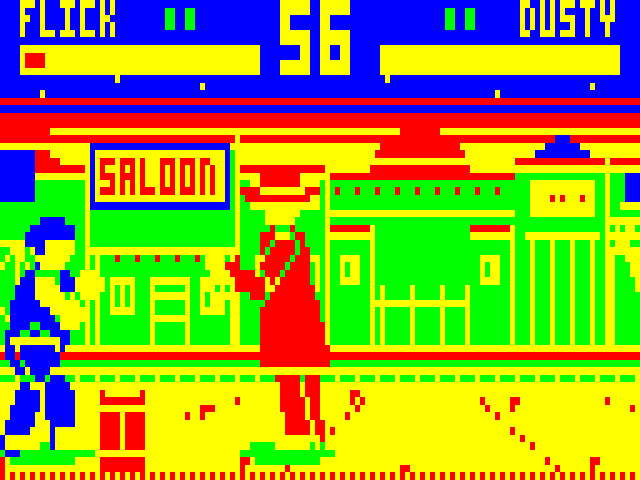

# RED DUST RUMBLE

A one-on-one fighting game for the Dick Smith VZ300, in the style of Street Fighter II. Two fighters square off in the main street of a dusty outback town at sunset.

VIBED BY BPM 2026

 

## Status: v0.6 (emulator-tested, not yet run on a real VZ300)

New in v0.6:

- **Main Street arena:** rebuilt from the mock-up (see `mockups/`).
- **Scrolling stage:** 192 pixels wide, with the camera following the fight in 2-pixel steps. The screen edges act as walls, and the starry top of the sky stays still.
- **Shadows:** a small shadow under each fighter.
- **Messages:** big messages now sit on a dark banner.
- **Dusty's whip:** slower and weaker, and the CPU uses it less.

- Flick Finnegan (fast, close-range) and Dusty Marlowe (slow, long reach), each with six normal attacks and two signature moves
- One arena: Main Street at sunset, a 1.5-screen scrolling stage
- Best of three rounds, health bars, 60-second timer, K.O. and time-out
- 1 player against the CPU (Easy / Normal / Hard), with either fighter on either side
- 2 players: joystick 1 against joystick 2, with keyboard controls as well
- A control test screen and an in-fight speed readout for checking the real machine
- A CPU-against-CPU demo plays after 20 seconds on the title screen (press any key to stop it)

## Hardware

VZ300 with a BennVenn SD loader and 128K SRAM, plus joysticks (two buttons each) or the keyboard. Copy `release/RUMBLE.VZ` to the SD card and load it from the SD menu. It loads at $8000.

## Controls

| | Player 1 | Player 2 |
|---|---|---|
| Move / jump / crouch | Joystick 1 or `W A S D` | Joystick 2 or `I J K L` |
| A (light) | Joystick 1 fire, or `F` | Joystick 2 fire, or `;` |
| B (heavy) | Joystick 1 second button, or `G` | Joystick 2 second button, or `:` |

In 1-player mode every joystick and key set controls player 1.

- **Hold away from your opponent** to block. Hold down-away to block low.
- Jump attacks must be blocked standing; sweeps and the Ankle Snare must be blocked crouching.
- Signature moves: **press A and B together** (they can be up to 3 ticks apart). Hold down as well for the second move.

| | A+B | Down + A+B |
|---|---|---|
| Flick | **Blade Run**: a dashing punch (punishable if blocked) | **Tin Roof**: a rising uppercut that beats jump-ins |
| Dusty | **Whip Crack**: hits only at the tip of the whip | **Ankle Snare**: low whip, knocks down |

- A light attack that connects can be cancelled straight into a signature move.
- `RETURN` pauses. While paused, `RETURN` resumes and `Q` quits to the menu.
- `T` during a fight toggles the speed readout (see below).
- **QUIT TO SD** on the title screen restarts into the SD card menu.

## Checking it on the real VZ300

1. **CONTROL TEST** (title menu) shows both joysticks and both key sets live, the raw values of ports $2C $2E $2D $29 $23 $2B $27, a drop-out counter for each joystick direction (held, lost for one field, held again), and the gap in fields between pressing A and B. Hold each joystick 2 direction for 10 seconds and check its counter stays at 00. `RETURN` leaves.
2. **Speed readout**: press `T` in a fight. Player 1's name is replaced by the spare time per tick (the worst over each second, as a percentage) in yellow and the number of slow ticks this round in red. Spare time should stay above 0%, and slow ticks should rarely go up.

Photos of both screens will show whether anything needs changing.

**Joystick 2:** its directions are read from port $29 and port $23 together. $29 is the port your joystick 2 left/right already worked on. $23 is the matching port for joystick 2's own arm-select line, which may make up/down reliable. The control test shows both raw values.

## How it works

- **Display:** mode 1 (128×64, 4 colours). Every tick is composed in a shadow screen and copied to video RAM by the frame interrupt, starting at the top of field sync, ahead of the beam, so the picture never tears. Only the area the fighters and effects touched is restored and copied.
- **Scrolling:** the stage is 48 bytes wide, rows 10-63. There is a second copy shifted by 2 pixels, built at start-up, so the camera can move in 2-pixel steps. Sprites are erased straight from the stage. On a tick when the camera moves, every scrolling row is redrawn and copied. The camera only moves when the fight drifts more than 12 pixels from the centre of the screen.
- **Speed:** in ten minutes of CPU-against-CPU demo, 1.7% of ticks ran slow (three fields instead of two), almost all of them during Dusty's whip specials while the camera was moving.
- **Timing:** logic runs at 25 ticks a second (two fields). The controls are read every field and button presses are latched, so a quick tap is never lost.
- **Banked RAM:** each fighter has 22 frames, stored once and given a 2-pixel-shifted copy at start-up. Flick's frames live in SRAM bank 1 (port $37 = 3). Dusty's live in bank 0 (port $37 = 1), the bank the SD DOS normally occupies, with a few frames in main RAM. Mirroring and player 2's red colouring are done with lookup tables while drawing.
- Because bank 0 is overwritten, the game doesn't call the SD DOS. Quitting restarts the machine through the SD loader, which reloads the DOS from the card.

Memory map:

- `$4000-$67FF`: SRAM banks 0 and 1 (fighter frames)
- `$8000-$E5BF`: program and data
- `$D400`: the 2-pixel-shifted stage, built over spent start-up data
- `$E000`: shadow screen
- `$E800`: clean view (still sky and messages)
- `$F000-$F7FF`: draw tables
- `$F800`: interrupt table and stack
- `$FA00`: variables. That area is the SD DOS's workspace, and the game never calls the DOS.

## Building

Needs only Python 3 with Pillow (used for the art):

```
./build.sh        # -> build/RUMBLE.VZ
```

- `tools/art.py` draws the fighters (posed skeletons rendered as thick shapes).
- `tools/stage.py` draws the 192-pixel Main Street stage.
- `tools/mockup.py` renders exact 128×64 mock-ups from it.
- `tools/mktables.py` generates the sprite blitter and the lookup tables.
- `emu/` is the test emulator (`gcc -O2 -o vzemu vzemu.c`). Its joystick 2 now has a second button.

See [DESIGN.md](DESIGN.md) for the full game plan: the six-fighter roster, the boss, the single-player circuit and what comes next.
