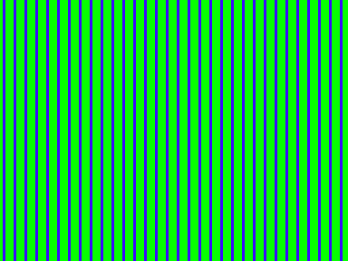
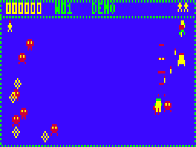
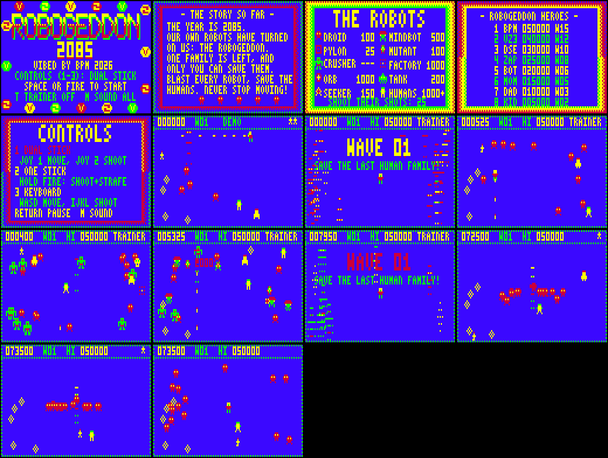

# ROBOGEDDON 2085

A *Robotron: 2084*-style twin-stick arena shooter for the Dick Smith VZ300 / VZ200 with the
**BennVenn SD loader + 128K**. ViBED by BPM 2026. Version 1.0.
Original code, graphics and music. It's inspired by Robotron but contains nothing from it.








## Play it

Copy `release/ROBOGEDN.VZ` to the SD card and run it from the BennVenn SD loader.
- It's a single type F1 binary. It loads at $8000 (to $D96F) and runs from $8000. There are no other files.
- It needs the **128K expansion** (RAM up to $FFFF, and the card's SRAM at $4000–$67FF).
- It doesn't call the DOS while running, and it never writes to the SD card.

## Controls

Pick a control scheme on the title screen with **1**, **2** or **3**. The choice is remembered.

| | Move | Shoot |
|---|---|---|
| **1 Dual stick** (the Robotron way) | joystick 1 *or* W A S D | joystick 2 *or* I J K L, in 8 directions |
| **2 One stick** | joystick 1 *or* W A S D | hold fire (or SPACE) to shoot the way you're facing. While fire is held you **strafe**: you keep facing that way as you move |
| **3 Keyboard** | W A S D | I J K L (joysticks ignored) |

In dual-stick mode, standing still and shooting turns you to face the shot.

| Other keys | |
|---|---|
| SPACE, RETURN or fire | start |
| RETURN | pause (Q quits while paused) |
| M | sound: music + effects → effects only → off |
| T (title) | trainer mode: infinite lives, no high score |

Joystick notes for this VZ interface: joystick 1 is read on port $2C, joystick 2 on $29, and the fire buttons
on $2E/$2D (stick 1) and $2B/$27 (stick 2). These are the same ports DUEL II uses.

## The game

The robots have risen and the last human family is wandering the arena. Shoot every robot to clear the
wave, and run into the humans to save them. Each rescue is worth more than the last (1000, 2000, 3000,
4000, then 5000 each). The count starts again every wave.

| Robot | Points | What it does |
|---|---|---|
| **Droid** | 100 | Marches straight at you. Droids start slow and speed up the longer a wave lasts |
| **Pylon** | 25 | Sits still. It kills on touch. Its shape and colour change from wave to wave |
| **Crusher** | — | Can't be destroyed. Shots only knock it back. It wanders, squashes humans (leaving a skull) and flattens you too |
| **Mindbot** | 500 | Hunts the humans and turns them into **Mutants**. It also launches homing cruise missiles |
| **Mutant** | 100 | A fast, twitchy ex-human that comes straight for you |
| **Orb** | 1000 | Bounces around the arena and gives birth to **Seekers** |
| **Seeker** | 150 | Drifts after you and fires sparks |
| **Factory** | 1000 | Bounces around the arena and builds **Tanks** |
| **Tank** | 200 | Lumbers toward you and lobs shells that bounce off the walls |

Any spark, missile or shell can be shot down for 25 points.

**Easing in.** The first ten waves are gentler, getting a little tougher as you go:

| Waves | Robot speed | Also |
|---|---|---|
| 1–2 | about half speed | sparks at half speed; robots start well away from you; droids top out at a step every 6 frames and speed up only every 10 s |
| 3–5 | 30% slower | droids top out at a step every 3 frames and speed up every 5.7 s |
| 6–10 | 25% slower | droids speed up every 5.3 s |
| 11 on | full speed | droids speed up every 4 s, to a step every 2 frames |

**Waves.** There are 20 hand-made waves: droid swarms, crusher waves, mindbot waves and tank waves. After
wave 20 they repeat, faster. Each wave opens with its robots *materialising* line by line, with a caption
saying what's coming. Destroyed robots shatter apart the same way.

**The arena** is blue, edged with a single 50:50 green/blue dithered line that melts into the VZ's own green
border. Blue is the background, so the blue parts of every sprite,
including the logo's shadow and the title discs, are drawn green (crushers, tanks and so on).

**Extras**
- **Power-ups** from wave 2 on: **3-Way** (triple spread shot for 10 s) and **Shield** (6 s of invulnerability,
  with a flashing ring; robots that touch you are destroyed). Each pickup is also worth 250.
- **Full Family Bonus**: 5000 for a wave where you save someone and lose no one.
- An **extra life** every 25,000. The arena's edge flashes when you get one.
- When you die, the robots scatter back to the edges and re-materialise around you.

## Attract mode and front end

- A big **ROBOGEDDON** logo flies up as a bunch, then spreads out, while round **V** and **Z** discs travel
  around the edge of the screen in cycling colours, as the Williams "W" discs do on the arcade title. A
  gritty title tune plays.
- Every information screen (story, robots, controls, high scores, name entry) has a Robotron-style
  border: four concentric dithered bands whose colours flow through all four VZ colours (green, yellow,
  red, blue, with dithered mixes between).
- **Blue background throughout**, framed by the VZ's own green border.
- **The story so far**, typed out a letter at a time while a human flees a line of droids.
- **Meet the robots**: the rogues' gallery, each robot materialising in turn.
- **Controls** page, with your chosen mode highlighted.
- A **demo**: the computer plays a few waves.
- **High scores** with initials and the wave reached. A new entry flashes.

The high-score table (and your control and sound choices) are kept in the BennVenn card's second SRAM bank,
at $6700 with a signature and checksum. They survive a reset or reloading the game while the machine stays on.
The game checks the bank is really there first (the probe DUEL II uses). Without it, the scores last until
you switch off.

## How it works

- **Mode 1** (128×64, 4 colours). The arena is 124×54 blue pixels inside the 1-pixel dithered edge, with the scores above.
- **Snow-free display at a steady 25 frames a second.** The game draws each frame into one of two
  frame buffers ($E800 and $F800). An IM2 interrupt on field sync (vector table at $F000) copies the
  finished buffer to video RAM with POP/PUSH, top half in one vblank and bottom half in the next. Each half
  takes about 60 of the 81 lines before the picture starts. So video RAM is never touched while the
  picture is drawn. New frames are swapped in at most every second field. A frame that runs long costs 3
  fields rather than 4.
- Ordinary waves run at a steady 25 fps. The busiest waves (50+ objects) run at a mix of 25 and 16.7 fps
  (about a third of their frames at 25). The materialise effect on the biggest waves is slower for a moment.
- Sprites are pre-shifted for the 4 pixel positions in a byte. In the arena they're drawn through masks
  (each byte is a keep-mask plus pixels, read with POP) so they sit cleanly on the blue. Text is drawn
  through masks too. The 4:3 screen's tall pixels are allowed for in
  movement and aiming: vertical speeds are two-thirds of horizontal ones.
- The screen-copy routines (four unrolled POP/PUSH copies, 7K) are built at start-up in the card's SRAM,
  which keeps the program small. If the SRAM isn't there, the game says so on the screen and stops.
- The front-end screens draw their still parts once into a backdrop in the SRAM at $4000, and add only
  what moves each frame.
- **Sound**: a 16-bit phase accumulator drives the speaker in a square wave (or pitched noise) while the
  game waits for the frame swap. Music and effects are stepped at 25 Hz. Like DUEL II, there's only sound
  while the CPU is waiting, so in-game effects have a gritty 25 Hz texture.

### Memory map

| Address | Use |
|---|---|
| $4000–$47FF | front-end backdrop (BennVenn SRAM, bank 1) |
| $4800–$640B | screen-copy routines, built at start-up (SRAM bank 1) |
| $6700–$6746 | saved high scores (SRAM bank 3) |
| $7000–$77FF | video RAM |
| $8000–$D96F | code and data |
| $E800–$EFFF | frame buffer 0 |
| $F000–$F100, $F1F1 | IM2 vector table, `jp isr` |
| $F200–$F6FF | variables, objects (64 × 8 bytes), bullets, shots, high scores |
| $F700–$F7FF | stack |
| $F800–$FFFF | frame buffer 1 |

## Building

You need python3, Pillow (only for `tools/media.py`) and [sjasmplus](https://github.com/z00m128/sjasmplus).

```
src/build.sh            # -> build/ROBOGEDN.VZ and build/robogedn.sym
```

- `src/gfx.py` turns the ASCII-art sprites, big logo letters and the 3×5 font into `gfx.inc`.
- `src/music.py` turns the tunes and sound effects into `music.inc`.
- `tools/vzemu/` is the headless test emulator, with snow detection and the BennVenn SRAM model.
  `tools/shot.sh` takes screenshots, and `tools/media.py` makes the README pictures and the MP3s in `media/`.

## Files

| | |
|---|---|
| `src/main.asm` | memory map, start-up, variables |
| `src/engine.asm` | interrupt and copy, frame swap and beeper, drawing, text, input, sound |
| `src/game.asm` | waves, player, robots, humans, bullets, demo AI |
| `src/front.asm` | attract sequence, title, story, gallery, controls, high scores, SRAM records |
| `src/data.asm` | wave table, robot stats, text |
