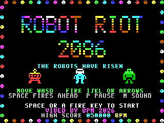
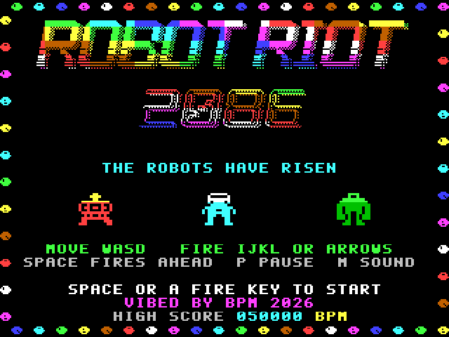
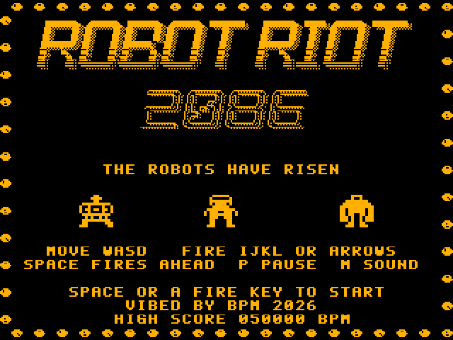
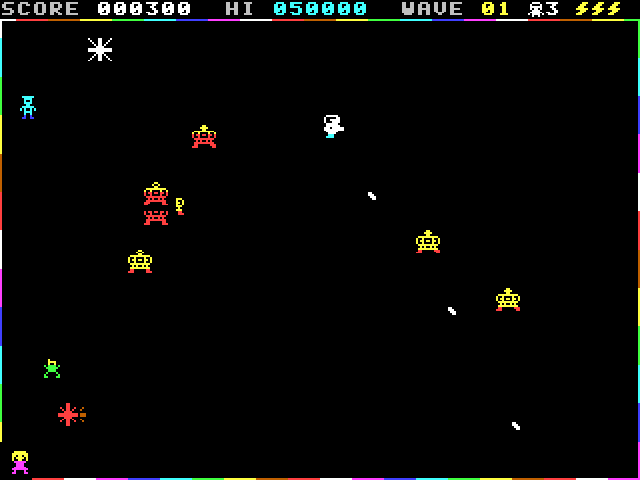
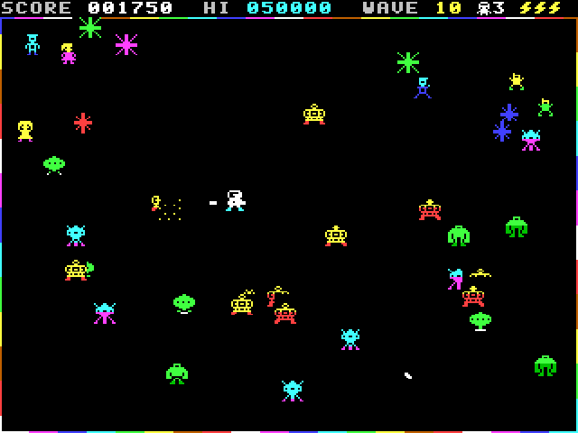
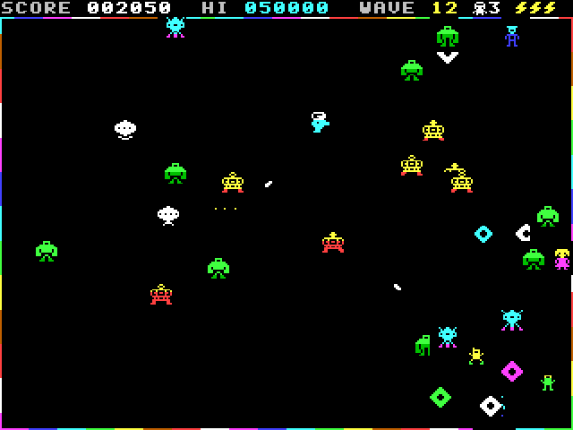
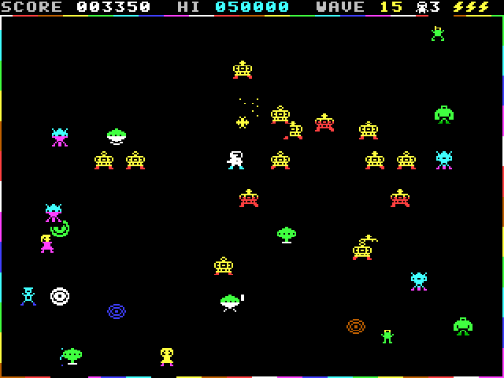
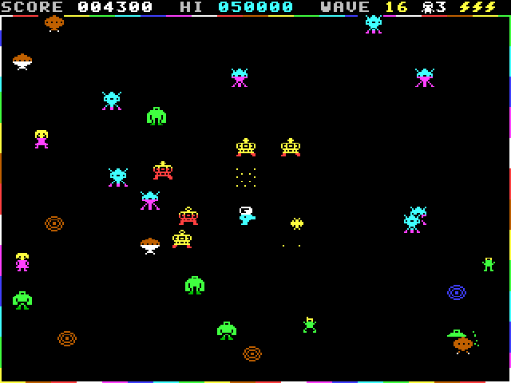
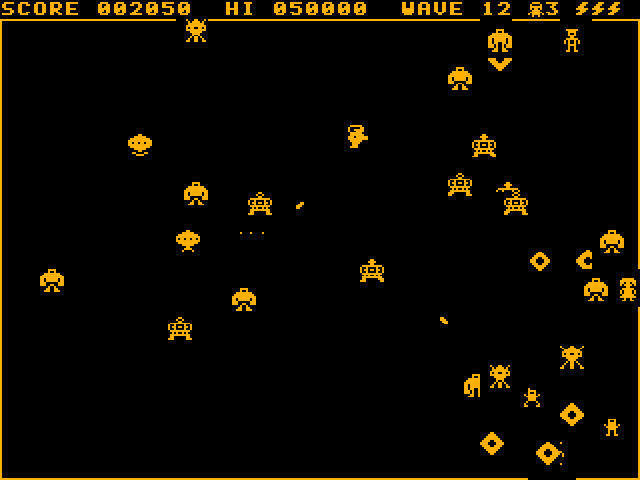

# ROBOT RIOT 2086
### Frantic single-screen robot mayhem for the Microbee Premium Plus — VIBED BY BPM 2026

**The year is 2086, and the robot factories have risen up.** Their machines swarm the city, and they mean to wipe out humanity. One cyborg hero with a plasma gun is all that stands between them and the last human family.

**Run one way and shoot another.** ROBOT RIOT is a full-screen arena shooter in the spirit of the 1982 classic, built for the Premium Plus's PAL screen. Move with one hand and blast in eight directions with the other. Back away while you shoot, strafe past a crowd of robots, and dive across the arena to pull the family to safety before the machines get to them. The robots beam in as sparkles. Every wave you clear erupts into rainbow rectangles that fill the screen, then wipe away for the next.

**Sixteen hand-designed waves, then no mercy**
- **Stompers** goggle-eyed box walkers that come straight for you, faster the longer you take
- **Zappers** keep their distance and fire sparks at where you're *going*, cutting off your escape
- **Crushers** gorilla-bots that take four hits, knocked back by every one, and squash any human they catch
- **Whirlers** colour-cycling saucers that swoop in from the corners
- **Shock nodes** pulsing rainbow hazards that change shape every two waves. They fry any stomper that blunders into them
- Named showdowns:
  - **Whirlwind**
  - **Crusher Colony**
  - **The Node Maze**
  - **The Zapper Army**
  - **Stampede**
  - **The Final Riot**
- After wave 16 the riot loops, quicker on every pass

Save dad, mum and the kid for 1,000 to 5,000 points apiece. Each life has three charge cells, so one hit won't finish you, and there's an extra life every 25,000 points. Families start out near the edges, beyond the shock nodes, so every rescue is a gamble.

**A proper arcade attract sequence**
- **Title:**
  - A chrome-style logo in rolling rainbow bands, with a glint that sweeps across it.
  - A train of spinning, colour-cycling balls orbits the screen.
  - The hero dances between two robots.
  - A squelchy, robotic title jingle plays.
- **Story:** typed out with typewriter clicks, inside glowing, colour-chasing dithered borders.
- **Meet the Riot:** each robot beams in, double size and animated.
- **Hall of Legends:** high scores with your initials.
- **Demo:** the computer plays a wave for you.

**Play it your way**
- **Keyboard:** W A S D to move, and I J K L or the arrow keys to fire. Hold a fire key to keep shooting
- **Joystick:** move with the stick. SPACE or fire shoots the way you're facing and holds that aim, so you can retreat and keep shooting
- **Colour or amber:** choose your monitor at start-up. Monochrome mode swaps colour effects for marching patterns and blinks, and the robots are told apart by shape

**Tech specs**
| | |
|---|---|
| Machine | Microbee Premium Plus (Z80 at 3.375 MHz), 1MB RAM, 32K PCG RAM, PAL |
| Display | 40 × 25 cells of 8 × 10 pixels: a 320 × 250 picture that fills a PAL screen. Uses the 6545 table from BPM's MODES.COM (31 rows of 10 lines + 2 = 312 lines) and the 40-column dot clock |
| Frame rate | A steady 25 fps on every wave |
| Rendering | Two screen pages, flipped with the 6545 start address. Each frame is built as a list of cells and written in three stack-pop passes (characters, PCG banks, colours). The passes run in chunks, so they never miss the short 62-line vertical blank |
| Sprites | Each 12 × 12 sprite always covers exactly 2 × 2 cells. Every animation frame is stored as 16 ready-made PCG glyphs (one set for each grid position), so drawing a sprite is just four character writes. Sprites are two-tone. 1,385 of the 2,048 PCG glyphs are used |
| Arena | The full screen below the score line, edged by a one-pixel rainbow-cycling border. The border's glyphs sit in every PCG bank, and a 1K background map restores it |
| Objects | Up to 44 robots, humans and effects, plus 5 plasma bolts and 6 zapper sparks |
| Sound | Two-voice beeper, played in the time left over in each frame. Tunes are built frame by frame from squelchy bass drops, robotic arpeggios and pitch zips. Original title jingle, fanfare and effects |
| Controls | Keyboard (two direction sets), or a joystick on PIO port A |
| Disk | `RIOT.DS8`: a DS80 image with no shell. Type `RIOT` at the `A>` prompt. It holds a CP/M loader, a 15K program and a 23K glyph bank |
| Code | 100% Z80 assembly (about 5,700 lines). Original code, graphics and music |

| | |
|---|---|
|  |  |
|  |  |
|  |  |
|  |  |
