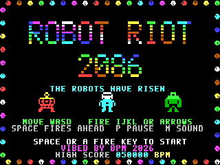
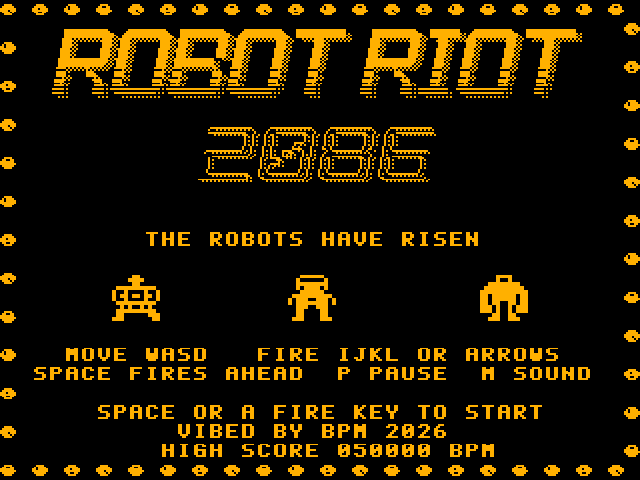

# ROBOT RIOT 2086

An original single-screen robot-uprising arena shooter for the **Microbee Premium Plus**, in the spirit of Robotron: 2084.

2086. The robot factories have risen up and their machines swarm the city. One cyborg hero with a plasma gun stands between them and the last human family.

**VIBED BY BPM 2026**

## Status: build 0.5

- Build 0.5 moves to the 8 x 10 MODES mode: a 320 x 250 picture that fills a PAL screen.
- Build 0.4 adds 6 more hand-designed waves (16 in all), and an endless loop that gets harder every pass.
- Build 0.3 adds a monochrome mode (press C or M at start-up) and a new stylised title logo.

- Re-themed from build 0.1 (ROGUE MUSTER) to a robot uprising, with all-new robots.
- New attract sequence, a thin rainbow border with a full-screen arena, and Robotron-style rectangles between waves.
- Tested in the Premium Plus emulator model:
  - It holds a steady 25 frames a second on every wave.
  - Long soak tests passed: random play across several games, and the attract sequence left to loop through every screen and the demo.
- Build 0.2.1 fixes a fault found on BPM's Premium Plus: the screen showed as four small copies. The 40-column dot clock was never selected, so the 6545 scanned at twice the rate.

## Play it

`release/RIOT.DS8` is a DS80 disk image with no shell. At the `A>` prompt type:

    RIOT

Then press **C** for a colour monitor or **M** for a monochrome one. It needs a Premium Plus with 1MB RAM.

| Action | Keys |
|---|---|
| Move | **W A S D**, or a joystick |
| Fire | **I J K L** or the **arrow keys**. Hold to keep firing, in 8 directions. |
| Fire the way you face | **SPACE** or joystick fire. The aim stays locked while held, so you can retreat and keep shooting. |
| Pause / sound / title | **P**, **M** (music + effects → effects → off), **ESC** |

## The attract sequence

It loops until someone presses SPACE, RETURN, a fire key or joystick fire.

1. **Title.**
   - The ROBOT RIOT 2086 logo in a stylised 80s chrome-style font: chamfered, forward-leaning letters with a dotted drop shadow and venetian-blind stripes, over a hollow outlined "2086".
   - The logo rolls in rainbow bands, and a glint sweeps across it, flipping its cells to reverse video.
   - A train of spinning, colour-cycling balls orbits the screen edge.
   - The hero dances between a stomper and a crusher.
   - A squelchy, robotic title jingle plays.
2. **Story.** The story is typed out with typewriter clicks inside a glowing dithered border, then the last human family appears.
3. **Meet the Riot.** Each robot beams in, in a shower of sparkles with a beam-in sound, then dances at double size with its name, points and habits.
4. **Hall of Legends.** The top 8 scores with initials, in rolling colours, with a robot fanfare.
5. **Demo.** The machine plays wave 3 for 20 seconds.

The glowing borders are dithered cells whose ink and paper colour pairs chase round the screen edge.

**Monochrome mode:**
- Built for an amber screen: no paper colours anywhere.
- The glowing borders become dither with solid blocks marching round them.
- The logo keeps its glint.
- A crusher taking a hit blinks instead of flashing white.
- A new Hall of Legends entry is marked with arrows.
- The robots, family, shots and sparks are told apart by shape.

**Audio:** the title jingle is short and plays over the title, where the screen work is light (about 6% of each frame). The other attract screens use effects and jingles: typewriter clicks, beam-ins and the fanfare. That keeps the sound smooth rather than chopped up.

## The riot

| Robot | Points | What it does |
|---|---|---|
| **Stomper** (yellow/red box walker, goggle eyes) | 100 | Stomps straight for you, a step at a time. Stompers speed up the longer a wave lasts. |
| **Zapper** (cyan dome on a magenta tripod) | 200 | Keeps its distance and throws sparks where you are *going*, which cuts off escape routes. Sparks can be shot down. |
| **Crusher** (green gorilla-bot) | 500 | Takes 4 hits and is knocked back by each. It hunts the family and squashes them. |
| **Whirler** (colour-cycling saucer) | 150 | Swoops corner to corner, re-aiming at you. |
| **Shock node** | 25 | Pulsing rainbow shapes that change every two waves. Don't touch them. They fry any stomper that walks into one. |
| **The last human family** (dad, mum, kid) | 1000 → 5000 | Walk into them to save them. Each rescue in a wave is worth 1000 more. |

**Rescues are a decision.** The family starts near the edges, away from the safe middle, and the first shock nodes of each wave stand between them and you. When the last robot falls the wave ends, and anyone still out there is lost.

**Forgiving play:**
- Each life has 3 charge cells, and a hit costs one, followed by two seconds of flickering safety.
- After losing a life, the robots are scattered away from the middle.
- There's an extra life every 25,000 points.

**Between waves:**
- After WAVE CLEARED, rainbow rectangles grow out of the middle until the screen is filled, then wipe away.
- The next wave's robots beam in as sparkles before they move.

## Waves

16 hand-designed waves, then an endless loop that gets harder every time round.

| Wave | What's new |
|---|---|
| 1-2 | Stompers and shock nodes, slow and easy to read |
| 3 | Zappers |
| 4-5 | Crushers (5 is a crusher wave) |
| 6 | Whirlers |
| 7-10 | Everything at once, building to Robot Meltdown |
| 11 | **Whirlwind:** 10 whirlers swooping |
| 12 | **Crusher Colony:** 8 crushers going for the family. Hurry! |
| 13 | **The Node Maze:** 12 shock nodes and 16 stompers |
| 14 | **The Zapper Army:** 12 zappers, with sparks flying faster from here on |
| 15 | **Stampede:** 20 stompers at top speed |
| 16 | **The Final Riot:** everything, at its quickest |
| 17+ | Waves 12-16 round and round. Each pass, stompers get a step quicker (to their limit), zappers throw sooner and sparks fly faster. |

Within every wave the stompers also speed up the longer it lasts. The shock nodes change shape every two waves.

## Under the hood

- **Display:** BPM's MODES.COM mode: 40 × 25 cells of 8 × 10 pixels, a 320 × 250 picture that fills a PAL screen.
  - The 6545 table is `$35,$28,$2C,$34,$1E,$02,$19,$1C,$48,$09,$20,$09`: 31 rows of 10 lines + 2 = 312 lines.
  - It also needs the 40-column dot clock (`IN A,(09h)` with A = 1).
  - It's the tallest picture that still leaves room for two screen pages in the 2K of screen RAM. The two pages are flipped with the 6545 start address.
  - The arena is rows 1-24, the whole screen below the score line.
  - Glyphs are 10 lines, and sprites move on a 4 × 5 pixel grid.
  - The vertical blank is only 62 lines here, so the drawing passes run in chunks of 32 cells and check for it in between.
- **Border:**
  - The arena border is one pixel thick. Its 8 glyphs sit at numbers 1-8 of every PCG bank, so a cell needs no bank change to show it.
  - When a sprite moves off a cell, that cell is restored from a 1K background map: blank, or border.
  - The border's colours run as a rainbow, with half the border recoloured each frame.
- **Sprites:**
  - Sprites are 12 × 12 on a 4 × 5 pixel grid, so each always covers 2 × 2 cells.
  - Each frame is stored as 16 ready-made PCG glyphs, and sprites are two-tone: top cells in one colour, bottom cells in another.
  - The gallery shows the same art at double size, using 3 × 3 cells.
- **Draw list:** each frame's cells go into a draw list, written in three passes (characters, PCG banks, colours) using stack pops.
- **Sound:**
  - Two-voice pin-pulse beeper.
  - The tunes are built frame by frame from squelchy bass drops (each note starts an octave up and dives), robotic arpeggios and pitch zips.

## Build

You need Python 3 with numpy and Pillow, and gcc for the emulator model. From `src/`:

    python3 tools/build.py

This writes `build/RIOT.DS8`. Tests:

| Script | What it does |
|---|---|
| `tools/shoot.py` | Takes screenshots of every screen |
| `tools/gif.py` | Records the showcase GIF |
| `tools/perf.py` | Measures the frame rate and profiles the code |
| `tools/frametime.py` | Shows the work per frame |
| `tools/soak.py` | Plays random input and checks for crashes |

## Files

| Path | What it is |
|---|---|
| `src/src/` | Z80 source: `main.asm`, `game.asm`, `actors.asm`, `attract.asm` (the attract sequence, Hall of Legends, demo AI), `fx.asm` (border, balls, glow, rectangles), `render.asm`, `sound.asm`, `loader.asm` |
| `src/tools/art.py` | All the artwork, as text |
| `src/tools/logo.py` | The stylised title logo |
| `src/tools/music.py` | The tunes |
| `src/tools/build.py` | Glyphs, tables and the disk |

The loader, the beeper engine, the assembler and the disk builder come from KABOOMERANG. The test emulator in `src/tools/emu` is only used for testing.
