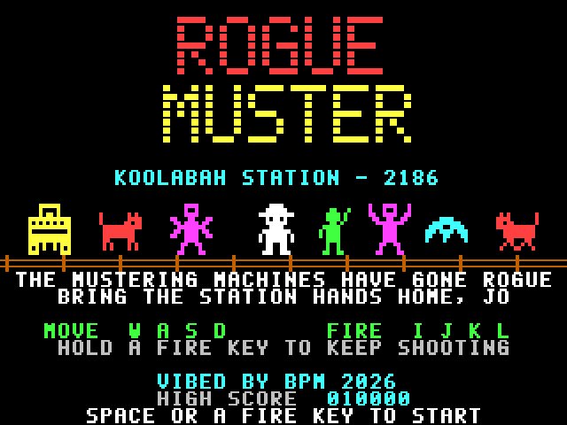
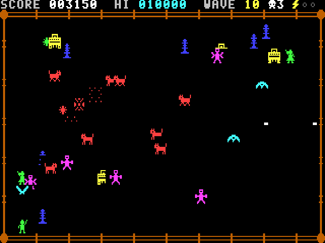

# ROGUE MUSTER

An original single-screen arena shooter for the **Microbee Premium Plus**, in the spirit of Robotron: 2084.

Koolabah Station, 2186. The station's mustering machines have gone rogue and penned the station hands in the home paddock. Jo Brumby walks in with a welding rig to bring them home.

**VIBED BY BPM 2026**

## Status: build 0.1, the playable loop

- Title screen, alternating with "The Rogue Mob" guide.
- Endless waves with scoring, lives, charge cells, a high score, game over and a quick restart.
- Tested in the Premium Plus emulator model:
  - It holds a steady 25 frames a second on every wave, with the arena full.
  - 20,000 frames of random play ran without a crash.
- It hasn't been run on real hardware yet.

## Play it

`release/MUSTER.DS8` is a DS80 disk image (80 tracks, 2 sides, 10 × 512 sectors). It boots to CP/M's `A>` prompt with no shell. Type:

    MUSTER

It needs a Premium Plus with 1MB RAM.

| Action | Keys |
|---|---|
| Move | **W A S D**, or a joystick |
| Fire | **I J K L** or the **arrow keys**. Hold to keep firing, in 8 directions. |
| Fire the way Jo faces | **SPACE** or joystick fire. The aim stays locked while held, so you can back away and keep shooting. |
| Pause / sound / title | **P**, **M** (music + effects → effects → off), **ESC** |
| Start / restart | SPACE, RETURN, a fire key or joystick fire |

Movement and firing are independent. You can retreat while shooting back, or run sideways while covering an escape route.

## The rogue mob

| Robot | Points | What it does |
|---|---|---|
| **Heeler** (red robot cattle dog) | 100 | Runs Jo down, a step at a time. Heelers get quicker the longer a wave lasts. A live pylon fries any heeler that blunders into it. |
| **Shearer** (magenta, scissor-blade arms) | 200 | Keeps its distance and throws spinning blades at where Jo is *heading*, not where Jo is, to cut off escape routes. Blades can be shot down. |
| **Harvester** (yellow) | 500 | Slow, and takes four hits, each one knocking it back. It goes after the station hands and flattens them. |
| **Maggie** (cyan drone) | 150 | Swoops diagonally across the paddock, bouncing off the fence and re-aiming at Jo. |
| **Live pylon** (blue) | 25 | Stands still. Touching one costs a charge cell. |
| **Station hand** (green) | 1000 → 5000 | Walk into one to bring them home. Each rescue in a wave is worth 1000 more, up to 5000. |

**Rescues are a decision.** Station hands start out near the fence, away from the safe middle where Jo begins, and the first pylons of each wave are planted between them and the middle. Once the last robot falls the wave ends, and any hands still out there are left behind.

**Forgiving play:**
- Each life has 3 charge cells, and a hit costs one, followed by two seconds of flickering safety. A heeler or maggie that hits Jo is destroyed by the hit.
- After losing a life, the mob is scattered away from the middle before Jo walks back in.
- There's an extra life every 25,000 points.

## Waves

| Wave | What's new |
|---|---|
| 1-2 | Heelers and pylons only. Slow and readable. |
| 3 | Shearers |
| 4-5 | Harvesters, with a harvest wave at 5 |
| 6 | Maggies |
| 7-10 | Everything at once, quicker and with more blades |
| 11+ | Waves 6-10 again, quicker each time |

Heelers start slow, especially in waves 1-5, and speed up every six seconds within a wave.

## Under the hood

- **Display:** 40 × 25 cells of 8 × 8 pixels (320 × 200), the 40-column mode BPM's MODES.COM test proved on the Premium Plus. Two screen pages are flipped with the 6545 start address.
- **Sprites:**
  - Every robot, hand and Jo is 12 × 12 pixels on a 4-pixel grid, so each always covers exactly 2 × 2 cells.
  - Each animation frame is stored as 16 ready-made PCG glyphs, one set for each of the 4 grid offsets. Drawing a sprite is just 4 character writes, with no masking or shifting at run time.
  - The welder bolts and blades are single cells, with a glyph for each quarter of the cell.
- **The draw list:**
  - Each frame's cells go into a list, written in three passes (characters, PCG banks, colours) using stack pops.
  - Next time that page comes round, the same cells are blanked. Glyph 0 of every PCG bank is blank, so blanking only needs the character.
- **Sound:** the two-voice beeper engine from KABOOMERANG plays music in the time left over in each frame. The title tune is a stockman's march in A minor, and the in-game music is slow, sparse blips.
- **Monochrome:** everything is ink on black, so it reads the same on an amber screen. The robots differ in shape as well as colour.

## Build

You need Python 3 with numpy and Pillow, and gcc for the emulator model. From `src/`:

    python3 tools/build.py

This writes `build/MUSTER.DS8`. Tests:

| Script | What it does |
|---|---|
| `tools/shoot.py` | Takes screenshots of the title, the waves and game over |
| `tools/perf.py` | Measures the frame rate on waves 1, 7 and 10 and profiles the code |
| `tools/frametime.py` | Shows the work per frame (T-states), split into update, draw and flush |
| `tools/soak.py` | Plays random input across several games and checks for crashes |

## Files

| Path | What it is |
|---|---|
| `src/src/` | Z80 source: `main.asm`, `game.asm` (waves, Jo, bolts, blades, score), `actors.asm` (the mob), `render.asm` (pages, draw list), `front.asm` (title), `sound.asm`, `loader.asm` |
| `src/tools/art.py` | All the artwork, as text |
| `src/tools/build.py` | Glyphs, pictures and the disk |
| `src/tools/music.py` | The tunes |

The loader, the beeper engine, the assembler and the disk builder come from KABOOMERANG. The test emulator in `src/tools/emu` uses a Z80 core that looks like superzazu/z80 (MIT). It's only used for testing.
