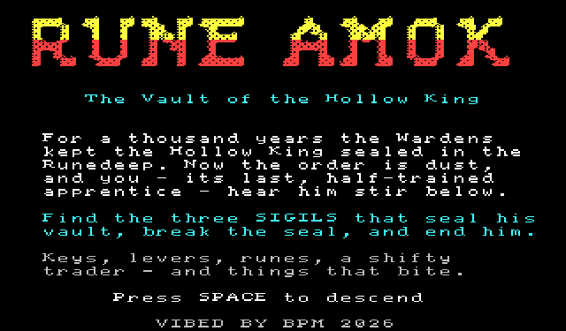
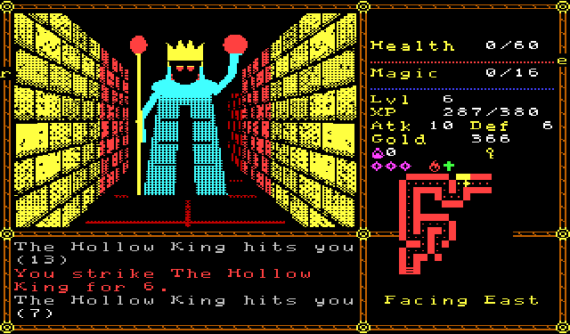

# RUNE AMOK — The Vault of the Hollow King

A first-person dungeon crawl for the **Microbee Premium Plus**: step and turn on a grid, through four themed depths, with lightweight RPG systems, puzzles, and a three-voice beeper score. It was designed for the Microbee's PCG and colour hardware from the start, not ported from another machine.

**The story.** For a thousand years the Wardens kept the Hollow King sealed in the Runedeep beneath the old gatehouse. The order is now dust. You are its last, half-trained apprentice, and you can hear him stirring below. (The name is a pun on "run amok"; the dungeon is still called the Runedeep.)

VIBED BY BPM 2026

| | |
|---|---|
|  |  |
|  |  |
|  |  |

## Status

Version 1.0. It has been tested only in the emulator model (`tools/emu`, the Spindrift/REDBACK Premium Plus model), **not on real hardware, and not in uBee512**.

What has been checked in the model:

- **Disk**: `release/RUNEAMOK.DS8` boots with the bn60 ROM to the CP/M prompt. Typing `RUNEAMOK` loads all files in about 16 seconds and starts the game. ESC then Y returns cleanly to `A>`, and `DIR` works afterwards (`tools/boottest.py`).
- **Solvability**: every build checks that all four depths can be finished (`tools/mklevel.py`).
- **Bot playthrough**: a bot plays through the keyboard (`tools/bot.py`): fighting, keys, levers, buttons, hidden walls, the trader, rune puzzle, stairs and the seal.
- **Speed**: a step takes about 5 frames (0.1 s) from key press to the new view. Composing a view costs about 1.1 frames of CPU; it is copied to the hidden screen page in the blanking, and then the page flips.

## Playing

Needs a Premium Plus with 1MB RAM. Boot `release/RUNEAMOK.DS8` and type `RUNEAMOK` at the `A>` prompt.

| Key | Action |
|---|---|
| Arrows or W A S D | Walk forward and back, turn left and right |
| Q E (or Z X) | Step aside |
| SPACE or RETURN | Fight, open, pull, read, drink, trade |
| 1 / 2 | FIREBOLT / MEND, once learnt |
| 3 or P | Drink a potion |
| H | Help |
| T | Music and effects, effects only, or silence |
| ESC | Leave (asks first) |

A joystick on the parallel port also works.

Turning is free. Every other action takes a turn, and then the awake creatures step or strike.

Find the **three sigils** on depths 1–3. They break the seal on the Ember Throne, where the Hollow King waits.

| Depth | Look | What's there |
|---|---|---|
| The Gatehouse | Torchlit grey stone, mossy walls | Rats and skeletons; a bronze key, a lever and gate, a hidden wall and its button |
| The Fungal Grotto | Green cave rock | Cave spiders and fungoids; illusory walls, a gate button, a lever, a pit, the silver key, the trader |
| The Drowned Archive | Cyan stone and bookshelves | Ghouls and grave wisps; a four-rune sequence puzzle, portals, a spinner, the golden key, the FIREBOLT scroll |
| The Ember Throne | Red brick | Ember imps and ash hounds; the sealed door, the Hollow King |

## How it suits the Microbee

The full design and style guide is in [`docs/DESIGN.md`](docs/DESIGN.md). In short:

- **Cell-aligned perspective.** The square boundaries are 96, 48, 32, 24 and 16 pixels wide, so every vertical edge of the 3D view falls on an 8-pixel cell boundary.
- **One ink on black.** Inside the view the paper is always black. Depth is shown by a colour ramp per level plus dithered density, so attribute clash cannot happen.
- **No pixel drawn at run time.** Every wall, floor, door, creature, item and decoration cell is pre-rendered into a per-level PCG tile dictionary of up to 1,856 glyphs. The Z80 composes each view from tile lists.
- **Writes only in the blanking.** The Premium stalls the CPU on video access during a displayed line, so every video write happens in the vertical blanking, with two screen pages flipped by the 6545 start address.
- **Colour is the animation.** Torches, runes, fountains, portals and wisps cycle their ink at almost no cost.
- **Woodcut creatures.** Monsters are solid silhouettes, one ink per cell with black-cut detail, and each has an attack pose close up.
- **Sound in the idle time.** In the time each frame waits for the blanking, three voices share the speaker: a soft-attack melody, a plucked bass, and effects and drums. Each depth has an original theme in its own mode:
  - title: D minor march
  - Gatehouse: A aeolian
  - Grotto: E phrygian drips
  - Archive: D dorian waltz
  - Ember Throne: driving C minor

## Building

`py tools/build.py` builds everything; add `--nodata` to skip the art and levels. It needs Python 3 with numpy and Pillow. The emulator model (`tools/emu`) compiles with gcc, or on Windows with TinyCC 0.9.27 unpacked into `tools/tcc/tcc` (not in the repo; from download.savannah.gnu.org/releases/tinycc/). The boot test needs the Microbee boot ROM `bn60.rom`, which is not in the repo.

| Command | What it does |
|---|---|
| `py tools/rd.py OUT "w150 SPACE w60 UP sname"` | Scripted run with screenshots |
| `py tools/bot.py OUT` | The whole-game bot |
| `py tools/perf.py` | Step timing |
| `py tools/boottest.py resources/bn60.rom OUT` | Real boot from the disk image |

## Not verified

- Real Premium Plus hardware: the timing of the blanking commit, the keyboard and the joystick.
- uBee512.
- The model's CPU-hold behaviour is the one the owner measured on real hardware for Spindrift. The commit writes only in the vertical blanking, so it should be safe.
