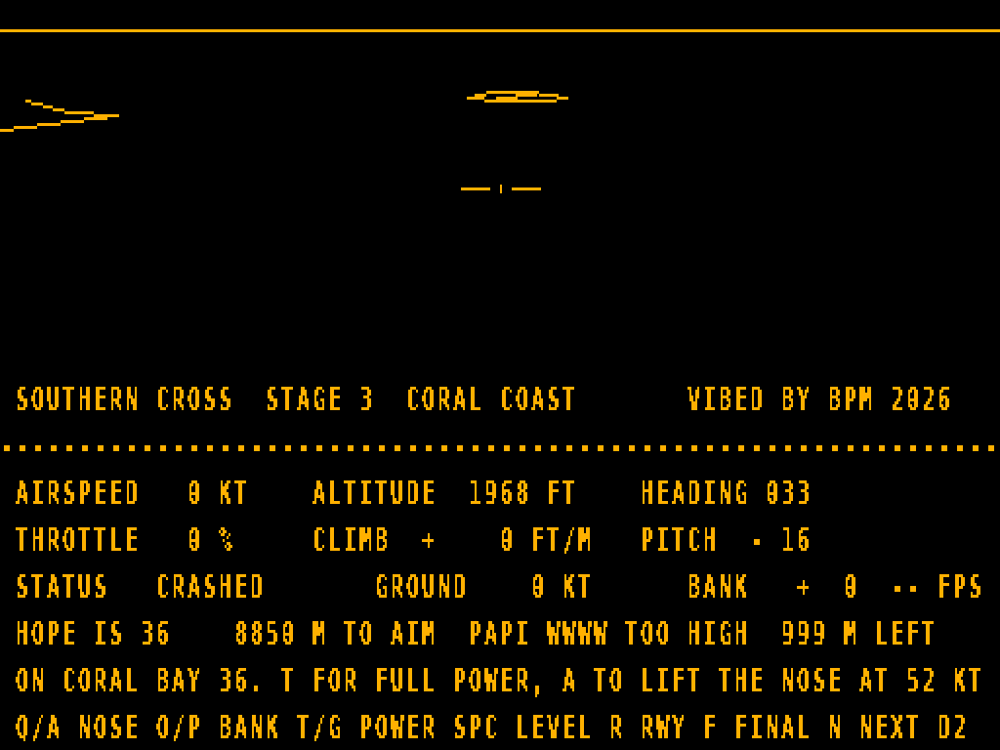
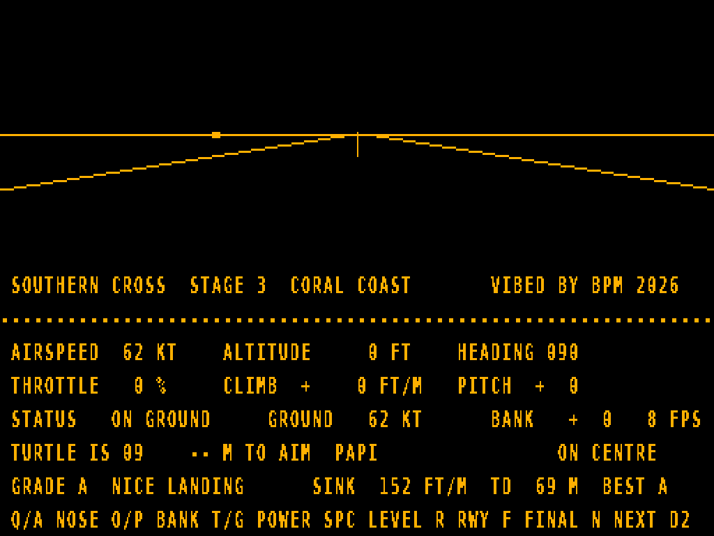
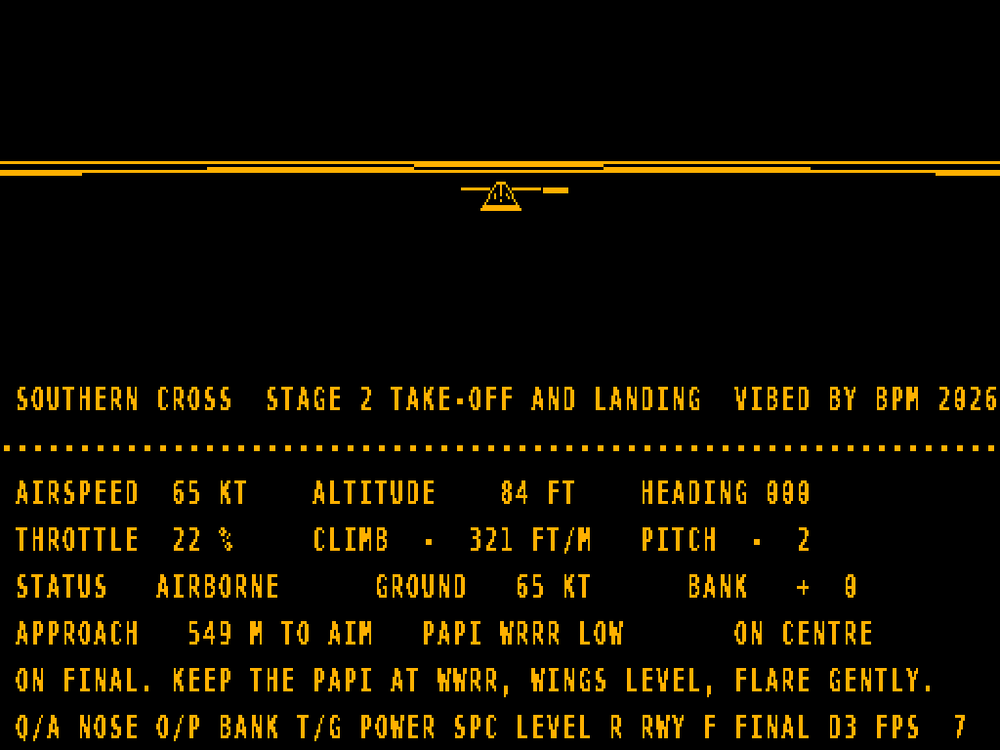
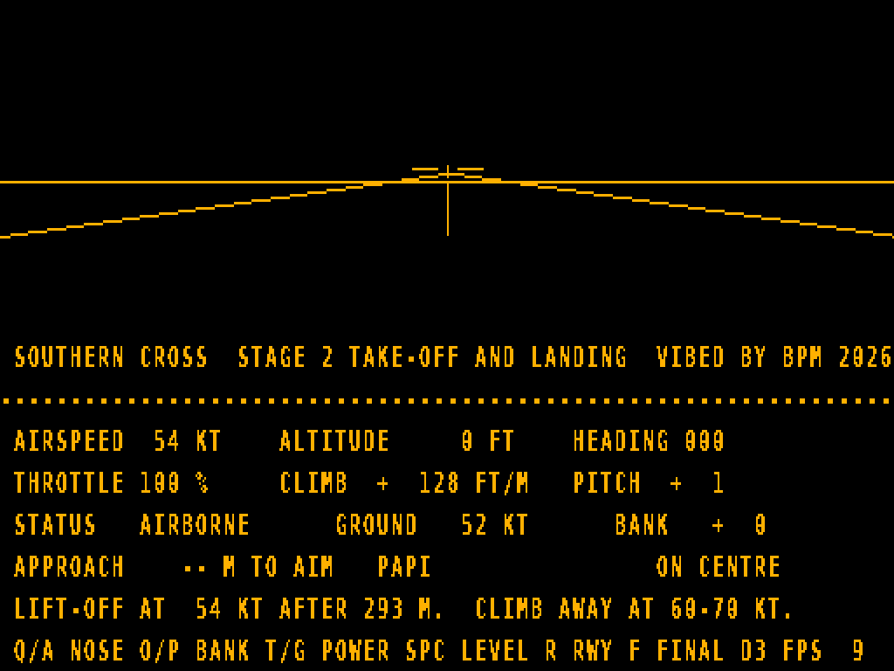

# SOUTHERN CROSS (Microbee Premium Plus) — work in progress

An FS1-style wireframe flight simulator for the Microbee Premium Plus: a light trainer, a fictional slice of Australian coast, flying school, mail runs and an Ace combat mode. VIBED BY BPM 2026.

**Status: stage 3 of 7 — Coral Coast.** Areas now load from disk. The first, Coral Coast, has the Coral Bay home airfield, a beach resort and jetty, 17 km of coastline with a lighthouse on the headland, a ship at anchor, a reef, and three islands, each with its own airstrip. Landing grades, the PAPI approach aid and forgiving bounces and crashes (stage 2) work at every strip. See `docs/DESIGN.md` for the whole plan.

## Flying stage 2

- **Take-off:** R puts you on runway 36. Hold T for full power and hold A to lift the nose at about 52 kt. The panel reports your lift-off speed and how much runway you used.
- **Approach:** F puts you on final, 1.5 km out and 100 m up. The APPROACH line shows the distance to the aim point, the PAPI lights as text and how far you are off the centreline. Four lights read W (white) or R (red): WWRR is on the 3° slope, more W is high, more R is low.
- **Landing grade A–E:** sink rate, centreline, touchdown point (aim for the markers 150–210 m in), wings level, lined up, speed and bounces all count. The message line names your biggest fault, and the best grade is kept.
- **Forgiving:** a firm arrival (about 690–1080 ft/min) bounces instead of crashing. A real crash (sinking faster than that, wing tip down or nose first) puts you back on final after 3 seconds.

## Running it

Boot `release/SCROSS.DS8` (DS80) and type `SCROSS` at `A>`. Press RESET to exit.
It loads `CORAL.LOC` from the same disk. `SCROSS name` loads `name.LOC` instead, for later areas. If the file isn't there, you fly from the home field alone and the message line says so.
To put it on another disk, copy `release/SCROSS.COM` and `release/CORAL.LOC` together.

## Controls

| Key | Action |
|---|---|
| Q / A | Nose down / nose up |
| O / P | Bank left / right (steer on the ground) |
| T / G | Throttle up / down (throttle closed = brakes on the ground) |
| SPACE | Level the wings |
| R | Restart on the current airfield's runway |
| F | Restart on final approach to the current airfield (1.5 km from the aim point, 80 m up) |
| N | Next airfield: Coral Bay, Turtle Island, Hope Island, Lizard Island (on final) |
| D | Detail level 1–3 (starts at 2: scenery and runway markings; 3 adds the ground grid and the reef) |

Rotate at about 52 kt, climb at 60–70 kt, stall is about 43 kt (the nose drops by itself). For a good grade, touch down at the aim markers under ~300 ft/min with the wings level, on the centreline, below about 60 kt.

## Speed (emulator, 3.375 MHz, Coral Coast)

Ten fixed views: on the runway, on final, climbing out, turning, low and fast, and five around the coast and islands.

| Detail | What's drawn | Average | Range |
|---|---|---|---|
| 1 | Horizon, runways, coastline, islands, lighthouse | 8.8 fps | 6.3–16.8 |
| 2 (default) | + runway markings, buildings, jetty, ship | 6.7 fps | 4.7–15.5 |
| 3 | + ground grid, reef | 4.6 fps | 3.4–8.5 |

The areas themselves are written in `src/areas.py` (runways, buildings, coastlines and islands as Python), and `build.py` assembles each one into a `.LOC` file.

The panel shows the real frame rate, timed from the 6545 vertical blank (50 Hz); game speed uses the same count.

## How it works

- 64 × 16 screen of 8 × 16 cells (512 × 256). The top half is a 512 × 128 bitmap made from 512 PCG glyphs arranged as four vertical strips, one 2K PCG bank each, so a pixel column is a contiguous 128-byte run and stepping a line up or down is `INC L`/`DEC L`.
- Double buffered: page A (screen F000, banks 1–4) and page B (screen F400, banks 5–8), flipped with the 6545 start address.
- 8-bit camera matrix rebuilt each frame; world in half-metre units; shared-vertex "lattice" objects and incremental line series.
- Areas are data files (`CORAL.LOC`) loaded through CP/M at start-up, before the program takes over the machine. Each has a scenery table: per object, a detail level, a cull distance and a size. Objects are skipped when far, behind or off to the side. Flat ground objects are skipped once they'd lie within ~3 pixels of the horizon. Small ones switch to a few "far" lines, then vanish under ~10 pixels.
- Very flat lines (40:1 or flatter) are filled as horizontal runs a byte at a time; lines under 24 pixels skip the slope set-up.
- Ground grid drawn straight in screen space: each grid line's screen line comes from the eye height and its sideways distance (no 3D clipping), cut off about 6.5 km out; lines lying on the horizon are skipped.
- Lines with both ends plainly in view skip clipping altogether.
- One-pass 3D line clip (Liang–Barsky) against the view plus a 16-pixel margin, full-precision interpolation, then a small 2D "edge fix" slides each end exactly onto the screen edge.
- Unrolled `SET n,(HL)` pixel loop for shallow lines (~45 T-states a pixel), long lines split at the midpoint so the 8-bit slope stays exact.
- Only the rows each strip actually used are cleared next time round (PUSH runs down each byte column).
- Flight model at 50 ticks per second of game time, driven by the vertical-blank field count (thrust, drag, gravity along the path, stall, bank-to-turn, ground roll, landing check).

## Building

Python 3 only. From `src/`: `python3 build.py` writes `build/SCROSS.COM` and `build/SCROSS.DS8`. `python3 run.py` runs it in the included test emulator and saves screenshots; `prof.py` shows where the frame time goes. From `src/`, `python3 tests/bench.py` times five fixed views, `python3 tests/hzcheck.py SEED N` checks N random flights for ground drawn above the horizon, and `python3 tests/fly.py takeoff|land|next|hard|crash OUTDIR FRAMES` flies a scripted test pilot, `python3 tests/views.py OUTDIR` times ten views at detail 2 and 3, `python3 tests/objprof.py px,pz,alt,hdg,pitch,roll` shows what each object costs, and `python3 tests/rwtest.py` checks the runway maths, and `python3 tests/multest.py` checks the multiply routines against exact arithmetic. The test emulator answers CP/M file calls from `src/build/`, so the area files load as they do on the real disk.

The assembler (`src/tools/z80asm.py`) and emulator (`src/tools/z80emu.py`) were written for this project. The system tracks and `CCP.SYS` in `src/resources/` are the same ones used by the other Microbee disks in this repo.
