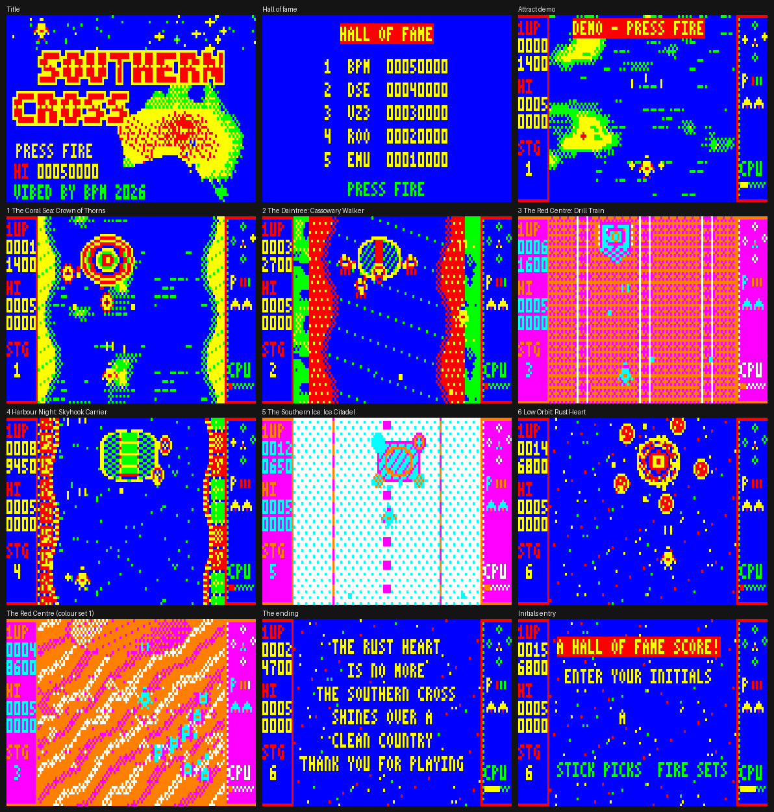

# SOUTHERN CROSS

An original vertically scrolling shoot-'em-up for the Dick Smith **VZ300** with the
**BennVenn SD loader + 128K RAM**. Mode 1 (128 × 64, four colours). VIBED BY BPM 2026.

A starfighter, the *Crux*, flies north across a Rust-infested Australia and up into orbit.
Destroyed formations drop star shards. Each shard becomes a star locked around your ship in
the Southern Cross pattern. Stars fire with you and each one soaks a hit. A knocked-off star
tumbles away and can be caught again. **Cross Burst** flings every star outward to clear the
screen, and they fly back home afterwards.



## Status: v0.3, the whole game

| | |
|---|---|
| **Done, tested in the emulator** | Six stages with six bosses, the title (satellite-style Australia, three-voice Cybernoid-style tune), a hall of fame with initials entry, an attract demo, and the ending. A test run went through all six stages, the ending and the initials entry with no snow. It had 7 late frames in 63,000 fields (about one per stage change). |
| **Tested on the real VZ300** | The SCTEST engine (v0.1): it runs and plays well. v0.2 and v0.3 add SD loading and need a fresh check. |
| **Not done** | Saving the hall of fame to the SD card (it lasts until the machine is switched off). |

### The stages

| | Stage | Colours | Scenery | Boss |
|---|---|---|---|---|
| 1 | The Coral Sea | set 0 | reefs, cays, a wreck, a lighthouse, a jetty; the atoll | **Crown of Thorns**: five turrets orbit an armoured body on banded arms and fire aimed shots in turn. With the arms gone, the shell opens and the core fires five-way spreads. |
| 2 | The Daintree | set 0 | rainforest canopy, flowering trees, billabongs, a waterfall, a research camp; the gorge | **Cassowary Walker**: stomps along on two clawed feet with a wing gun each side. Every part fires three-way. Legs are drawn as banded chains. |
| 3 | The Red Centre | set 1 | dune ridges, spinifex, a salt lake, the monolith, waterholes, a crater; the rail yard | **The Drill Train**: a drill-headed engine sweeps figure-eights with four ore wagons following its path. When the wagons are gone, the drill head fires rings of eight. |
| 4 | Harbour Night | set 0 | the lit city on both shores, ferries, the Opera House sails, the bridge | **Skyhook Carrier**: a flat-decked airship with four deck guns. It launches drone flights from its bays. |
| 5 | The Southern Ice | set 1 | wind-cut sastrugi, crevasses, pack ice, an iceberg, pressure ridges, a research station; the runway | **The Ice Citadel**: a star fort with a three-way turret on each bastion. With the turrets gone, the keep fires rings of eight. |
| 6 | Low Orbit | set 0 | stars, a nebula, the Moon, the station truss with solar wings, debris | **The Rust Heart**: a corroded engine-heart behind five orbiting shields that can't be destroyed. It's always open and fires rings of eight. |

Each stage has its own drones, hornets and ground or water craft, coloured to show up on that stage's ground. Each stage also has its own in-game tune in slow arpeggio blips. Stages 3 and 5 use colour set 1 (buff, cyan, magenta, orange). The flash from a Cross Burst swaps to the other colour set for a moment, on every stage.

Between stages: the clear tally (star bonus, then "NEXT: <stage>") and the next pack loads from the SD card. Your score, lives, weapon level and stars carry over.

### Attract mode and the hall of fame

The title runs for 25 seconds, then the hall of fame for 8. Then the autopilot plays 30 seconds of Stage 1 ("DEMO - PRESS FIRE"), and it starts over. FIRE starts a game from any of them.

A score that makes the top five gets initials at the end of the game, after the ending or when the CONTINUE? countdown runs out. Move the stick to pick a letter (holding it repeats), and press FIRE to set each letter. The table starts with BPM, DSE, VZ3, ROO and EMU (50,000 down to 10,000). HI is always the top entry. A continue resets the score, so a long run only counts if you don't continue.

## Loading

Copy all eight files to the same folder on the SD card and run `SCROSS.VZ`:

| File | What it is | Loaded into |
|---|---|---|
| `SCROSS.VZ` | the program | $8000-$DB2E (low, no mapper writes) |
| `SCROSS00.DAT` | the title: its code, art, tune and hall-of-fame page | SRAM bank B, whenever the title appears |
| `SCROSS01.DAT` - `SCROSS06.DAT` | the stages: scenery blocks, map, waves, boss, enemies, tune | SRAM bank B, at the start of each stage |

The packs are loaded with the same DOS calls Graves 'n' Gargoyles uses on your machine: sector buffer at $F800, the frame buffer as the DOS's stack, interrupts off after every call. Sectors are copied into SRAM bank B with port $37 switched around the copy, as 13 Ghosts does. If a file can't be read you get a red screen with a yellow bar; press FIRE to retry.

## Controls

| | Keyboard | Joystick |
|---|---|---|
| Move | O left, P right, Q up, A down | stick (either joystick) |
| Fire | SPACE | FIRE |
| Cross Burst | M | ARM |
| Pause | H | |

FIRE or ARM starts a game from the title (or the demo) and continues after a game over.

## Measured performance (emulator)

- **All six stages (invincible test build, random input), 63,000 fields:** no snow. 7 late frames, about one at each stage change.
- **Through a stage:** usually 20-35% of the CPU spare. The busiest boss moments drop to a few percent, but frames stay on time. The Skyhook Carrier was cut from 32 to 30 pixels wide so its body uses the fast 8-byte sprite loop.
- **Captions:** the stage-clear tally draws each line once, then copies it from a cache every frame. The ending holds the scene still and writes each line once. Both used to make the frame late.
- **Title tune:** notes measured within about 10 cents of true pitch. Only the work at the start of each field is silent (about 5-8%, against about 14% in Cybernoid).

## Technical design

### Screen

```
bytes 0-3    left panel (score, hi, stage)          16 px
bytes 4-27   playfield                              96 px x 64 rows
bytes 28-31  right panel (stars, weapon, lives, CPU) 16 px
```

The playfield is 96 pixels wide because of a hard limit, not a style choice. On the VZ,
the CPU may only touch video RAM between the field-sync interrupt and the start of the
display (94 lines = 21,432 T-states), or the screen shows snow. The fastest copy (stack
POP/PUSH, 12.8 T-states a byte) moves about 1,650 bytes in that window. A full 2,048-byte
screen doesn't fit, but 64 rows × 24 bytes (1,536) does, in 19,712 T-states. The side
panels only change when the HUD changes, and they're copied in the other field.

### Frame pipeline (25 fps, two fields a frame)

1. The scenery for the current scroll position (two or three 32-row blocks from SRAM bank B)
   is copied into the frame buffer with an unrolled LDI chain.
2. Objects are drawn over it: ground targets, shots, enemies, pickups, explosions, stars,
   the ship, then enemy bullets on top so they are always visible.
3. `frame_end` marks the frame ready. The next field-sync interrupt copies it to video
   RAM before the display starts. The other field's interrupt sends the HUD panels if they
   changed.
4. While waiting, the CPU runs the sound loop, which also counts the idle time.

Sprites are pre-shifted to all four pixel positions with masks. 2-, 3-, 4- and 8-byte widths
have unrolled loops. The boss body is stored at two shifts and moves in 2-pixel steps. Captions
are drawn with a 3x5 font straight into the frame buffer. The unrolled frame blit and the LDI
chain are built at game start in the overlay that holds the title pack the rest of the time.

### Memory map

```
$4000-$67FF  SRAM bank B (port $37 = 3): the front pack on the title
             (code, art, tune), the current stage pack in play
$7000-$77FF  video RAM - written only before the display starts
$7800-$7AE8  left alone (ROM / SD DOS system area)
$7B00-$7CFF  HUD shadow (64 rows x 8 bytes)
$7D00-$7D7C  stack                $7D7D jp isr
$7D80-$7DFF  test: last 128 spare-CPU readings, for the emulator
$7E00-$7EB7  frame buffer row table (92 rows)
$7F00-$8000  IM2 vector table
$8000-$DB2E  program, sprites, HUD art, paths, font, music, variables
$DB2F-$EBFF  overlay: the copy code built for play (32-row LDI chain + the
             frame blit); on the title, the hall-of-fame page
$EC00-$EDFF  boss trail history / tally caption cache, title player variables
             (the DOS's stack overruns it during loads, so nothing lasting)
$EE00-$F69F  frame buffer, 92 rows x 24 (20-row margin on top so the boss can
             slide in), and the DOS's stack during SD loads
$F800-$F9FF  DOS sector buffer
$FA00-$FFFF  BennVenn DOS RAM - never touched
```

### Stage packs

Every pack is assembled at $4000 with a fixed header the program reads: stage number, colour set, then pointers to the wave script, the boss definition, the tune, the stage, boss and next-stage names, and the 13 enemy sprites (the stage's own or the program's). Then come 16 block pointers at $4030 and the 256-entry map at $4050. Each pack is 8.7-10.1K of the 10K bank.

### Bosses

One engine runs all six bosses from a 46-byte definition in the pack. A boss is a body sprite (closed, and two open frames) plus up to five parts:

- **Part arrangements:** orbit the body on arms, fixed at offsets, legs that stomp in turn, or a train following the body's recorded path.
- **Movement:** sway, walk (sway and bob), snake (figure-eights) or park.
- **Parts:** aimed or three-way guns, or indestructible shields.
- **Core:** armoured until the parts are gone, or always open. It fires five-way spreads or rings of eight, alternating two sets so there are gaps to slip through.

### Scenery

Each stage is a map of 32-row blocks, each 96 x 32 pixels (768 bytes), six to nine per stage. Each stage's ground texture repeats every 32 rows, and features fade out towards each block's top and bottom edges, so blocks join in any order. The 256-entry map covers the whole stage plus an arena block that repeats under the boss. The frame is composed from two or three block segments with the LDI chain.

### Title player (three voices)

The title code itself lives in the front pack and runs from SRAM bank B, which leaves room in main RAM for the rest of the game. It runs with interrupts off and owns the CPU, as Cybernoid's front end does. Three pulse voices share one 188 T-state pass (18.9 kHz):

- voice 1 in HL/DE/B;
- voice 2 in the alternate registers;
- voice 3 in IX with the **stack pointer as its pitch step** (safe because interrupts are off).

The pass ends by reading the field-sync flag. When field sync starts, the program saves the voices and plays any snare or hat burst (noise read from the ROM). It then steps the sequencer, updates the screen while video RAM is free, reads the controls, and jumps back into the voices.

The sequencer works Cybernoid-style. Instruments have duty-cycle envelopes (volume shapes) and arpeggio tables, which give the fast-arpeggio chords and the dropping-pitch kick drum.

### Audio

The in-game engine is the proven Graves 'n' Gargoyles design. It has two pulse channels
time-multiplexed on the speaker, with 139 T-states a pass (25.5 kHz), and pulse width
doubles as volume. The sequencer runs in the 50 Hz interrupt. The tone loop runs in the
CPU's idle time and through the field-sync wait. Each note is a short blip (three fields),
which suits the chopped-up idle time. Sound effects take over channel 2 by priority.

**The Cybernoid player, examined.** The Cybernoid VZ300 port (v1.7, `src/music.asm`) runs
Dave Rogers' original 128K **AY music driver** unchanged, once per 50 Hz step. It then turns
the driver's AY register shadow into three speaker voices:

- true pitch from the AY periods (a 24-bit division per voice per step);
- pulse width from the AY volume;
- AY noise as a short burst;
- all three mixed by interleaving in a hand-timed 183 T-state sample loop (19.4 kHz).

That loop runs with interrupts off for about 61,000 of the 70,937 T-states in every step, so
**the player owns about 86% of the CPU**. The front-end animation fits only because it is
drawn a quarter-screen per step in the remaining time. It is cycle-critical: tone and timing
come from instruction counts, so it can't become a background routine. Cybernoid itself plays
no music during gameplay.

What carries over:

- The AY-register approach: a tracker sequence drives period, volume and mixer per channel, and
  a synthesiser renders it. This makes arpeggios, vibrato, slides and decays possible, and
  they're what give Cybernoid its character.
- For the title, stage-clear, boss-intro and ending screens, a full three-voice player in
  that style can take 80%+ of the CPU, because those screens animate lightly.
- During play, the same sequence data feeds the two-channel blip engine. Same tunes, thinner
  texture: the adaptive-quality plan in the brief.

## Building

```
./build.sh                      # -> build/SCROSS.VZ, SCROSS00.DAT - SCROSS06.DAT
./build.sh cheat 4              # test build: the ship can't be hit, starts at stage 4
gcc -O2 -o emu/vzemu emu/vzemu.c
cd build && ../emu/vzemu SCROSS.VZ -S . -f 6000 -i ../emu/play2.txt -s 5400 -p shot
```

- `tools/mkassets.py` generates the sprites, HUD art, font, paths, tables, in-game music and sound effects, and calls the other generators.
- `tools/stages.py` builds the six stage packs (scenery, waves, bosses, enemies, tunes) and their previews. Stage 1's scenery and boss art come from `tools/stage1.py`.
- `tools/front.py` and `tools/australia.py` build the title pack.
- `tools/z80asm.py` and `emu/vzemu.c` are the assembler and test emulator from Graves 'n' Gargoyles.
- `emu/play*.txt` and `emu/soak.txt` are input scripts for testing.

The emulator's Z80 core looks like superzazu/z80 (MIT licence). It's used only for testing.
