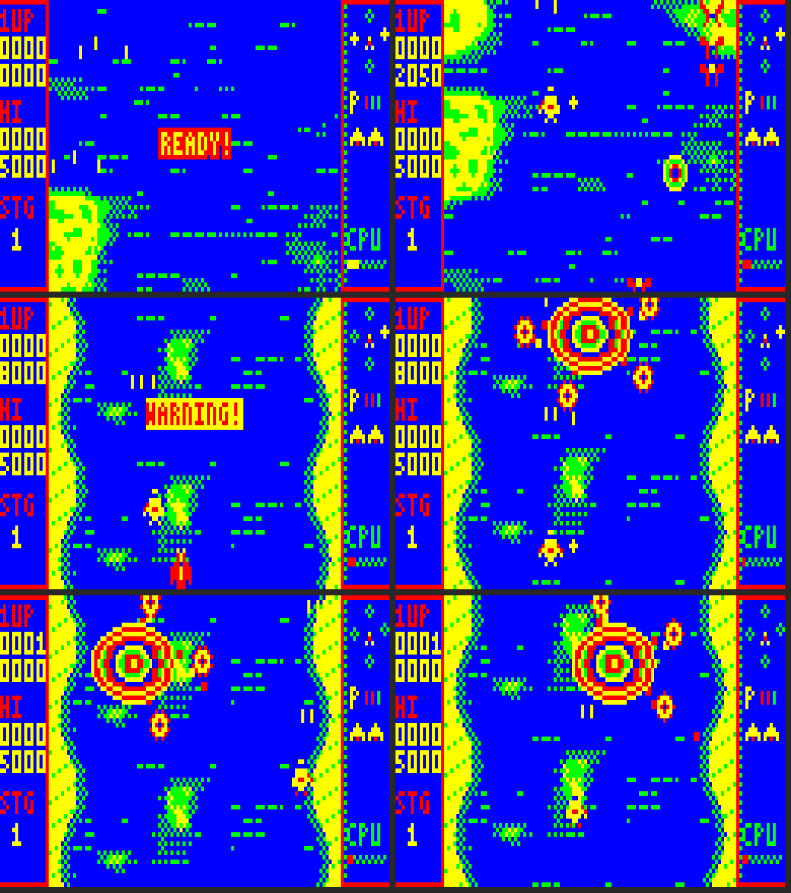

# SOUTHERN CROSS

An original vertically scrolling shoot-'em-up for the Dick Smith **VZ300** with the
**BennVenn SD loader + 128K RAM**. Mode 1 (128 × 64, four colours). VIBED BY BPM 2026.

A starfighter, the *Crux*, flies north across a Rust-infested Australia and up into orbit.
Destroyed formations drop star shards. Each shard becomes a star locked around your ship in
the Southern Cross pattern. Stars fire with you and each one soaks a hit. A knocked-off star
tumbles away and can be caught again. **Cross Burst** flings every star outward to clear the
screen, and they fly back home afterwards.



## Status: v0.2, Stage 1 complete (the Coral Sea)

| | |
|---|---|
| **Done, tested in the emulator** | Title screen with full-screen art and a three-voice Cybernoid-style tune (drums, arpeggio chords, bass), twinkling stars, high score. Stage 1: about two and a half minutes of hand-placed waves over scenery built from a block map (open sea, reefs, cays, a wreck, a lighthouse, a jetty, the atoll arena), with a mid-stage checkpoint. New enemy: the Rust Hornet (strafes the top of the screen, three-way fire). WARNING sequence with siren. The boss, the Crown of Thorns. Stage-clear tally with star bonus. Game over with CONTINUE? countdown, restarting from the last checkpoint. All the SCTEST engine features. |
| **Tested on the real VZ300** | The SCTEST engine (v0.1): it runs and plays well. v0.2 adds SD loading, so it needs a fresh check. |
| **Not started** | Stages 2-6, attract mode, high-score table and saving, ending |

### The Crown of Thorns

A mechanical starfish hovers over the atoll. Five turrets orbit its armoured body on banded arms, and each fires an aimed shot in turn after a yellow glint. Shots bounce off the body ("tink") while any arm survives. Every arm you destroy makes it spin faster and fire sooner. With all five gone, the shell opens and the core fires five-way spreads with gaps to slip through. While the boss is on screen your ship is kept below it.

## Loading

Copy all three files to the same folder on the SD card and run `SCROSS.VZ`:

| File | What it is | Loaded into |
|---|---|---|
| `SCROSS.VZ` | the program | $8000-$D5A0 (low, no mapper writes) |
| `SCROSS00.DAT` | title art and title tune | main RAM, whenever the title appears |
| `SCROSS01.DAT` | Stage 1: scenery blocks, map, waves, boss art | SRAM bank B, when a game starts |

The packs are loaded with the same DOS calls Graves 'n' Gargoyles uses on your machine: sector buffer at $F800, the frame buffer as the DOS's stack, interrupts off after every call. Sectors are copied into SRAM bank B with port $37 switched around the copy, as 13 Ghosts does. If a file can't be read you get a red screen with a yellow bar; press FIRE to retry.

## Controls

| | Keyboard | Joystick |
|---|---|---|
| Move | O left, P right, Q up, A down | stick (either joystick) |
| Fire | SPACE | FIRE |
| Cross Burst | M | ARM |
| Pause | H | |

FIRE or ARM starts a game from the title and continues after a game over.

## Measured performance (emulator)

- **10-minute random-input run, normal build:** no late frames and no snow, including the title, both SD loads and the screen changes. The random player reached the boss using continues.
- **Through the stage:** usually 20-35% of the CPU spare. During the boss fight it drops to about 4% at the busiest moment, but frames stay on time.
- **Title tune:** notes measured within about 10 cents of true pitch. Only the work at the start of each field is silent (about 5-8%, against about 14% in Cybernoid).

## Technical design

### Screen

```
bytes 0-3    left panel (score, hi, stage)          16 px
bytes 4-27   playfield                              96 px x 64 rows
bytes 28-31  right panel (stars, weapon, lives, CPU) 16 px
```

The playfield is 96 pixels wide because of a hard limit, not a style choice. On the VZ,
the CPU may only touch video RAM between the field-sync interrupt and the start of the
display (94 lines = 21,432 T-states), or the screen shows snow. The fastest copy (stack
POP/PUSH, 12.8 T-states a byte) moves about 1,650 bytes in that window. A full 2,048-byte
screen doesn't fit, but 64 rows × 24 bytes (1,536) does, in 19,712 T-states. The side
panels only change when the HUD changes, and they're copied in the other field.

### Frame pipeline (25 fps, two fields a frame)

1. The scenery for the current scroll position (two or three 32-row blocks from SRAM bank B)
   is copied into the frame buffer with an unrolled LDI chain.
2. Objects are drawn over it: ground targets, shots, enemies, pickups, explosions, stars,
   the ship, then enemy bullets on top so they are always visible.
3. `frame_end` marks the frame ready. The next field-sync interrupt copies it to video
   RAM before the display starts. The other field's interrupt sends the HUD panels if they
   changed.
4. While waiting, the CPU runs the sound loop, which also counts the idle time.

Sprites are pre-shifted to all four pixel positions with masks. 2-, 3-, 4- and 8-byte widths
have unrolled loops. The boss body is stored at two shifts and moves in 2-pixel steps. Captions
are drawn with a 3x5 font straight into the frame buffer. The unrolled frame blit and the LDI
chain are built at game start in the overlay that holds the title pack the rest of the time.

### Memory map

```
$4000-$67FF  SRAM bank B (port $37 = 3): the stage pack (blocks, map, waves, boss art)
$7000-$77FF  video RAM - written only before the display starts
$7800-$7AE8  left alone (ROM / SD DOS system area)
$7B00-$7CFF  HUD shadow (64 rows x 8 bytes)
$7D00-$7D7C  stack                $7D7D jp isr
$7D80-$7DFF  test: last 128 spare-CPU readings, for the emulator
$7E00-$7EB7  frame buffer row table (92 rows)
$7F00-$8000  IM2 vector table
$8000-$D5A0  program, sprites, HUD art, paths, font, music, variables
$D600-$EBFF  overlay: the front pack on the title, or the copy code built
             for play (32-row LDI chain + the frame blit)
$EE00-$F69F  frame buffer, 92 rows x 24 (20-row margin on top so the boss can
             slide in), and the DOS's stack during SD loads
$F800-$F9FF  DOS sector buffer
$FA00-$FFFF  BennVenn DOS RAM - never touched
```

### Scenery

Each stage is a map of 32-row blocks, each 96 x 32 pixels (768 bytes). Every block has open water along its top and bottom edges, so they join in any order. Stage 1 uses nine blocks and a 256-entry map, which is enough for the whole stage plus an atoll arena that repeats under the boss. The frame is composed from two or three block segments with the LDI chain.

### Title player (three voices)

The title runs with interrupts off and owns the CPU, as Cybernoid's front end does. Three pulse voices share one 188 T-state pass (18.9 kHz):

- voice 1 in HL/DE/B;
- voice 2 in the alternate registers;
- voice 3 in IX with the **stack pointer as its pitch step** (safe because interrupts are off).

The pass ends by reading the field-sync flag. When field sync starts, the program saves the voices and plays any snare or hat burst (noise read from the ROM). It then steps the sequencer, updates the screen while video RAM is free, reads the controls, and jumps back into the voices.

The sequencer works Cybernoid-style. Instruments have duty-cycle envelopes (volume shapes) and arpeggio tables, which give the fast-arpeggio chords and the dropping-pitch kick drum.

### Audio

The in-game engine is the proven Graves 'n' Gargoyles design. It has two pulse channels
time-multiplexed on the speaker, with 139 T-states a pass (25.5 kHz), and pulse width
doubles as volume. The sequencer runs in the 50 Hz interrupt. The tone loop runs in the
CPU's idle time and through the field-sync wait. Each note is a short blip (three fields),
which suits the chopped-up idle time. Sound effects take over channel 2 by priority.

**The Cybernoid player, examined.** The Cybernoid VZ300 port (v1.7, `src/music.asm`) runs
Dave Rogers' original 128K **AY music driver** unchanged, once per 50 Hz step. It then turns
the driver's AY register shadow into three speaker voices:

- true pitch from the AY periods (a 24-bit division per voice per step);
- pulse width from the AY volume;
- AY noise as a short burst;
- all three mixed by interleaving in a hand-timed 183 T-state sample loop (19.4 kHz).

That loop runs with interrupts off for about 61,000 of the 70,937 T-states in every step, so
**the player owns about 86% of the CPU**. The front-end animation fits only because it is
drawn a quarter-screen per step in the remaining time. It is cycle-critical: tone and timing
come from instruction counts, so it can't become a background routine. Cybernoid itself plays
no music during gameplay.

What carries over:

- The AY-register approach: a tracker sequence drives period, volume and mixer per channel, and
  a synthesiser renders it. This makes arpeggios, vibrato, slides and decays possible, and
  they're what give Cybernoid its character.
- For the title, stage-clear, boss-intro and ending screens, a full three-voice player in
  that style can take 80%+ of the CPU, because those screens animate lightly.
- During play, the same sequence data feeds the two-channel blip engine. Same tunes, thinner
  texture: the adaptive-quality plan in the brief.

## Building

```
./build.sh                      # -> build/SCROSS.VZ, SCROSS00.DAT, SCROSS01.DAT
./build.sh cheat                # test build: the ship can't be hit
gcc -O2 -o emu/vzemu emu/vzemu.c
cd build && ../emu/vzemu SCROSS.VZ -S . -f 6000 -i ../emu/play2.txt -s 5400 -p shot
```

- `tools/mkassets.py` generates the sprites, HUD art, font, paths, tables, in-game music and sound
  effects; `tools/stage1.py` builds the Stage 1 pack and `tools/front.py` the title pack.
- `tools/z80asm.py` and `emu/vzemu.c` are the assembler and test emulator from Graves 'n'
  Gargoyles.
- `emu/play*.txt` and `emu/soak.txt` are input scripts for testing.

The emulator's Z80 core looks like superzazu/z80 (MIT licence). It's used only for testing.
