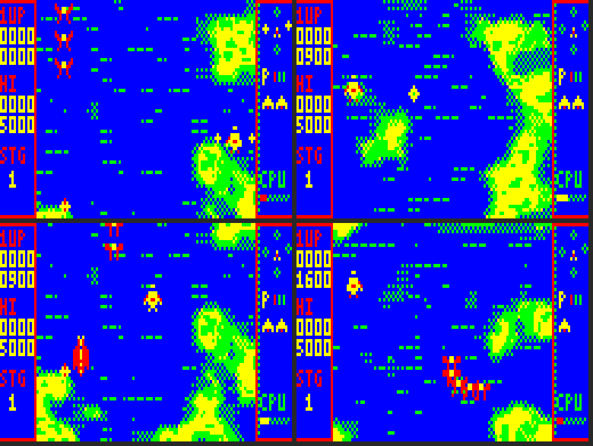

# SOUTHERN CROSS

An original vertically scrolling shoot-'em-up for the Dick Smith **VZ300** with the
**BennVenn SD loader + 128K RAM**. Mode 1 (128 × 64, four colours). VIBED BY BPM 2026.

A starfighter, the *Crux*, flies north across a Rust-infested Australia and up into orbit.
Destroyed formations drop star shards. Each shard becomes a star locked around your ship in
the Southern Cross pattern. Stars fire with you and each one soaks a hit. A knocked-off star
tumbles away and can be caught again. **Cross Burst** flings every star outward to clear the
screen, and they fly back home afterwards.



## Status: Phase 2 engine test (SCTEST.VZ)

| | |
|---|---|
| **Done, tested in the emulator** | 25 fps full-screen vertical scrolling, no snow, no tearing (frame copied to video RAM inside vertical blank); masked, pre-shifted sprites; ship with banking frames; the star mechanic (attach, fire, knock loose, re-catch, Cross Burst, fly home); player shots and weapon levels; three enemy types (drones in path formations, diving darts, gunboats that surface from ripples); telegraphed, aimed enemy fire; collisions; four-frame explosions; star shards and weapon pods; score / hi / lives / weapon / star diagram panels; blip-style music and ten sound effects; title, READY, pause and game over; a spare-CPU meter |
| **Not yet tested** | Anything on a real VZ300 |
| **Not started** | Bosses, stages 2-6, SD stage packs, attract mode, high-score entry and saving, ending |

## Loading

Copy `release/SCTEST.VZ` to the SD card and run it from the loader. It loads at
$8000-$E08A (low, like Xevious 1.2 and Graves 'n' Gargoyles), makes no SD calls, and maps
SRAM bank B at $4000 (port $37 = 3) as Graves 'n' Gargoyles does. If that SRAM isn't there
it shows a red screen with a blue bar.

## Controls

| | Keyboard | Joystick |
|---|---|---|
| Move | O left, P right, Q up, A down | stick (either joystick) |
| Fire | SPACE | FIRE |
| Cross Burst | M | ARM |
| Pause | H | |
| Scroll speed (test) | S cycles 1, 3/4, 1/2, 1/4 rows a frame | |

FIRE or ARM starts a game from the title.

## Please check on the real machine

1. Does it load and show the title over the scrolling reef?
2. Is the scrolling smooth, with no specks ("snow") or tearing in the playfield?
3. Do the keys and both joysticks work, including ARM for the burst?
4. How does the sound come across? The music is deliberately "dink, dink-dink" blips.
5. Is 1 row a frame a good scroll speed on your TV? Press S to compare the slower speeds.
6. The CPU bar (bottom right) shows spare time: yellow is plenty, red is under 25%.

## Measured performance (emulator, 5-minute random-input soak test)

- 7,494 frames in 15,000 fields: a steady **25 fps**, no late frames.
- Worst frame: 6.6% of the CPU spare. Average: about 31% spare.
- Snow (video RAM touched during the display): none, apart from the one-off screen clear at start-up.

Average CPU use during play (profiler):

| Work | Share |
|---|---|
| Sound output loop (idle time) and the field-sync wait | 40% |
| Background strip → frame buffer (LDI chain) | 17% |
| Frame buffer → video RAM (stack copy in vertical blank) | 14% |
| Sprites, game logic, collisions, HUD | 29% |

## Technical design

### Screen

```
bytes 0-3    left panel (score, hi, stage)          16 px
bytes 4-27   playfield                              96 px x 64 rows
bytes 28-31  right panel (stars, weapon, lives, CPU) 16 px
```

The playfield is 96 pixels wide because of a hard limit, not a style choice. On the VZ,
the CPU may only touch video RAM between the field-sync interrupt and the start of the
display (94 lines = 21,432 T-states), or the screen shows snow. The fastest copy (stack
POP/PUSH, 12.8 T-states a byte) moves about 1,650 bytes in that window. A full 2,048-byte
screen doesn't fit, but 64 rows × 24 bytes (1,536) does, in 19,712 T-states. The side
panels only change when the HUD changes, and they're copied in the other field.

### Frame pipeline (25 fps, two fields a frame)

1. The background strip (256 rows × 24 bytes, seamless top to bottom, in SRAM bank B) is
   copied into the frame buffer at the current scroll position with an unrolled LDI chain.
2. Objects are drawn over it: ground targets, shots, enemies, pickups, explosions, stars,
   the ship, then enemy bullets on top so they are always visible.
3. `frame_end` marks the frame ready. The next field-sync interrupt copies it to video
   RAM before the display starts. The other field's interrupt sends the HUD panels if they
   changed.
4. While waiting, the CPU runs the sound loop, which also counts the idle time.

Sprites are pre-shifted to all four pixel positions with masks. 2-, 3- and 4-byte widths
have unrolled loops. Fixed-position text and the logo are stored at one shift only. The
unrolled blits and the LDI chain (6.6K of regular code) are generated at start-up into the
space the strip occupied in the load image.

### Memory map

```
$4000-$57FF  SRAM bank B (port $37 = 3): background strip
$7000-$77FF  video RAM - written only in vertical blank
$7800-$7AE8  left alone (ROM / SD DOS system area)
$7B00-$7CFF  HUD shadow (64 rows x 8 bytes)
$7D00-$7D7C  stack                $7D7D jp isr
$7D80-$7DFF  test build: last 128 spare-CPU readings, for the emulator
$7E00-$7E9F  frame buffer row table
$7F00-$8000  IM2 vector table
$8000-$C861  program, sprites, HUD art, paths, music, variables
$C862-$E08A  strip in the load image, then code built at start-up (to $E488)
$EE00-$F57F  frame buffer, 80 rows x 24 bytes (8-row margins top and bottom)
$FA00-$FFFF  BennVenn DOS RAM - never touched
```

The full game will load each stage's strip or tile map, sprites, boss and music into SRAM
banks from SD during the stage-clear tally. RASTEST measured 16K in 0.4 s.

### Audio

The in-game engine is the proven Graves 'n' Gargoyles design. It has two pulse channels
time-multiplexed on the speaker, with 139 T-states a pass (25.5 kHz), and pulse width
doubles as volume. The sequencer runs in the 50 Hz interrupt. The tone loop runs in the
CPU's idle time and through the field-sync wait. Each note is a short blip (three fields),
which suits the chopped-up idle time. Sound effects take over channel 2 by priority.

**The Cybernoid player, examined.** The Cybernoid VZ300 port (v1.7, `src/music.asm`) runs
Dave Rogers' original 128K **AY music driver** unchanged, once per 50 Hz step. It then turns
the driver's AY register shadow into three speaker voices:

- true pitch from the AY periods (a 24-bit division per voice per step);
- pulse width from the AY volume;
- AY noise as a short burst;
- all three mixed by interleaving in a hand-timed 183 T-state sample loop (19.4 kHz).

That loop runs with interrupts off for about 61,000 of the 70,937 T-states in every step, so
**the player owns about 86% of the CPU**. The front-end animation fits only because it is
drawn a quarter-screen per step in the remaining time. It is cycle-critical: tone and timing
come from instruction counts, so it can't become a background routine. Cybernoid itself plays
no music during gameplay.

What carries over:

- The AY-register approach: a tracker sequence drives period, volume and mixer per channel, and
  a synthesiser renders it. This makes arpeggios, vibrato, slides and decays possible, and
  they're what give Cybernoid its character.
- For the title, stage-clear, boss-intro and ending screens, a full three-voice player in
  that style can take 80%+ of the CPU, because those screens animate lightly.
- During play, the same sequence data feeds the two-channel blip engine. Same tunes, thinner
  texture: the adaptive-quality plan in the brief.

## Building

```
./build.sh                      # -> build/SCTEST.VZ (needs python3 + Pillow)
gcc -O2 -o emu/vzemu emu/vzemu.c
emu/vzemu build/SCTEST.VZ -f 3000 -i emu/play1.txt -s 1000 -p shot
```

- `tools/mkassets.py` generates the reef strip, sprites, HUD art, paths, aim table, waves,
  music and sound effects into `src/gen/`.
- `tools/z80asm.py` and `emu/vzemu.c` are the assembler and test emulator from Graves 'n'
  Gargoyles.
- `emu/play1.txt` and `emu/soak.txt` are input scripts for testing.

The emulator's Z80 core looks like superzazu/z80 (MIT licence). It's used only for testing.
