# SPINDRIFT
### for the Microbee Premium Plus
***"Ride the spiral home."***
**VIBED BY BPM 2026**

You ride the rim of a vortex at the edge of the solar system. From the vanishing point at its heart the swarm spirals out of deep space: specks at first, then full-size, right in your face. They wheel into a breathing ring of formation, then peel off one by one to dive at you. Sweep round the rim, fire inward, slip through a gap, and wipe out a whole group of eight on the next pass for the big bonus.

Eight sectors stand between you and home, from the icy **Oort Drift** to the burning heart of **The Eye**. Each has its own colours, its own enemies and its own nasty trick. Every second sector ends at a **Guardian**: an armoured eye behind a turning wall of shield pods. Then comes the **Chance Stage**, where forty jewels spiral past and nobody shoots back. **"3 WARPS TO CINDER GATE"**: the game always tells you how far it is to the next one.

The whole picture fills a PAL screen: 320 × 250 in full Microbee colour, with the starfield streaming out to every edge. **SWIRL**, a new three-voice engine, plays a psychedelic acid title tune on the one speaker bit. In the game, every shot spurts and every kill squelches.

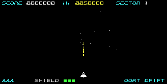

| | |
|---|---|
| 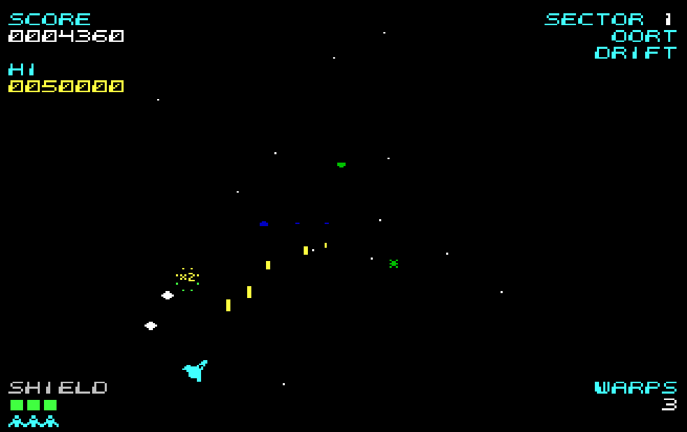 | 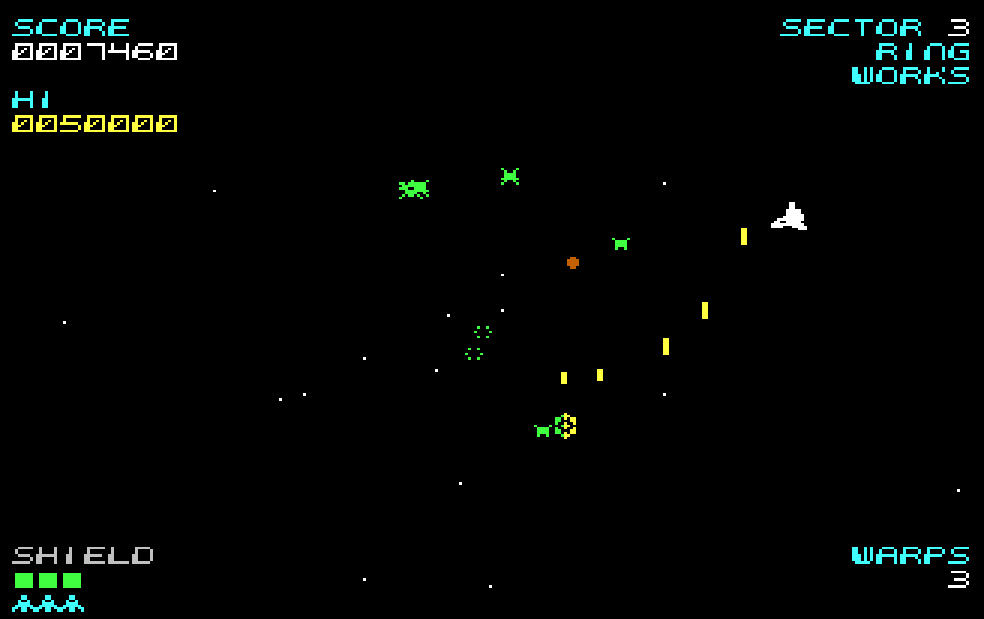 |
| 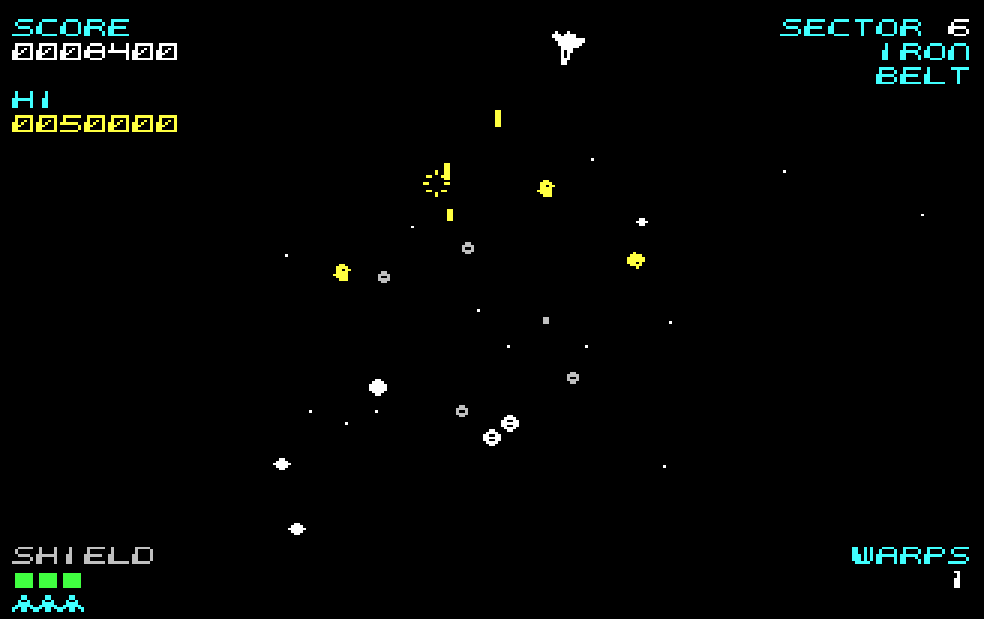 | 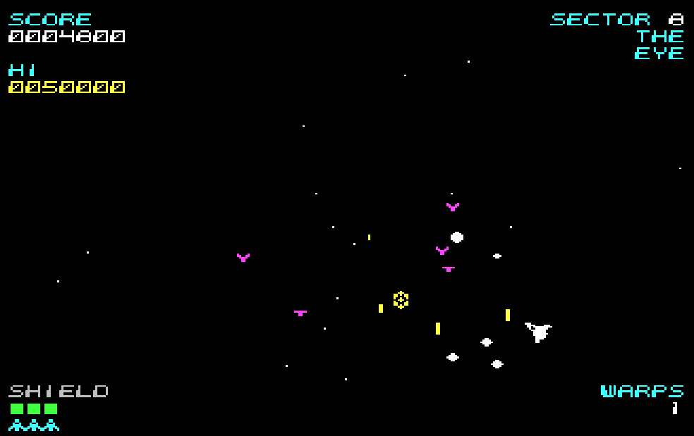 |
| 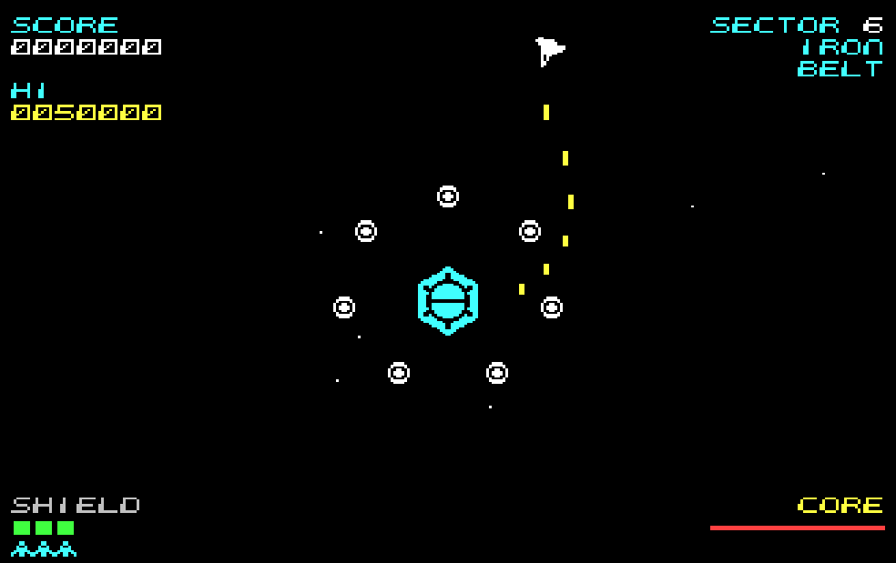 | 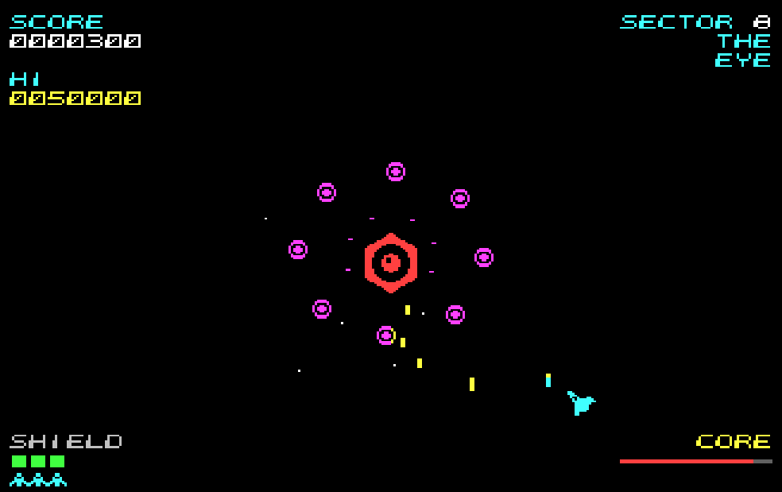 |
| 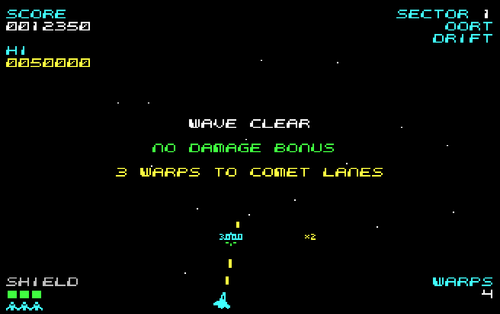 | 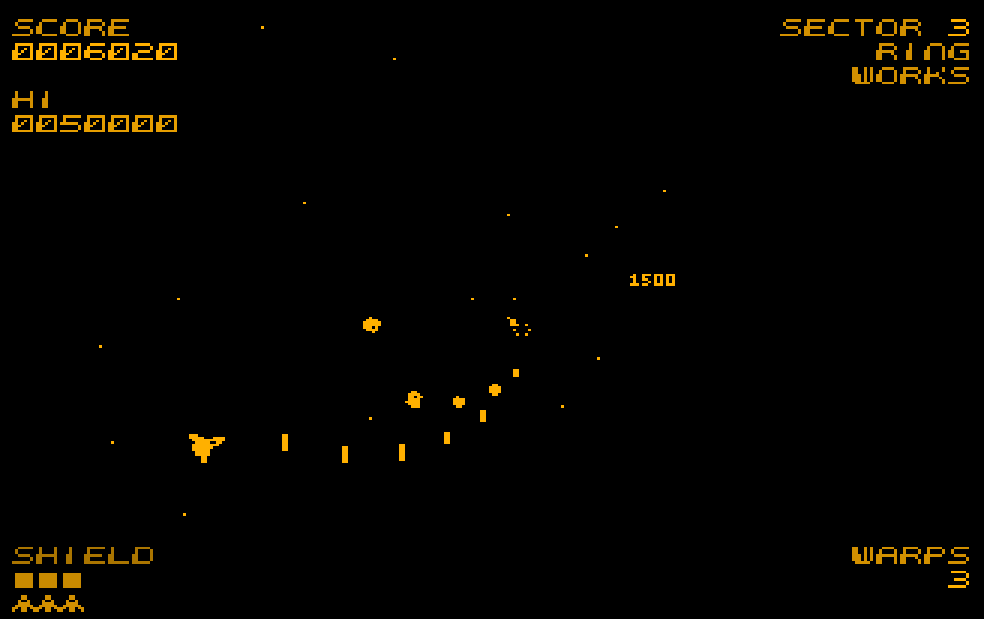 |
| 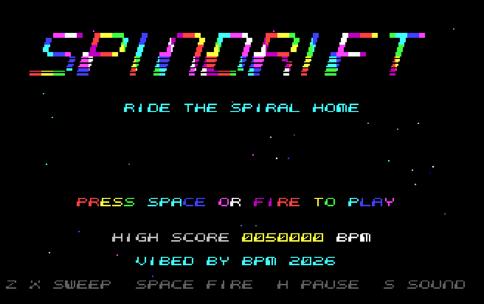 | 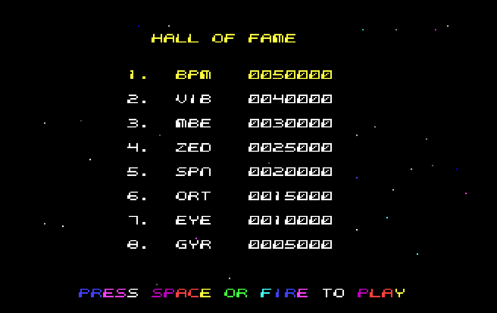 |

## Features
- **Eight sectors:**
  1. Oort Drift
  2. Comet Lanes
  3. Ring Works
  4. Cinder Gate
  5. Gas Giant
  6. Iron Belt
  7. Corona
  8. The Eye

  Each has its own star and HUD colours, enemy types, entry paths and signature attack. After The Eye it goes round again, harder.
- **Formations you can learn:**
  - groups of eight spiral out and settle into a turning, breathing ring
  - then they break off into seven kinds of attack run: lunge, corkscrew, pincer, rush, loop, orbit-sweep and swoop
  - **every attacker flashes and sounds a warning before it breaks away**
- **Depth you can read:**
  - nine enemy types, each drawn at six sizes, so a far enemy is a proper small drawing, not a squashed big one
  - far enemies are dim and near ones bright
  - stars race outward at perspective speed, out past the ring to the edge of the screen
- **Four Guardians:**
  - break the ring of shield pods, then hit the eye while it's open
  - they fire radial bursts, aimed shots and spirals, and launch raiders
  - the first one leaves you a **twin cannon**
- **The Chance Stage** after every Guardian: 40 jewels, 100 points a hit and 10,000 for all forty.
- **Scoring that rewards risk:**
  - attackers count double
  - shots at point blank on the rim double again
  - wiping out whole groups pays 1,000 rising to 5,000
  - a wave with no damage pays 2,000
  - extra ships at 20,000, at 60,000 and every 60,000 after that
- **Forgiving:**
  - three ships, each with a three-hit shield and a moment of safety after a hit
  - the first wave never fires at you
- **A ring that's really round:** the screen-shape screen lets you squash or stretch the vortex until it looks round on your own monitor, whether that's a CRT or a stretched 4:3 screen.
- **HUD in the corners**, so the arena gets the full height of the screen.
- **Monochrome mode** for amber and green monitors.
- **Sound:** two original engines on the one speaker bit:
  - **SWIRL** (title and hall of fame): a squelching acid bass, a swirling phaser and shimmering arpeggios, with designed 1-bit drums, playing **"Spiral Arms"**
  - **in-game**: a phaser melody, a plucked bass and a separate voice for the sound effects, so shots and kills never cut the music. Shots spurt, kills squelch, the attack warning and the Guardian's siren go wucka-wucka, and the warp is one long zip
- A full **attract sequence**:
  - title with a rainbow marquee
  - a How to Play demo
  - a demo game
  - a hall of fame of eight initials
- **Pause, quick restart and sound modes.**

## Tech specs
| | |
|---|---|
| **Machine** | Microbee Premium Plus: Z80 at 3.375 MHz, 1MB RAM, 32K PCG RAM, 6545 CRTC |
| **Display** | BPM's MODES40 table, 40 × 25 cells of 8 × 10: 320 × 250, a full PAL picture (312 lines, 50 Hz), 16 colours |
| **Graphics** | Sprites are composed into private 10-line glyphs every frame (up to 100), so they move a pixel at a time and overlap freely. Two screen pages and two PCG banks take turns, so there's no flicker or tearing |
| **Frame rate** | Locked to 25 frames a second, measured in a raster-accurate Premium Plus model at 23.9 on average across the busiest wave of every sector and every Guardian. 90% of frames are on time, and the gentle sectors run at 25 |
| **Video timing** | Every video write happens in the 62-line vertical blanking. A frame too big for one blanking finishes its last part in the next |
| **Vortex** | A polar table of 128 depths × 65 angles. The ring's width is rebuilt from a pristine copy for whichever of the eight screen shapes you pick |
| **Sound** | SWIRL: three voices mixed by time-slicing inside a 218 T sample (15.5 kHz). In-game: three voices at 264 T a sample, played in each frame's spare time |
| **Disk** | DS80 (80 tracks × 2 sides × 10 × 512 bytes). Boots to the CP/M `A>` prompt with no shell. `SPIN` checks for 1MB, loads the game and its data blocks, and the game then takes over the machine |
| **Source** | About 8,400 lines of Z80 assembly, plus about 3,900 lines of Python tools that draw the art, compose the music and build the disk |

## RAM used
| Block | Contents | Size |
|---|---|---|
| 0 (upper 32K) | the program (8000-C7FF), cell tables, glyph buffers, sprite lists, text queues, variables, stack, video window (F000) | 32K |
| 4 | font, ship, shots, explosions, the vortex's position table | 30K |
| 5 | enemies (nine types × two frames × six sizes), explosions, score pop-ups | 26K |
| 6 | the SPINDRIFT logo, the Guardian's core, the pristine vortex widths | 20K |
| 7 | "Spiral Arms" for SWIRL, plus the in-game tunes and effects | 25K |

**PCG RAM (32K, 2048 glyphs):**

| Banks | Contents |
|---|---|
| 0–1 | font and HUD icons |
| 2 | the logo |
| 12 | the Guardian's three faces |
| 14–15 | the sprite pools, one per screen page |

## To play
Boot `release/SPINDRIFT.DS8` and type `SPIN` at the `A>` prompt. Press **C** for colour or **M** for monochrome, then squash or stretch the ring until it's round.

| Action | Keys |
|---|---|
| Sweep clockwise / anticlockwise | Z / X |
| Fly round to that side of the vortex | arrow keys, Q A O P, or the joystick |
| Fire | SPACE, or fire on the joystick |
| Pause, sound, restart, quit | H, S, R, ESC |
| Change monitor or screen shape (on the title) | C / M |

More pictures: [gameplay](screenshots/gameplay/) · [screens](screenshots/info/)
