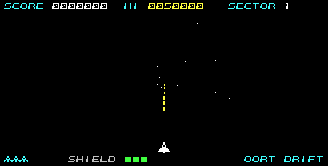
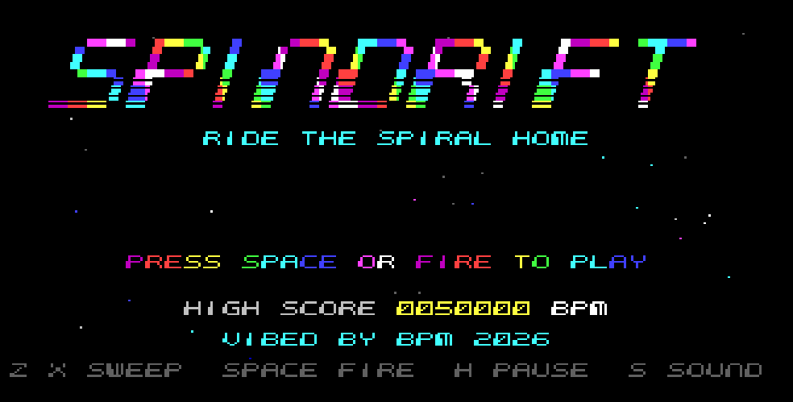
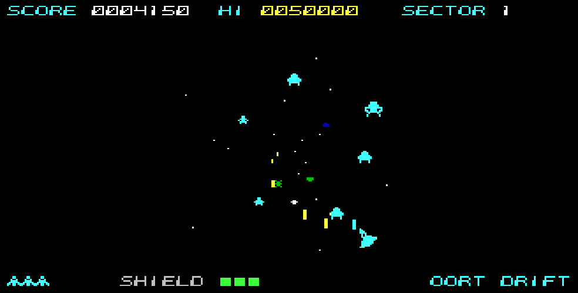
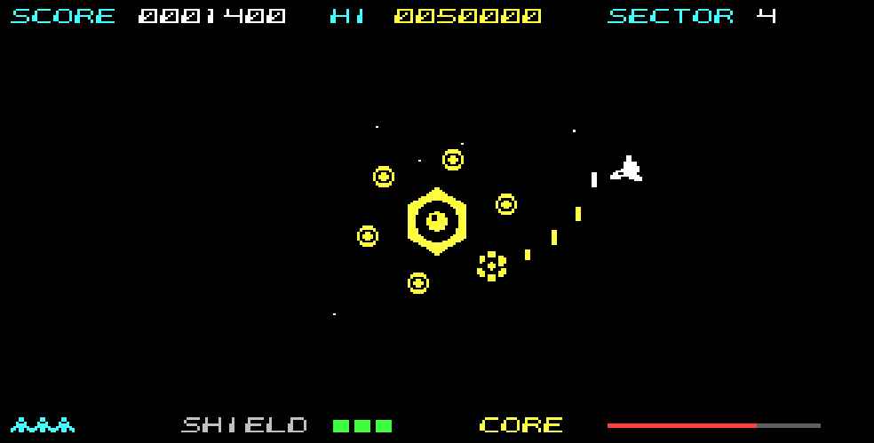
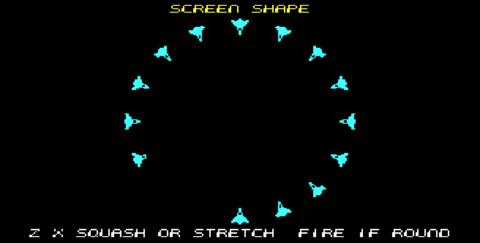

# SPINDRIFT

**Ride the spiral home.** An original arcade shooter for the **Microbee Premium Plus**, inspired by Gyruss.
*VIBED BY BPM 2026*

Your ship rides the rim of a vortex. The swarm spirals out of deep space from its centre: specks in the distance, full-size up close. Sweep round the rim, shoot into the middle, slip through a gap and take out a whole formation on the next pass.

| | |
|---|---|
|  |  |
|  |  |

Videos with sound, from the emulator model: [the title and its music](media/spindrift_title_music.mp4) · [play](media/spindrift_gameplay_sound.mp4)

## Play it

`release/SPINDRIFT.DS8` is a DS80 disk image (80 tracks, 2 sides, 10 × 512 sectors). It boots to CP/M's `A>` prompt (no shell). Type:

    SPIN

Then press **C** for a colour monitor or **M** for a monochrome one, and set the **screen shape**: a ring of ships appears, and **Z** / **X** (or the stick) stretch or squash it until it looks round on your screen; fire to go on. (A CRT shows the 40-column pixel a little wider than a line is tall; a screen that stretches the picture to fill 4:3 shows it narrower, so the right setting depends on the display.) On a Premium Plus that loads images from SD, boot the image and type `SPIN` at the prompt.

Needs a **Premium Plus with 1 MB RAM and 32K PCG RAM**. The loader checks for the RAM and says so if it isn't there.

| Action | Keyboard | Joystick |
|---|---|---|
| Sweep clockwise / anticlockwise | **Z** / **X** | |
| Fly round to that side of the vortex | arrow keys or **Q A O P** | stick |
| Fire | **SPACE** | fire |
| Pause | **H** | |
| Sound: music + effects / effects / off | **S** | |
| Restart the game at once | **R** | |
| Quit to the title | **ESC** | |
| Switch monitor, then set the screen shape (on the title) | **C** / **M** | |

The joystick is read from PIO port A (active low, bit 7 fire), as in the earlier Premium games. It's tested in the emulator model; it hasn't been tried on BPM's hardware yet.

## The game

- **A round vortex.** The ring is drawn round on your screen, whatever it is: the screen-shape setting picks one of eight widths.
- **"3 WARPS TO CINDER GATE".** Under each sector's name, and between its two waves, a countdown of the waves left to the next Guardian.
- **Eight sectors**, each with its own star colour, HUD colour, enemy types, entry paths and signature attack:
  Oort Drift, Comet Lanes, Ring Works, Cinder Gate, Gas Giant, Iron Belt, Corona, The Eye. After The Eye it goes round again, harder.
- **Depth you can read.** Each of the nine enemy types is drawn at six sizes, so a far enemy is a proper small drawing, not a squashed big one. Far enemies are dim, near ones bright. Stars stream outward at perspective speed.
- **Formations, then attack runs.** Groups of eight spiral out and settle into a breathing, turning ring. Then they peel off into seven kinds of attack run (lunge, corkscrew, pincer, rush, loop, orbit-sweep, swoop). **An enemy flashes and sounds a warning before it breaks away**, so you can learn to read them.
- **Guardians** close every second sector: an armoured eye at the vanishing point behind a turning ring of shield pods. Break the ring, then hit the eye while it's open. It fires radial bursts, aimed shots and spirals, and launches raiders. Four Guardians, each tougher.
- **The Chance Stage** follows each Guardian: 40 jewels, nobody shoots back. 100 points a hit, 10 000 for all forty.
- **The twin cannon** is the first Guardian's gift.
- **Forgiving.** Three ships, each with a three-hit shield and a moment of safety after a hit. The first wave of the first sector never fires at you.

### Scoring

| | |
|---|---|
| Enemies | 50 to 500 by type |
| Hit an attacker (out of formation) | double |
| Point blank, at the rim | double again (an **×2** pops up) |
| Whole group of eight shot | 1 000, rising to 1 500, 2 000, 3 000, 5 000 for each further group in the same wave |
| Wave with no damage | 2 000 |
| Guardians | 10 000, 15 000, 20 000, 30 000 |
| Chance Stage | 100 a jewel, 10 000 for all 40 |
| Extra ships | at 20 000, 60 000, then every 60 000 |

The high score table keeps eight sets of initials (type them, or pick them with the stick).

### The home release

- Monitor question at start-up (colour or amber monochrome; the monochrome mode draws everything as ink, readable on BPM's amber screen).
- A title with the SPINDRIFT marquee logo, bands of colour rolling through it in time with **"Spiral Arms"**, an original psychedelic title tune (see Sound below).
- An attract cycle: title, a scripted **How to play** demo that shows each control with a caption, the title again, a **demo game** played by the computer, the title, the **hall of fame**.
- Pause, sound modes, quick restart, quit.
- Sound from the one speaker bit (below).

### Sound

Two engines, both original, both on the one speaker bit:

- **SWIRL** plays the title and the hall of fame with all of the CPU. Three voices take turns at the speaker inside every 218 T sample (15 482 a second), so they add up like real mixing instead of masking each other: a **squelch bass** (its duty swells and decays like a filter, each note diving in from a fifth above), a **phaser** (two oscillators a hair apart, exclusive-or'd, so the tone sweeps as they drift through each other) and an **arpeggio / lead** voice (tick-rate chord arpeggios, or the melody with a scoop and a delayed vibrato). Drums are designed 1-bit pulse trains: kick, snare, hats, toms. The title runs on the music's ticks; its picture changes only in the vertical blanking, where video writes cost nothing, so the music never stops for it.
  **"Spiral Arms"**: A minor, about 125 BPM, on the Am – G – F – E descent; an intro where the phaser pad swells in, a groove with 16th-note acid bass and shimmering arpeggios, the lead, a breakdown where the phaser takes the hook and swirls, then round again. About a minute before it loops. It's written as a score in `tools/song.py` and baked into a 20K stream of per-tick settings in RAM block 7.
- **In the game** the voices sound in the time each frame waits for the vertical blanking. Three voices again: a **phaser melody** (the note and a hair over its octave), a **plucked bass** ("dunk", not "beep"), and the effects' **own voice**, so effects no longer cut the music. An effect is a pulse whose pitch glides smoothly inside the frame, or pitched noise: shots spurt (a wet fizz, then a zip down), enemies burst with a squelch and a splat, the attack warning and the Guardian's siren go wucka-wucka, the warp is one long zip up.

## How it works

The display is the 40-column mode BPM proved on the Premium Plus: 40 × 25 cells of 8 × 8 pixels, 320 × 200, with the 40-column dot clock selected.

The PCG RAM holds 2048 glyphs, twice the number of cells, so nothing is built from tiles. Every cell a sprite touches gets a private glyph composed in RAM, and the cell is pointed at it. Two screen pages and two glyph banks take turns, so sprites move a pixel at a time, overlap freely and never flicker or tear. All video RAM writes happen in the vertical blanking, when the 6545 doesn't hold the CPU.

The game is locked to **25 frames a second**. Measured in the raster-accurate Premium Plus model, flying the busiest wave of every sector and every Guardian:

| Scene | Frames a second | Frames on time |
|---|---|---|
| Sector waves (8 scenes) | 24.6 – 25.0 | 95 – 100% |
| Guardians (4 scenes) | 23.9 – 24.8 | 91 – 98% |
| **All play** | **24.7** | **97.5%** |

The details, what was changed to get there, and how it was tested are in [docs/DESIGN.md](docs/DESIGN.md) and [docs/TESTING.md](docs/TESTING.md).

## Build it

Python 3 with numpy and Pillow, and gcc (for the emulator model used by the tests). From this folder:

    python3 tools/build.py

That draws the art, writes the music (`tools/mkmusic.py` for the game, `tools/song.py` for the title), assembles the program and the CP/M loader, and writes `build/SPINDRIFT.DS8` (and a copy in `release/`).

| Script | What it does |
|---|---|
| `tools/fronttest.py` | Plays the whole home-release flow: 20 checks |
| `tools/loadertest.py` | Runs the CP/M loader off the disk image and checks every file and block |
| `tools/playtest.py OUT 900 --god` | A scripted pilot flies the whole campaign, saving pictures |
| `tools/perf2.py` | Measures every sector and Guardian |
| `tools/showcase.py` | Makes the screenshots and the GIF |
| `tools/video.py title OUT.mp4` (or `play`) | A video with sound from the model |
| `tools/audio.py` | Renders the speaker as a small speaker hears it |

## Files

| Path | What it is |
|---|---|
| `release/SPINDRIFT.DS8` | The disk |
| `src/` | Z80 source: engine, enemies, game, Guardians, front end, sound, loader |
| `tools/` | Art, music, data and disk builders; the test harness |
| `tools/emu/` | The Premium Plus model used for testing (its Z80 core looks like superzazu/z80, MIT; not part of the game) |
| `docs/` | Design and test notes, and the README that goes on the disk |
| `screenshots/` | Pictures from the model |
| `media/` | Videos with sound from the model |
