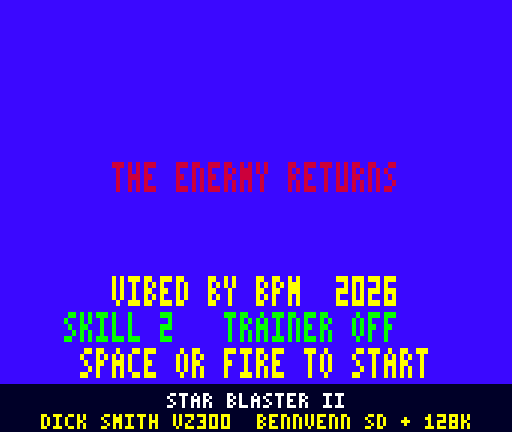
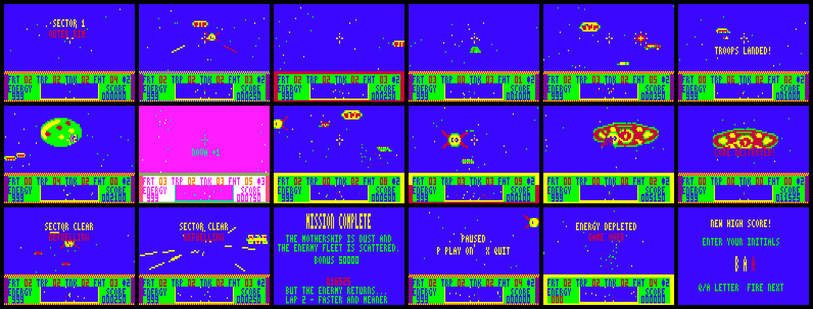
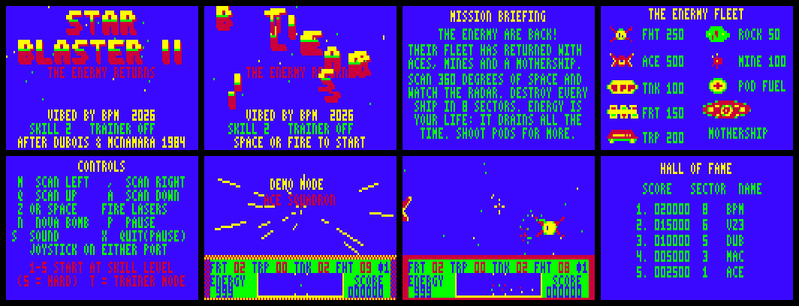

# STAR BLASTER II — THE ENERMY RETURNS

Sequel to the VZ200/VZ300 game *STAR BLASTER* (Dubois & McNamara, 1984) for the Dick Smith VZ300 with the BennVenn SD loader + 128K RAM.
ViBED by BPM 2026. The code, graphics and music are all new. Nothing from the original game is included.



**Release blurb and tech specs: [BLURB.md](BLURB.md).** Release zip: `release/STARBLS2_v1.2.2.zip`.





The individual screens are in `screenshots/gameplay/` and `screenshots/attract/`.

## Play it

Copy `release/STARBLS2.VZ` to the SD card and load it from the BennVenn SD loader. It's a single type F1 binary that loads at $8000 (to $D1BD) and runs from $8000. There are no other files.

It needs the **BennVenn SD loader with 128K RAM**. If the expansion RAM or the SRAM bank isn't there, it shows `NEEDS BENNVENN SD + 128K RAM` and stops.

| Action | Keyboard | Joystick |
|---|---|---|
| Scan left / right | M / `,` (same as the original) | left / right |
| Scan up / down | Q / A | up / down |
| Fire lasers | Z or SPACE | fire |
| Nova smart bomb | N | — |
| Pause (X quits while paused) | P | — |
| Sound: music+SFX → SFX only → off | S | — |
| Start at skill 1–5 (5 = hard) | keys 1–5 on the title | — |
| Start at the current skill | SPACE, Z, RETURN | fire |
| Trainer mode on/off | T on the title | — |
| High-score initials | Q/A change the letter, SPACE/fire moves to the next, RETURN finishes | up/down, fire |

Either joystick works: every port of your custom interface is read and combined. There is no joystick Y/N question.

## What it is

**Kept from the original:**
- The cockpit view, with a crosshair and a starfield.
- Scanning left, right, up and down to bring ships into your sights.
- Unarmed tankers (TNK), freighters (FRT) and troop carriers (TRP) that cruise across space.
- Fighters (FHT) that fly straight at you and crack your canopy if you don't destroy them in time.
- Energy is your life. It starts at 999 and drains all the time, faster on higher skill levels. Firing costs energy, and so does every hit you take.
- The `FRT TRP TNK FHT` tally, skill levels 1–5, and the original's keys.

**New in the sequel:**
- **360° space and a radar.** The Enermy fleet surrounds you. The radar strip in the dashboard shows every contact around the full circle, with the bracket marking your view. Hostiles are red and convoys yellow.
- **Twin laser bolts** fly from the cockpit corners to the sights. When anything is in the sights, the crosshair turns red.
- **Combo chains.** Quick successive kills score ×2, ×3, ×4.
- **Eight sectors**, each with its own twist:
  1. **Outer Rim**: convoys and a few fighters.
  2. **The Rock Belt**: drifting asteroids. A rock that reaches you costs energy.
  3. **The Minefield**: mines that home in on you and tick as they get close.
  4. **The Invasion**: troop carriers race for a planet. Each one that lands costs 60 energy ("TROOPS LANDED!"), and another one comes.
  5. **Nebula X**: the alternate (CSS1) palette, with fighters that are cloaked until they're close. They flicker and don't show on the radar.
  6. **Ace Squadron**: Aces hover, weave and fire plasma bolts, which you can shoot down. Then they dive at you.
  7. **The Gauntlet**: everything at once.
  8. **The Enermy Mothership**: a huge boss that holds station and sways. It fires plasma from four turrets and launches fighters. Knock out the turrets (they burn), then the exposed core.
- **Hyperspace.** You warp into each sector with star streaks and a fanfare. After each clear you refuel (energy tally), then warp out.
- **Mission complete** after sector 8 gives a 50,000 bonus. Then the Enermy returns: lap 2 is faster, with more fighters.
- **Supply pods.** Shoot them for +150 energy or an extra NOVA. A NOVA destroys everything on screen.
- **The dashboard bezel:** a 50:50 dithered frame (red/yellow band, red/blue sides) runs round the HUD and does the talking:
  - **Hit:** the bezel flashes red and yellow, the view shakes, sparks spray up from the dashboard and the palette blinks once.
  - **Threat warning:** when a fighter, ace, mine or plasma bolt gets close, the bezel side it's coming from blinks yellow with a tick, so you know which way to turn. If it's already in view, the top band blinks instead.
  - The low-energy alarm sounds below 150, and the energy readout turns red below 200.
- **Trainer mode**: energy never runs out, and scores aren't recorded.

**Presentation:**
- **Title (Mode 1):** the STAR BLASTER II logo letters fly in from all over and land with a flash. A starfield streams behind them, and an Enermy fighter swoops in and gets blasted. The bottom line cycles through the messages.
- **Attract cycle:** title → Mission Briefing → The Enermy Fleet (gallery with points) → Controls → a computer-played demo of a sector → Hall of Fame. Pages change with blinds wipes, and you can start at any point.
- **High scores:** 5 entries, with score, sector reached and 3-letter initials. They're kept until power-off.
- **Sound:** the two-voice pin-pulse beeper engine from Ghost Hunter 2 / Penguin 2, with short, separated notes for that gritty sound. All the tunes are original:
  - title march, in-game patrol loop and boss theme
  - jingles: warp-in fanfare, sector clear, game over, high score
  - mission-complete theme and an info-pages tune
  - 14 sound effects: laser, explosions, hit crackle, alarm, pickup, nova, warp, plasma, turret zap…

  `media/` has the emulator's speaker output of the title music and a stretch of gameplay.

## Version history

- **v1.2.2:** the attract-mode demo pilot is invulnerable (it used to run out of energy and end on "ENERGY DEPLETED"), and the hit/threat bezel no longer flashes on the title screen after a demo. New release package: blurb, gameplay and attract screenshots, showcase GIF, zip.
- **v1.2.1:** the original sound effects are back. v1.2 fixed the table but also shortened them and removed the warble; now they play exactly as designed.
- **v1.2:** sound effects fixed. The effects table had 9 bytes per entry, but the player looks entries up 8 bytes apart, so every effect after the laser played the wrong sound (the long, chirpy, lingering one was the warning tick reading garbage).
- **v1.1:** easier (see below), a dithered bezel round the HUD replaces the full-screen cracked canopy, directional threat warnings on the bezel, and the logo reads STAR / BLASTER II.
  - Fighters approach more slowly (skill × 6 instead of × 8) and fewer come at once (1 + skill/2 instead of 2 + skill/2).
  - Hits cost less: fighters 35, aces 50, mines 45, rocks 30, plasma 20, plus skill × 3; landed troops cost 60.
  - The laser hit box is a pixel bigger on every side.
- **v1.0:** first release.

## Hardware notes

These follow your earlier VZ300 builds, MAME's `bus/vtech/memexp/sdloader.cpp`, and your RASTEST / XVTEST / BIX probe results.

- **Loading:** one .VZ loading low at $8000, which is the method that works on your machine (Penguin 2, Ghost Hunter 2/3, Xevious v1.2). The game makes no ROM calls, runs with interrupts off throughout (DI, no IM2), and doesn't need the DOS after loading.
- **BennVenn mapper:** port $37 is written once, with **3**: DOS RAM switched in, with 10K SRAM bank "3" at $4000–$67FF. That's one of the two values your BIX probe proved are separate banks. The DOS in bank 1 is never written, and bit 2 (the bank at $B800–$FFFF) isn't used.
- **Memory:**

| Range | Use |
|---|---|
| $4000–$67FF | SRAM bank 3: sprite library part 1 (scaled, pre-shifted, masked) |
| $7000–$77FF | video RAM (written only in vertical blank) |
| $7AE8–$7BFF | engine variables (system area $7800–$7AE7 untouched) |
| $7C00–$7CFF | per-row dirty-span tables |
| $7D00–$7DFF | game variables |
| $7E00–$7FFE | stack |
| $8000–$D1BD | code and data (the .VZ) |
| $D700–$E853 | sprite library part 2 |
| $E900–$ECFF | objects, stars, particles |
| $ED00–$EFFF | generated VRAM-copy code (rebuilt every frame) |
| $F000–$F7FF | BASE picture (cockpit, HUD, bezel) |
| $F800–$FFFF | back buffer (= VRAM OR $8800). This overwrites the DOS workspace, which isn't needed once the game is loaded. |

- **Sprite library:** the .VZ holds each ship at up to 8 sizes, but only at one pixel phase. At start-up, `build_library` writes the images to bank 3 and high RAM and generates the other three 1-pixel shifts with masks (14.5K). The blitter draws with POP, clipped to the view, at about 38 T-states a byte. Distance picks the size from a per-type table.
- **Snow-free drawing:**
  - Everything is drawn into the back buffer, and each drawn byte span is recorded per row.
  - Next frame the spans are restored from the BASE picture.
  - Before vertical blank, `prep_commit` generates a straight-line routine (`ld hl / ld de / call` into an LDI chain) that copies the union of the old and new spans to VRAM.
  - That routine runs as soon as field sync starts, within a 12,288 T-state budget. If a frame needs more, a wait for the next vblank is inserted, so VRAM is never touched during the picture.
- **Timing:** the game runs at 25 logic steps a second. The picture updates every second frame (25 fps) in normal play, and every third frame in the busiest moments. When a frame runs late, the game logic catches up, so the game speed stays constant. The music also keeps time, because vblanks that arrive mid-render are counted.
- **Joysticks:** ports $2C, $29, $2E, $2B, $2D and $27 are read and combined, with bit 4 as fire. When all four directions read as pressed, that's treated as "no interface".

## Build

You need Python 3 with Pillow, and sjasmplus (https://github.com/z00m128/sjasmplus) on your PATH.

```
cd src
./build.sh          # -> ../build/STARBLS2.VZ  (a finished copy is in release/)
```

- `gen.py` writes `data.inc`. It reads `art.py` for the ship art and `music.py` for the tunes, and produces:
  - the font
  - the scaled sprite library and the distance → size tables
  - the logo letters and sine table
  - the music

  It also writes previews to `build/preview/`.
- `mkvz.py` wraps `sb2.bin` into the .VZ file.
- `tools/vzemu/` is the headless VZ300 test emulator from Penguin 2 / Ghost Hunter 3. Build it with `gcc -O2 -o vzemu vzemu.c z80.c`. It models:
  - the BennVenn SRAM banks and field-sync timing
  - a snow detector (any CPU access to video RAM during the picture)
  - write counters for the DOS bank and the $7800–$7AE7 system area

  It uses the superzazu/z80 CPU core (MIT licence, see `LICENSE-z80`).
- `tools/playtest.py` runs a soak test. It pokes test-only flags into RAM: `autoplay`, `godmode`, `forceclear` and `startsec`.
- `tools/showcase_capture.py` runs the capture scenarios, `tools/export_shots.py` saves the screenshots and contact sheets, and `tools/showcase.py build/cap <work> screenshots/SB2_showcase.gif` builds the showcase GIF (needs ffmpeg).
- `tools/media.py` captures the audio clips.

## Testing

Tested **in the emulator only** so far:
- **Full campaign:** two complete laps (all 8 sectors, the mothership, mission complete, lap 2) in a 30,000-frame autoplay soak with forced clears. No crash, no stack leak, and no video-RAM access during the picture. Bank writes went only to bank 3 (0 DOS-bank writes), and there were 0 writes to the system area.
- **Normal play:** the AI plays sectors without forced clears (convoy, fighter, ace, plasma, rock, mine and pod kills, combos, troops landing). The mothership's turret and core hits register.
- **Front end and flow:** a 12,000-frame attract-loop run (no snow), the attract cycle, the demo, pause, quitting, game over, high-score entry and the Hall of Fame. The trainer mode toggle was checked on the title screen.
- **Timing:** 25 logic steps a second, and about 22 fps on average in busy play.

**Not yet checked on real hardware:**
- the real machine's top-border length (the commit budget assumes vblank plus about 8 lines)
- the sound level on your speaker
- joystick feel on your interface
- that start-up (library build into bank 3) behaves the same as Ghost Hunter 3's bank-3 copy, which already works on your machine

## Credits and redistribution

- *STAR BLASTER* (1984) is by Dubois & McNamara. No licence or public-domain release could be found for it, so the original is **not** included here. Only the idea and the "ENERMY" spelling live on.
- Everything in this folder is original work, ViBED by BPM 2026.
