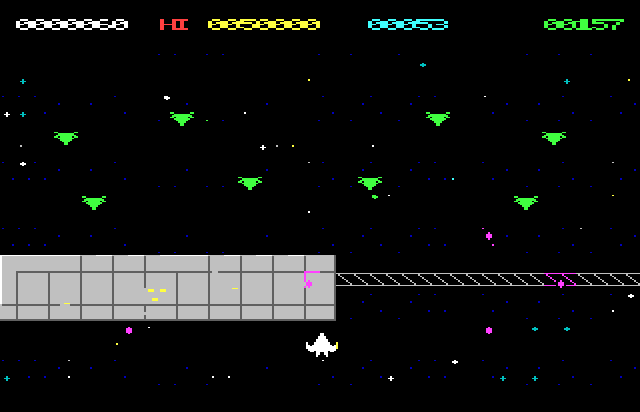

# STARHIVE (Microbee Premium Plus)

An original vertically scrolling shoot-'em-up for the Microbee Premium Plus, in development. You fly the **Hornet** starfighter against an insectoid alien Swarm. VIBED BY BPM 2026.



## Status

**Stage 1: hardware scroll test** (`release/SCRLTEST.DS8`). This disk proves the display engine on a real machine before the game is built on it.

- **Display:** 40 × 24 characters of 8 × 11 pixels. This is one of the 40-column modes proven on the Premium Plus with the MODES40 test, and the playfield runs the full width of the screen.
- **Smooth vertical scrolling:** done in hardware. The 6545's vertical total adjust (R5) slides the picture down 0–10 lines, then the start address steps back one row.
- **Steady HUD and window:** the HUD line and the window's top and bottom edges stay still while the picture slides.
- **Parallax:** distant stars move at half speed.
- **Sprites:** composed into the PCG and double-buffered, so they don't tear.

## Loading

Boot `SCRLTEST.DS8`, then type `SCRLTEST` at the `A>` prompt.

## Keys (scroll test)

| Key | Action |
|---|---|
| Q A O P, cursor keys, joystick | fly |
| SPACE | fire |
| 1 / 2 / 3 / 4 | scroll at 25 / 50 / 100 / 150 lines a second |
| 0 | stop the scroll |
| W | drone formation on/off |

The green number at the top right counts the idle time in the last frame. Bigger means more spare time.

## Building

Python 3 with numpy and Pillow.

```
python3 tools/mkdata.py                         # graphics, level, tables
cd src
python3 ../tools/zasm.py scrtest.asm --sym=../build/scrtest.sym
python3 ../tools/zasm.py loader.asm --sym=../build/loader.sym
cd ..
python3 tools/mkdisk.py                         # build/SCRLTEST.DS8
```

`tools/run.py` and `tools/prof.py` run the program in the Premium Plus model and profile it.
