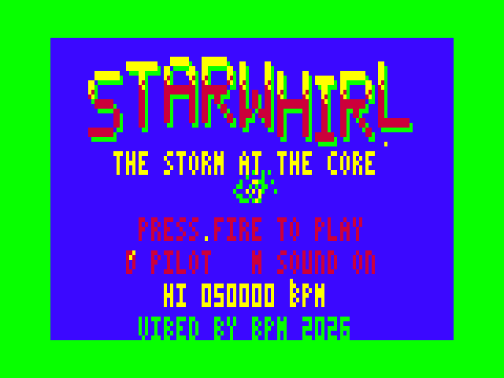
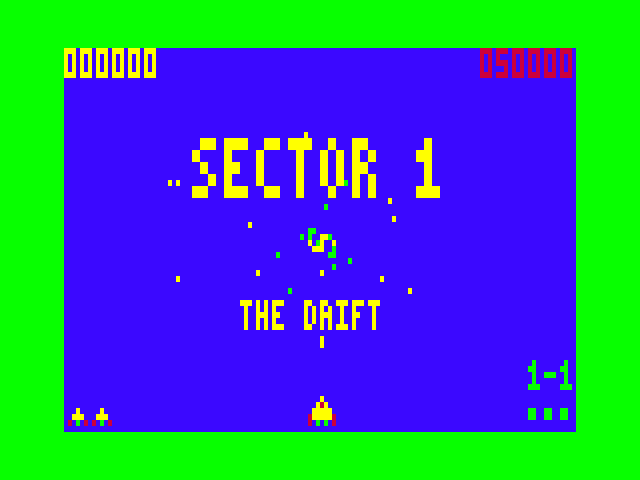

# STARWHIRL - The Storm at the Core

An original orbital arcade shooter for the **Dick Smith VZ300** with the **BennVenn SD loader + 128K expansion**, inspired by the feel of Gyruss. VIBED BY BPM 2026.

A spiral storm of stars, the Whirl, is spitting a swarm out of its eye. You ride the rim of the storm, swing around the orbit and fire inward, pushing through five sectors to the heart of the Whirl.

 

## Loading

1. Copy `release/STARWHRL.VZ` to the SD card.
2. On the VZ300 with the BennVenn SD drive, load and run it from the SD shell (VZ-DECK) or the DOS as you would any other `.VZ` (it loads at $8000-$E7A2 and starts itself).

It needs the BennVenn 128K expansion: RAM to $FFFF plus the SRAM at $4000. Without the SRAM it shows a message and stops.

## Controls

| | |
|---|---|
| Joystick, or W A S D | swing round to that side of the orbit (shortest way) |
| Z / X | turn anticlockwise / clockwise steadily |
| Fire, or SPACE | shoot (hold it to autofire) |
| P or RETURN | pause; while paused, Q quits to the title |
| M | music + effects / effects only / sound off |
| D (title) | skill: CADET (5 shields), PILOT (3), ACE (2, faster) |
| C (title / game over) | continue from the last sector reached (score starts again) |

## The game

- **5 sectors**: The Drift, The Ice Belt, Ember Reach, The Glass Nebula, The Eye of the Storm. Sectors 3 and 4 switch to the VZ's second palette (magenta space, buff/cyan/orange swarm).
- **4 waves a sector.** Formations spiral out of the storm's eye, split and loop, gather in a slowly turning holding ring, then peel off to dive across your orbit. Divers blink and you hear a warning before they come.
- **The swarm**: Glint (darts), Moth (shoots), Spinner (two hits), Hornet (rams), Mine (drifts out and bursts on the orbit), Pod (shoot it for TWIN SHOT).
- **Bosses**: The Warden, The Coral Queen, The Ember Lord, The Prism Queen, The Heart of the Whirl. Each has armour pods to strip, a core that opens and closes, and readable phases. A ring of sparks closes in before every volley.
- **Bonus round** after each boss: 40 harmless stars spiral past at 200 each. Hit all 40 for a 10,000 PERFECT bonus.
- **Shields**: hits take shields, not your ship; lose them all and you lose a ship. Extra ships at 30,000 and every 50,000 after.
- After sector 5 the Whirl starts again, faster and fiercer.

### Scoring

- **Formation bonus**: wipe out a whole formation while it's still flying in.
- **Point blank x2**: kills made close to the rim (big on screen) score double. Risky, because that's where they can hit you.
- Divers and boss pods are worth more; no damage through a boss fight earns 10,000.
- The top eight scores (with initials and the sector reached) are kept in the BennVenn SRAM's second bank. They survive reloading while the machine stays on, but not a power-off.

**Why not save scores to SD?** The VZDOS ROM can save to SD, but its write routine has no published entry point for programs. The DOS calls proven on your machine ($5F00/$5F03/$5F09) only open and read. A guessed write call could damage the card's file system, so scores stay in the battery-free SRAM. If the VZDOS write entry gets documented, the records code (`save_records` in `src/front.asm`) is the one place to change.

## Technical

- Mode 1, 128x64, 4 colours. Double-buffered: the frame is drawn in main RAM and copied to video RAM by an IM2 field-sync interrupt using generated POP/PUSH copy code in the BennVenn SRAM, so there's no snow or tearing. 25 fps target.
- Enemies, shots and stars live in polar coordinates (angle, depth) and go through a precomputed 64-radius projection table that's 4:3 aspect-correct, so the orbit is a true circle on screen. Enemy sprites have four sizes (dot to full) plus two animation frames and are pre-shifted for all four pixel phases.
- Entry flight paths are precomputed in Python (spirals, splits, loops, figure-eights) and stored as compact delta streams, mirrored at run time for split formations.
- Uses the SRAM for: screen-copy code, object arrays, the per-frame hit list, records (bank 2).
- Beeper sound runs while the CPU waits for each frame. Music is slow, separated notes, and every danger has its own cue: dive warning, mine fuse, boss charge-up, boss volley.
- **Stress test** (fire held, sound on, densest waves, 60 s): 85-91% of frames at 25 fps in every sector, the rest at 16.7 fps; no video-RAM access during the picture. When the sky is crowded, stars are thinned first so the controls stay responsive.

## Building

Needs `python3` (with no extra modules) and `sjasmplus`.

```
cd src
./build.sh            # or SJASMPLUS=/path/to/sjasmplus ./build.sh
```

This writes `build/STARWHRL.VZ`. Tools in `tools/`: `vzemu` (a test emulator with the BennVenn SRAM, a snow check, input scripts and screenshots), `stress.sh` (frame-time histogram for a busy 60 s run) and `prof.sh` (where the CPU time goes).

## Status: what's verified where

- **Emulator (vzemu) only.** Everything in this build has been run in the test emulator only, not on a real VZ300 yet: title and attract cycle, demo, all five sectors, bosses, bonus rounds, palette switch, name entry, records, pause, sound modes, game over and continue, frame timing and the snow check.
- **Carried over from earlier games proven on your hardware**: the interrupt/screen-copy engine, SRAM bank probe and records layout (ROBOGEDDON / DUEL II), joystick ports ($2C directions, $2E fire) and the keyboard matrix.
- **Not yet checked by ear**: the music and effects on the real beeper.
