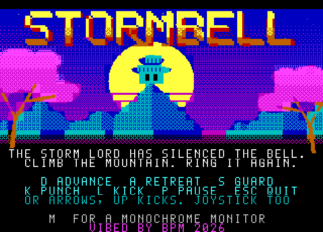
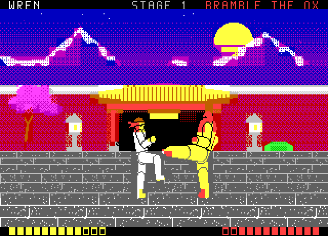
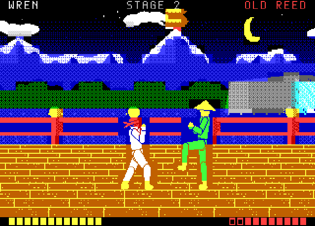
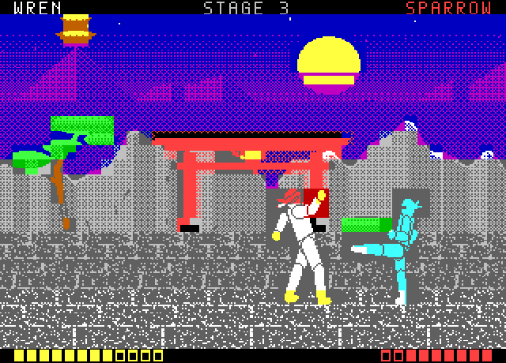
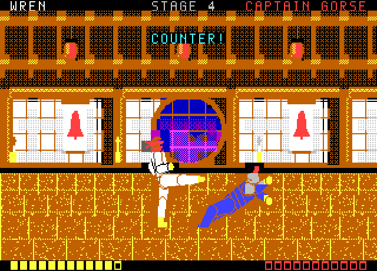
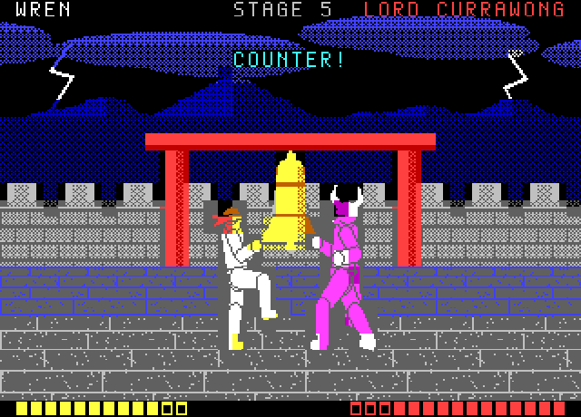
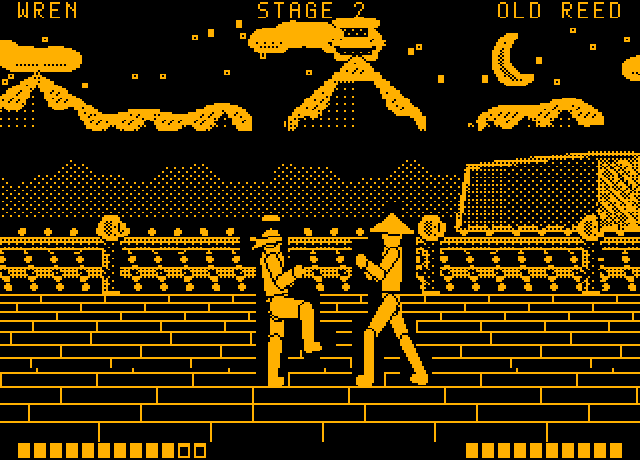
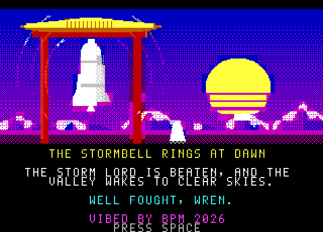

# STORMBELL
### for the Microbee Premium Plus
***"Watch. Wait. Strike."***
**VIBED BY BPM 2026**

The Storm Lord has silenced the great bell on the mountain, and the valley hasn't seen a clear sky since. **Wren**, a young fighter in a red headband, climbs the mountain road to ring it again. Five fighters stand in his way, one at each stage of the climb.

STORMBELL is a side-on duel in the spirit of the old masters. Wren runs along each stage's road while the scenery scrolls past in layers, until the next opponent comes out to meet him. They bow, the bell sounds, and then it's two fighters and a few careful steps. Every blow has a wind-up you can see coming. Spacing and timing win, and every opponent punishes button mashing in their own way. Each one has a rhythm you can learn: Bramble the Ox's huge slow kick, Old Reed's three kicks in strict time, Sparrow's dart-in double punch, Captain Gorse's guard and counter, and the Storm Lord's feints.

It fills the whole PAL screen in full Microbee colour, with a monochrome mode drawn for amber and green monitors.

| | |
|---|---|
|  |  |
|  |  |
|  |  |
|  |  |

## Features
- **Five duels on the mountain road:** the Outer Gate, the River Bridge, the Cliff Path, the Dojo Hall and the Bell Tower. Each stage has its own painted scenery, floor and opponent.
- **Opponents with a rhythm to learn:**

  | Stage | Opponent | How they fight |
  |---|---|---|
  | 1 | **Bramble the Ox** | Plods in for one huge, slow kick that your blows can't stop once it starts, then takes a long rest. |
  | 2 | **Old Reed** | Long legs and three kicks in strict time, then he backs off to breathe. |
  | 3 | **Sparrow** | Waits far off, darts in for two quick punches, darts out. |
  | 4 | **Captain Gorse** | Closes in behind his guard and punches straight back at any blow he blocks. |
  | 5 | **Lord Currawong** | The Storm Lord: all of the above, faster, with feints. |

- **A small, deliberate move set:** advance, retreat, guard, punch and kick. Every attack has a visible wind-up, a strike and a recovery where you're open. Blows that land hold the picture for a moment; a kick lands harder than a punch.
- **Scrolling roads in three layers:**
  - the sky, moon and mountains drift at a quarter speed
  - the walls, gates, railings, waterfall and trees pass at full speed
  - the perspective floor slides beneath, faster in the rows nearer you
- **Fighters drawn like people:** six puppets posed by joint angles, 20 poses each (including a four-frame run, bows and falls). Bold silhouettes tell them apart: the headband, the bald brute, the straw hat, the hood, the crested helmet, and the horned mask and cape.
- **No colour clash:** each fighter stands in a small, darker patch of the scenery, so the silhouette always reads.
- **Monochrome mode** for amber, green and white monitors (**M** on the title). The scenery is redrawn by brightness, with a black sky, outlined walls and gates, and plain floor joints.
- **A full soundscape on the beeper:**
  - swishes for punches and kicks, a crack and thump when a blow lands, and a dry wooden knock on a block
  - a whoosh and a boom for a fall, and footfalls on the road
  - a ringing gong and duel bell, thunder over the title, and three tolls of the storm bell at the end
  - title and ending tunes with a melody over a bass line, and slow, spaced plucks during a duel
- **Forgiving:** twelve health pips and a hint before each duel. After a defeat, **SPACE** puts you straight back into the same duel at full health, as often as you like.
- **The whole story:** an illustrated title, stage cards with the opponent's hint, bows before each duel, a victory screen, a pause screen with the keys, and an ending at dawn.

## Tech specs
| | |
|---|---|
| **Machine** | Microbee Premium Plus: Z80 at 3.375 MHz, 1MB RAM, 32K PCG RAM, 6545 CRTC |
| **Display** | 40 × 25 character cells of 8 × 10 pixels: 320 × 250, a full PAL picture. Uses the 40-column dot clock and the MODES 40 × 25, 8 × 10 table (R0–R11: 35 28 2C 34 1E 02 19 1C 48 09 20 09; 31 rows of 10 lines + 2 = 312 lines). 16 colours, an ink and a paper colour per cell. |
| **Screen pages** | Two 1000-cell pages in the 2K of screen, attribute and colour RAM (320 × 250 is the tallest picture that leaves room for two), flipped in the vertical blanking. Nothing is ever seen half drawn. |
| **Fighters** | Every frame is pre-cut into 8 × 10 glyphs held in the PCG: 376 to 628 glyphs per fighter, with Wren in banks 5–9 and the current opponent in banks 10–15. Drawing a fighter means pointing cells at glyphs; no pixels are moved. Where the two fighters overlap, a glyph is composed on the spot (lower pattern, upper mask, upper pattern) from a 32-glyph pool, 16 per page. Only the cells that changed are written. |
| **Scenery** | Painted in full colour with ordered dithering, then cut to two colours per cell and de-duplicated: up to 437 glyphs per stage in banks 1–4. Each road is 112 cells (896 pixels) of midground, with a far layer at a quarter speed. The eight floor strips are rewritten at each page flip so the floor slides a pixel at a time. The monochrome scenery is a second cut of the same paintings, by brightness with outlined edges. |
| **Frame rate** | Duels run at about 24 frames a second, and the road at about 17. Game logic runs a tick every two fields (25 a second). The vertical blanking is only 62 lines, so the far layer, the midground and the page flip each get one. |
| **Sound** | Continuous sound in 2.6 ms slices played between frames, from two generators. One is a toggler that flips the speaker every P + (random AND M) counts, swept slice by slice into noise, grit or tone. The other is a two-voice pulse mixer whose voices fade by narrowing their pulses (bells, the gong, music). The sound loops watch the 6545 and give way the moment a blanking begins. 13 effects, 6 tunes. |
| **Disk** | DS80 (80 tracks × 2 sides × 10 × 512 bytes). Boots to the CP/M `A>` prompt with no shell. `STORM.COM` loads 19 files (about 330K) into the RAM blocks in about 20 seconds, and the game then takes over the machine. |
| **Source** | About 5,100 lines of Z80 assembly, plus about 3,600 lines of Python tools. The tools draw all the art, pose and cut the fighters, compose the stages, write the sound, build the disk and play-test the game in an emulator. |

## RAM used
The Premium Plus's 1MB is 32 blocks of 32K. STORMBELL uses 19 of them, and about 330K of that is loaded from the disk.

| Block(s) | Contents | Size |
|---|---|---|
| 0 (upper 32K) | the program (8000–ACFF), scrolling scenery buffers (B000–B7FF), the fighters' band buffers: wanted, empty stage, each page's record, overlap map (C000–D9FF), variables (E000), stack, video window (F000) | 32K |
| 4–9 | the six fighters: 20 frames each as cell records, then each glyph's pattern and mask | 24–29K each |
| 10 | the font, HUD glyphs, the title and the ending | 17K |
| 11–15 | the five stages in colour: far and midground maps, floor strips and phases, glyphs | 11–13K each |
| 16–20 | the five stages for a monochrome monitor | 11–14K each |
| 21 | the title and the ending for a monochrome monitor | 17K |

**PCG RAM (32K, 2048 glyphs):** bank 0 holds the font, the HUD glyphs and the overlap pool. Banks 1–4 hold the stage's scenery (or the title or ending), banks 5–9 Wren, and banks 10–15 the opponent.

## To play
Boot `release/STORM.DS8` and type `STORM` at the `A>` prompt. On the title, press **M** to switch between a colour and a monochrome monitor.

| Action | Keys | Joystick |
|---|---|---|
| Advance | D or → | right |
| Retreat | A or ← | left |
| Guard (hold) | S or ↓ | down |
| Punch | K | fire |
| Kick | L or ↑ | up |
| Pause | P | |
| Quit to the title | ESC | |
| Start, try again | SPACE | fire |
| Run along the road between duels | hold D | right |

More pictures: [gameplay](screenshots/gameplay/) · [screens](screenshots/info/) · listen: [sound demo](docs/stormbell-sound-demo.wav)
