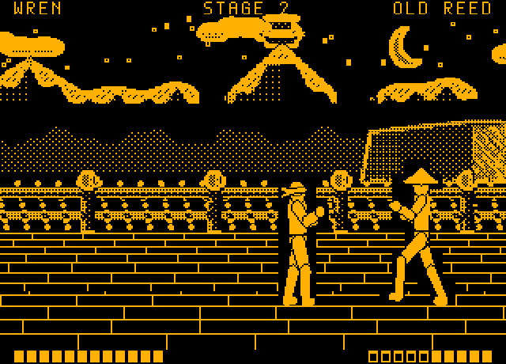
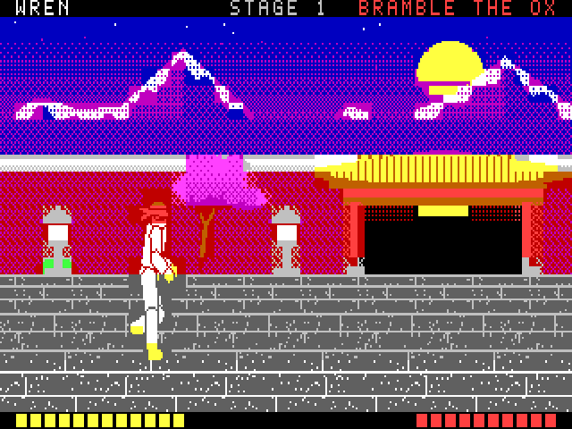
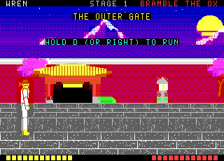
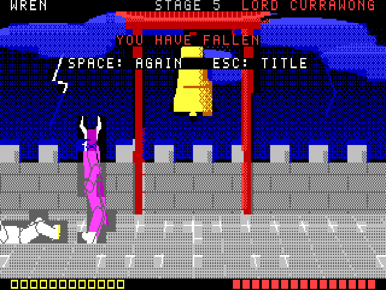
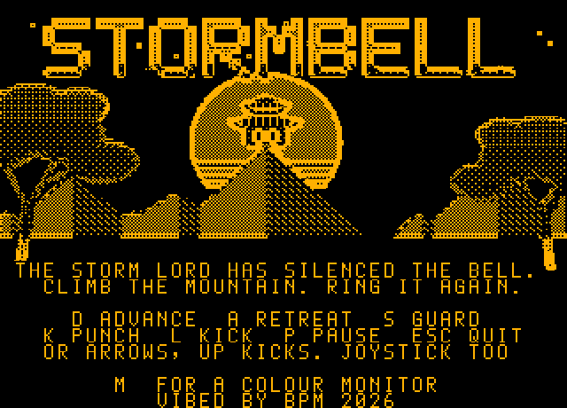

# STORMBELL

**An original martial arts duelling game for the Microbee Premium Plus.**
*VIBED BY BPM 2026*


The Storm Lord has silenced the great bell on the mountain, and the valley
has had no clear sky since. **Wren**, a young fighter in a red headband,
climbs the mountain road to ring it again. Five fighters stand in the way,
one at each stage of the climb.

It plays like a side-on duel from the old days. Wren runs along each
stage's road, the scenery scrolling past in layers, until the next
opponent comes out to meet him. Then it's two fighters, a few deliberate
steps, and blows you can see coming. Spacing and timing win.
Every opponent has a rhythm you can learn, and every one punishes button
mashing in its own way.

| | |
|---|---|
|  |  |
|  |  |
|  |  |

## To play

`release/STORM.DS8` is a double-sided 80-track Microbee disk image (DS80 / DS8).
Boot it, and at the `A>` prompt type:

```
STORM
```

and press RETURN. The game takes about 20 seconds to load.

Needs a **Microbee Premium Plus** (or a Premium with 1 MB RAM and 32K PCG RAM).

**Colour or monochrome monitor:** press **M** on the title screen to switch.
With a monochrome monitor (amber, green or white) the scenery is drawn
for one that shows only lit pixels: a black sky, outlined walls, gates and
railings, the floor's seams without speckle, and the moon, snow and clouds
bright. Press M again to go back to colour.

| Colour | Monochrome (M on the title) |
|---|---|
|  |  |

## Controls

The keys are shown on the title screen and on the pause screen.

| | Keys | Joystick |
|---|---|---|
| Advance | **D** or → | right |
| Retreat | **A** or ← | left |
| Guard (hold) | **S** or ↓ | down |
| Punch | **K** | fire |
| Kick | **L** or ↑ | up |
| Pause | **P** | |
| Quit to the title | **ESC** (then ESC again) | |
| Start, try again | **SPACE** | fire |
| Colour / monochrome monitor (title screen) | **M** | |

Between duels, hold **D** (or →, or the joystick right) to run along the
road.

## How a duel works

* **Every attack has three parts.** A wind-up you can see, a strike that
  lands if the other fighter is in reach, and a recovery when the attacker
  is open. The punch is quick and short; the kick is slower and reaches
  further, and hits harder.
* **A raised guard stops any blow** and knocks the attacker back into a long
  recoil. That is your moment to answer. A guard can't be held forever:
  after about two seconds your arms tire and drop for a moment.
* **Catch someone winding up** and your blow is a *counter*: one extra point
  of damage.
* **Whiff, and you pay.** A blow that hits nothing overbalances you and adds
  to your recovery. That is how every opponent catches mashers.
* Each fighter steps one pace at a time, and a step takes a moment. Being one
  pace outside someone's reach is where most fights are won.
* Wren has 12 points of health. Lose a duel and **SPACE** puts you straight
  back into the same duel at full health. There is no limit.

## The opponents

| Stage | Opponent | Rhythm | The way through |
|---|---|---|---|
| 1. The Outer Gate | **Bramble the Ox** | Plods in, one huge slow kick, a long rest. Your blows don't stop his swing once it starts. | Step back out of the kick, then strike while he recovers. |
| 2. The River Bridge | **Old Reed** | Long legs. Three kicks in strict time, then he backs off to breathe. | Guard the first kick, then step in while he resets. |
| 3. The Cliff Path | **Sparrow** | Waits far off, darts in for two quick punches, darts out. | Guard both punches, then answer. |
| 4. The Dojo Hall | **Captain Gorse** | Closes behind his guard and punches straight back at any blow he blocks. | Make him attack first. Never swing into his guard. |
| 5. The Bell Tower | **Lord Currawong** | The Storm Lord: all of the above, faster, with feints. | Watch, wait, and punish only what you're sure of. |

## What's new in 1.3

* **A monochrome mode** for amber, green and white monitors: **M** on the
  title. On a monochrome monitor only lit pixels show, so the colour
  scenery's dithers turn every sky and wall into texture. The mono scenery
  is drawn from the same paintings by brightness instead: dark colours
  black, bright ones lit, mid-tones a sparse dither, and an outline on the
  bright side of every brightness step, so a red gate still has an edge
  against a black doorway. The floors keep their seams and lose their
  speckle. These are separate stage and picture files in RAM blocks 16–21,
  so switching is instant. Loading takes about 20 seconds now.
* **Fixed: the opponent stayed on screen after a retry.** Starting a duel
  again forgot where the fighters had last been drawn, so the old fallen
  Wren and the old opponent were never painted over. A retry now redraws
  both screen pages' whole fighting band once.

## What's new in 1.2

* **A full PAL picture.** The game now uses the 40 × 25 table from MODES
  with **8 × 10 cells: 320 × 250**, which fills a PAL screen. It's the
  tallest picture that still leaves room for two screen pages in the 2K of
  screen RAM. The 6545 table is 31 rows of 10 lines plus 2 (312 lines),
  with the 40-column dot clock. Every glyph, font letter and floor strip
  is now 10 lines tall.
* **Taller fighters.** The fighters are drawn 15% taller to fill the
  10-line band. That also fixes their shape: they had been drawn for
  pixels wider than the 40-column mode really has, so they looked squat.
  Wren now has PCG banks 5–9, the opponent banks 10–15 and the scenery
  banks 1–4, so nothing had to be simplified to fit.
* **A new sound engine.** Sound now plays continuously between frames, in
  2.6 ms slices, instead of one short burst a tick. There are two
  generators: a noise/tone toggler swept slice by slice, and a two-voice
  pulse mixer with fading voices. They give swishes for punches and kicks,
  a crack and thump when a blow lands (heavier for a kick), a dry wooden
  knock on a block, a whoosh and a boom for a fall, footfalls on the road,
  a struck gong and duel bell that ring and fade, thunder on the title,
  and three tolls of the storm bell at the end. The title and ending tunes
  have a melody over a bass line. A blow that lands also holds the picture
  for a moment (one tick for a punch, two for a kick).
* **Sound gives way to the screen.** The blanking between pictures is now
  only 62 lines (about 4 ms). So while a page flip or scenery copy is
  waiting, the sound loops check the 6545 every few samples and stop the
  moment the blanking starts. The road still runs at about 17 frames a
  second, and duels at about 24. When neither fighter moves, the duel
  frame isn't redrawn at all, which leaves the whole tick to the sound.
* Listen: `docs/stormbell-sound-demo.wav` (recorded from the emulator's
  speaker: the title, a stage 1 duel, then the bell tolling).

## What's new in 1.1

* **The fighters stand like people.** Their legs used to be placed by
  pointing at where the feet should go, and the knees could fold backwards,
  like a faun's. They are now posed by joint angles, the way Tiger Gate
  draws its fighters, so knees always bend forwards. There's a new
  four-frame run.
* **The road scrolls.** As in Tiger Gate, Wren runs along each stage's
  road, with the far layer drifting at a quarter speed, the midground
  passing at full speed and the floor sliding beneath him. Then the next
  opponent runs in to meet him. After a win, hold D to run on.
* **Faster running.** The midground rows now go to video RAM straight
  from where they are composed, instead of being copied to a buffer
  first. A scrolling frame takes three fields instead of four, so the run
  is smoother: about 17 frames a second, against 12 before.
* Bramble shrugs off a blow sooner (a heavy man staggers less), so a
  button-masher can't hold him in a stagger.

## Test results (v1.3, 14 Nov 2026)

**Emulator** (`tools/emu`, Premium Plus model): `release/STORM.DS8` booted
from its own boot sector to CP/M's `A>`, `DIR` listed the files, and
`STORM` set up the 320 × 250 display about 20 seconds after it was typed.
The scripted player (0.2 s reactions) then ran each road and played from
the title to the ending twice, once in each mode:

| Stage | Opponent | Colour | Monochrome |
|---|---|---|---|
| 1 | Bramble the Ox | won, 9 / 12 health left | won, 9 / 12 |
| 2 | Old Reed | won, 1 / 12 | won, 12 / 12 |
| 3 | Sparrow | lost once, then won, 2 / 12 | won, 2 / 12 |
| 4 | Captain Gorse | won, 11 / 12 | won, 11 / 12 |
| 5 | Lord Currawong | won, 2 / 12 | won, 3 / 12 |

Also checked:

* After a defeat, **SPACE** restarts the same duel at full health, and the
  screen shows only the two fighters: nothing is left from before.
* **M** on the title switches to the monochrome scenery and back; every
  stage, the title and the ending load in both modes.
* A button-masher beats Bramble only 1 time in 4.
* Frame rates: duels about 24 frames a second, the road about 17.
* Every sound effect recorded from the speaker: no silence longer than
  15 ms inside any of them.

 

 

**Real hardware:** not tested yet. It uses the same 40-column set-up,
loader and disk format as FRILLSEEKER and Dracula's Castle II, which run
on a real Premium Plus.

## Building it

You need Python 3 with **numpy** and **Pillow**, and **gcc** (only for the
test emulator). From this folder:

```
python3 tools/build.py
```

That draws every picture and fighter from the scripts in `tools/`, writes the
sound tables, assembles the game and its loader with the included assembler
(`tools/zasm.py`), and writes the disk to `build/STORM.DS8`. It then reads
every file back off the disk image to check it.

| Step | Script | Output |
|---|---|---|
| Font and the seven pictures | `tools/art.py` | `GFX0.BNK`, `GFX1.BNK` |
| The six fighters, 16 frames each | `tools/fighters.py` | `F0.BNK` … `F5.BNK`, `src/ftab.inc` |
| Sound effects and tunes | `tools/music.py` | `src/snd.inc` |
| The game | `src/main.asm` | `STORM.BIN` (loads at 8000h) |
| The CP/M loader | `src/loader.asm` | `STORM.COM` |
| The disk | `tools/build_disk.py` | `STORM.DS8` |

The CP/M system tracks and `CCP.SYS` in `resources/` come from the earlier
Microbee games in this repository (the same boot as FRILLSEEKER and
Dracula's Castle II).

## Testing it

```
python3 tools/boottest.py            # boot the disk, DIR, run STORM, screenshot the title
python3 tools/playtest.py out/       # boot and play all five duels to the ending
python3 tools/trials.py 4 good 4     # fight one opponent several times
```

The tests run the game in `tools/emu`, a Premium Plus model (Z80, 6545, PCG,
colour RAM, 1 MB banking, the DS80 disk controller) shared with the other
Microbee games here. The Microbee boot ROM isn't in the repository, so
`tools/bootrom.py` does its one job (read the boot sector, and serve two
sector reads to it). From there the disk's own boot sector, CP/M, `STORM.COM`
and the game all run as they would on the machine.

`tools/playtest.py` plays with a scripted player that reads the fight the
way a person reads the screen, with a person's reaction time (0.2 s). It
also has a "masher" that holds advance and hammers punch and kick, to check
that mashing loses.

## What's inside

* **The 40-column mode:** 40 × 25 cells of 8 × 10, 320 × 250, a full PAL
  picture: the 40-column dot clock, and the 40 × 25 8 × 10 table from
  BPM's MODES test (R4 = 1Eh, R5 = 2, R7 = 1Ch, R9 = R11 = 9).
* **Fighters drawn by pointing cells at glyphs.** Every frame of every
  fighter is pre-cut into 8 × 10 glyphs held in the PCG (Wren in banks 5–9,
  the current opponent in banks 10–15). Drawing a fighter is just setting
  each cell's glyph, bank and ink. Nothing is erased and no pixels are moved.
* **No colour clash on the fighters.** A fighter's cell takes the fighter's
  ink over a dark shade of the scenery's paper, so a fighter stands in a
  small plain, darker patch of the background instead of mixing colours
  with it, and the silhouette always stands out.
* **Where the two fighters touch**, a glyph is made on the spot for that cell
  (the lower fighter's pattern, the upper one's mask cut out, the upper one
  laid over it), from a small pool in the font bank.
* **Two screen pages.** The video RAM holds two 1000-cell pages. The game
  draws the hidden page, comparing what it wants with what the page already
  shows and writing only the cells that differ, and swaps pages in the
  vertical blanking. Nothing is ever seen half drawn.
* **Scrolling scenery in three layers**, as in Tiger Gate on the VZ300.
  The far layer (sky, moon, mountains) moves a cell at a time at a quarter
  of the running speed. The midground (walls, gates, railings, waterfall,
  trees) moves a cell at a time with the run. The perspective floor's
  cells never move: its glyphs are rewritten at each page flip so the floor
  slides a pixel at a time, faster in the rows nearer the viewer. The far
  and midground rows are copied in the vertical blanking, so they never tear.
* **The pictures and stages** are painted in full colour with ordered
  dithering. Each cell is then cut down to the two colours it can show and
  de-duplicated into glyphs: the title and ending, or each stage's
  scenery, into PCG banks 1–4.
* **The fighters are puppets**, posed by joint angles the way Tiger Gate
  draws its fighters, so knees bend the way knees do. One skeleton, twenty
  poses (including a four-frame run), six builds:
  every move reads the same whoever throws it, and the silhouettes (the
  headband, the bald brute, the straw hat, the hood, the crested helmet,
  the horned mask and cape) tell them apart.
* **Sound** is the speaker, played continuously in 2.6 ms slices whenever
  the game is waiting for its next frame. A toggler flips the speaker
  every P + (random AND M) counts, and sweeping P and M slice by slice
  makes noise, grit and tone. A two-voice pulse mixer plays the music and
  the ringing gong and bells, its voices fading by narrowing their pulses.
  `tools/soundtest.py` records every effect from the emulator's speaker as
  a WAV with a spectrogram.

Source: `src/` (Z80 assembly) and `tools/` (Python). The Z80 core in
`tools/emu` is third-party code used only for testing; see the repository
README.
