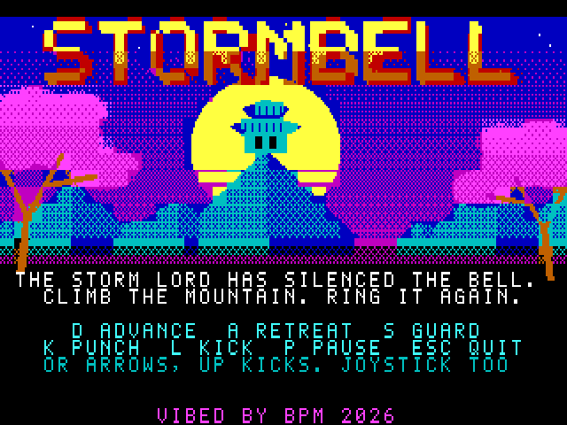
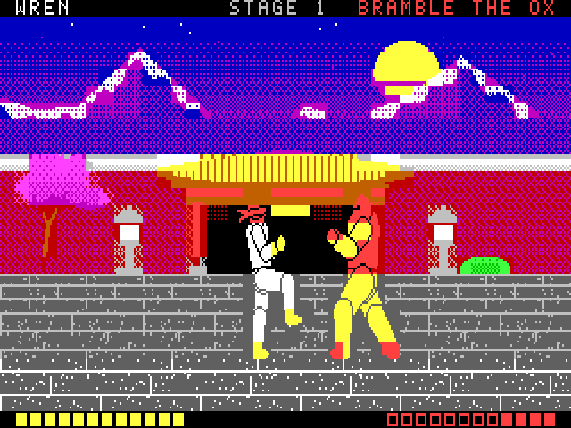
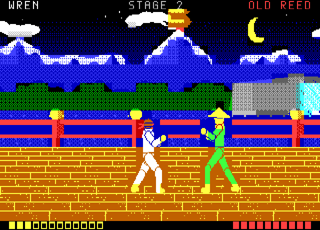
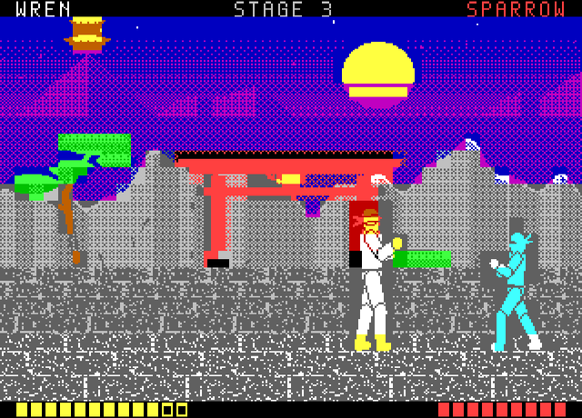
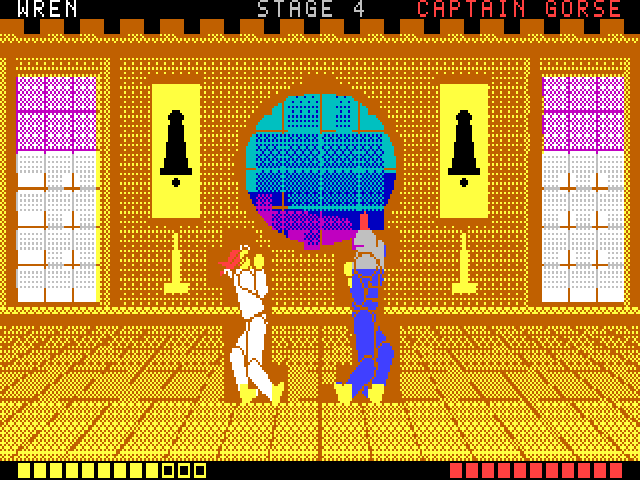
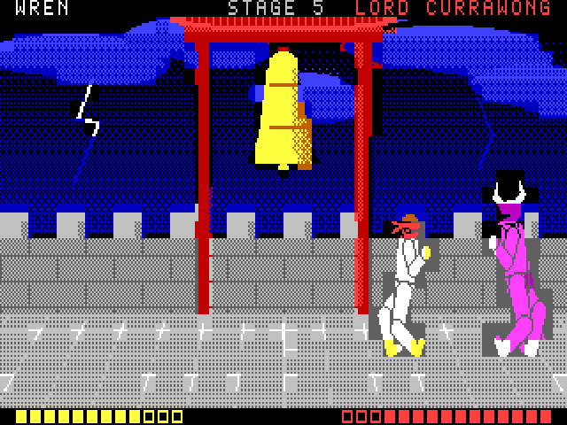
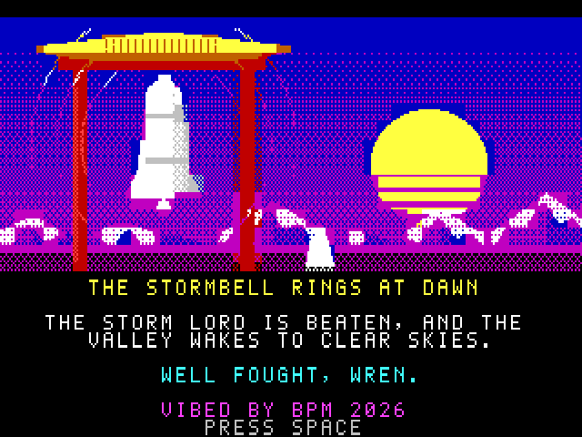

# STORMBELL

**An original martial arts duelling game for the Microbee Premium Plus.**
*VIBED BY BPM 2026*



The Storm Lord has silenced the great bell on the mountain, and the valley
has had no clear sky since. **Wren**, a young fighter in a red headband,
climbs the mountain road to ring it again. Five fighters stand in the way,
one at each stage of the climb.

It plays like a side-on duel from the old days: two fighters, a few
deliberate steps, and blows you can see coming. Spacing and timing win.
Every opponent has a rhythm you can learn, and every one punishes button
mashing in its own way.

| | |
|---|---|
|  |  |
|  |  |
|  |  |

## To play

`release/STORM.DS8` is a double-sided 80-track Microbee disk image (DS80 / DS8).
Boot it, and at the `A>` prompt type:

```
STORM
```

and press RETURN. The game takes about 12 seconds to load.

Needs a **Microbee Premium Plus** (or a Premium with 1 MB RAM and 32K PCG RAM)
and a colour monitor. It also reads on an amber monochrome monitor: the
lighter colour of every cell is always the drawn one.

## Controls

The keys are shown on the title screen and on the pause screen.

| | Keys | Joystick |
|---|---|---|
| Advance | **D** or → | right |
| Retreat | **A** or ← | left |
| Guard (hold) | **S** or ↓ | down |
| Punch | **K** | fire |
| Kick | **L** or ↑ | up |
| Pause | **P** | |
| Quit to the title | **ESC** (then ESC again) | |
| Start, try again | **SPACE** | fire |

## How a duel works

* **Every attack has three parts.** A wind-up you can see, a strike that
  lands if the other fighter is in reach, and a recovery when the attacker
  is open. The punch is quick and short; the kick is slower and reaches
  further, and hits harder.
* **A raised guard stops any blow** and knocks the attacker back into a long
  recoil. That is your moment to answer. A guard can't be held forever:
  after about two seconds your arms tire and drop for a moment.
* **Catch someone winding up** and your blow is a *counter*: one extra point
  of damage.
* **Whiff, and you pay.** A blow that hits nothing overbalances you and adds
  to your recovery. That is how every opponent catches mashers.
* Each fighter steps one pace at a time, and a step takes a moment. Being one
  pace outside someone's reach is where most fights are won.
* Wren has 12 points of health. Lose a duel and **SPACE** puts you straight
  back into the same duel at full health. There is no limit.

## The opponents

| Stage | Opponent | Rhythm | The way through |
|---|---|---|---|
| 1. The Outer Gate | **Bramble the Ox** | Plods in, one huge slow kick, a long rest. Your blows don't stop his swing once it starts. | Step back out of the kick, then strike while he recovers. |
| 2. The River Bridge | **Old Reed** | Long legs. Three kicks in strict time, then he backs off to breathe. | Guard the first kick, then step in while he resets. |
| 3. The Cliff Path | **Sparrow** | Waits far off, darts in for two quick punches, darts out. | Guard both punches, then answer. |
| 4. The Dojo Hall | **Captain Gorse** | Closes behind his guard and punches straight back at any blow he blocks. | Make him attack first. Never swing into his guard. |
| 5. The Bell Tower | **Lord Currawong** | The Storm Lord: all of the above, faster, with feints. | Watch, wait, and punish only what you're sure of. |

## Building it

You need Python 3 with **numpy** and **Pillow**, and **gcc** (only for the
test emulator). From this folder:

```
python3 tools/build.py
```

That draws every picture and fighter from the scripts in `tools/`, writes the
sound tables, assembles the game and its loader with the included assembler
(`tools/zasm.py`), and writes the disk to `build/STORM.DS8`. It then reads
every file back off the disk image to check it.

| Step | Script | Output |
|---|---|---|
| Font and the seven pictures | `tools/art.py` | `GFX0.BNK`, `GFX1.BNK` |
| The six fighters, 16 frames each | `tools/fighters.py` | `F0.BNK` … `F5.BNK`, `src/ftab.inc` |
| Sound effects and tunes | `tools/music.py` | `src/snd.inc` |
| The game | `src/main.asm` | `STORM.BIN` (loads at 8000h) |
| The CP/M loader | `src/loader.asm` | `STORM.COM` |
| The disk | `tools/build_disk.py` | `STORM.DS8` |

The CP/M system tracks and `CCP.SYS` in `resources/` come from the earlier
Microbee games in this repository (the same boot as FRILLSEEKER and
Dracula's Castle II).

## Testing it

```
python3 tools/boottest.py            # boot the disk, DIR, run STORM, screenshot the title
python3 tools/playtest.py out/       # boot and play all five duels to the ending
python3 tools/trials.py 4 good 4     # fight one opponent several times
```

The tests run the game in `tools/emu`, a Premium Plus model (Z80, 6545, PCG,
colour RAM, 1 MB banking, the DS80 disk controller) shared with the other
Microbee games here. The Microbee boot ROM isn't in the repository, so
`tools/bootrom.py` does its one job (read the boot sector, and serve two
sector reads to it). From there the disk's own boot sector, CP/M, `STORM.COM`
and the game all run as they would on the machine.

`tools/playtest.py` plays with a scripted player that reads the fight the
way a person reads the screen, with a person's reaction time (0.2 s). It
also has a "masher" that holds advance and hammers punch and kick, to check
that mashing loses.

## What's inside

* **The 40-column mode:** 40 × 25 cells of 8 × 8, 320 × 200, set up as
  FRILLSEEKER proved on a real Premium Plus (the 40-column dot clock and
  BPM's MODES40 6545 table).
* **Fighters drawn by pointing cells at glyphs.** Every frame of every
  fighter is pre-cut into 8 × 8 glyphs held in the PCG (Wren in banks 5–8,
  the current opponent in banks 9–15). Drawing a fighter is just setting
  each cell's glyph, bank and ink. Nothing is erased and no pixels are moved.
* **No colour clash on the fighters.** A fighter's cell keeps the scenery's
  paper colour and takes the fighter's ink, so a fighter stands in a small
  plain-coloured patch of the background instead of mixing colours with it.
* **Where the two fighters touch**, a glyph is made on the spot for that cell
  (the lower fighter's pattern, the upper one's mask cut out, the upper one
  laid over it), from a small pool in the font bank.
* **Two screen pages.** The video RAM holds two 1000-cell pages. The game
  draws the hidden page, comparing what it wants with what the page already
  shows and writing only the cells that differ, and swaps pages in the
  vertical blanking. Nothing is ever seen half drawn.
* **The pictures** are painted in full colour with ordered dithering, then
  each cell is cut down to the two colours it can show, de-duplicated into
  at most 512 glyphs (PCG banks 1–4).
* **The fighters are puppets.** One skeleton, sixteen poses, six builds:
  every move reads the same whoever throws it, and the silhouettes (the
  headband, the bald brute, the straw hat, the hood, the crested helmet,
  the horned mask and cape) tell them apart.
* **Sound** is the speaker, a few milliseconds of tone or noise a tick:
  thumps, whooshes, a clack on a block, a gong, and slow spaced tunes
  ("dink, dink-dink") that leave the game time to run.

Source: `src/` (Z80 assembly) and `tools/` (Python). The Z80 core in
`tools/emu` is third-party code used only for testing; see the repository
README.
