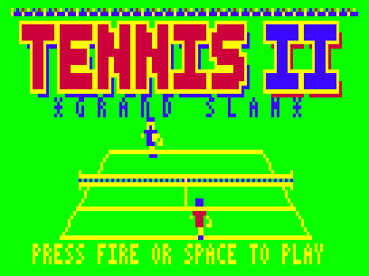
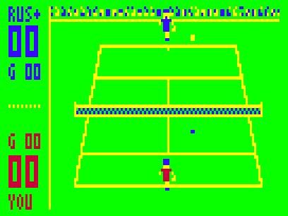
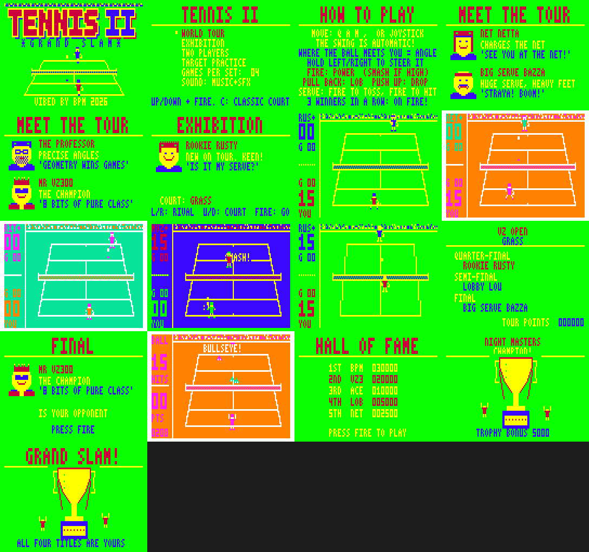

# TENNIS II — GRAND SLAM

Sequel to the VZ200/VZ300 game *TENNIS*, for the Dick Smith VZ300 / VZ200 with the **BennVenn SD loader + 128K**.
ViBED by BPM 2026. Version 1.0. Original code, graphics and music. Nothing from the original game is included.







## Play it

Copy `release/TENNIS2.VZ` to the SD card and run it from the BennVenn SD loader.
- It's a single type F1 binary. It loads at $8000 (to $DDDC) and runs from $8000. There are no other files.
- It needs the **128K expansion** (RAM up to $FFFF).

### Controls

| Action | Keyboard (player 1) | Joystick |
|---|---|---|
| Move | Q up · A down · M left · `,` right | either stick |
| Power shot / smash | SPACE (tap just before the ball arrives) | fire |
| Lob / drop shot | pull back / push forward as you hit | same |
| Steer the shot | hold left / right as you hit | same |
| Serve | SPACE to toss, SPACE again to hit | fire |
| Pause (X quits while paused) | P | — |
| Sound: music+SFX → SFX only → off | S | — |
| Menus | up/down, SPACE/fire or RETURN | stick + fire |

In two-player mode, player 1 uses joystick 1 or Q A M , SPACE, and player 2 uses joystick 2 or I J K L + H (or `;`).

## From the original to the sequel

**What the original does.** The 1980s game is 6.5K of machine code that loads at $7AE9 and makes no ROM calls. Its menu offers Demonstration, Human vs Human (joysticks), Joystick vs Computer and Keyboard vs Computer.
- The court is a green Mode 1 court with yellow lines and stepped "perspective" side lines.
- A blue player at the top plays a red player at the bottom, each a little figure with a yellow racket.
- The swing is automatic. Where the ball meets you sets the angle, and your court position sets the depth.
- The scoreboard runs down the left side, there's 15-30-40 scoring, and players change ends.

**Kept for the sequel:** the green court with blue and red players, the automatic swing with contact-point aiming, the vertical scoreboard down the left, change of ends, and all four of the original's modes.

**New:**
- **Real serving:** toss, then strike. The higher you hit, the harder the serve. There are faults, double faults, lets and aces.
  - Let the toss drop twice and the game serves for you.
- **Full scoring:**
  - deuce and advantage, games, sets and tie-breaks
  - change of ends after odd games
  - umpire calls: FIFTEEN-LOVE, THIRTY ALL, DEUCE, ADVANTAGE…, BREAK POINT, SET POINT, MATCH POINT
- **Shot control:**
  - power drives on fire, and **smashes** when the ball is high near the net
  - lobs, drop shots and volleys
  - steering left or right as you hit
  - a badly timed swing sends the ball wide or into the net
- **Ball physics:** the ball has height, a shadow and a bounce puff. Net cords dribble over. The line judge's flag goes up for OUT.
- **ON FIRE:** hit three aces or winners without losing a point in between, and your power shots blaze with a flame trail.
- **Four surfaces,** each with its own palette and bounce:
  - Grass (fast and low)
  - Clay (orange, slow and high)
  - Hard court (cyan)
  - Night Indoor (blue)

  Player sprites are recoloured on the fly for each surface, and again when ends change.
- **WORLD TOUR:** four tournaments (VZ Open, Paris Clay Cup, Hard Court Classic, Night Masters).
  - Each runs quarter-final → semi-final → final, with a bracket screen and an opponent card before every match.
  - The opponents get tougher each tournament.
  - Each title brings a trophy ceremony, and there's a **Target Practice** bonus round between tournaments.
  - Win all four for the **Grand Slam** ending.
  - Tour points go into the Hall of Fame.
- **Eight computer opponents,** each with a portrait and a style (speed, reach, reactions, accuracy, power, net-rushing, serve, lobbing):

  | Opponent | Style |
  |---|---|
  | Rookie Rusty | new on tour |
  | Lobby Lou | loves a high lob |
  | Net Netta | charges the net |
  | Big Serve Bazza | huge serve, heavy feet |
  | Dusty the Wall | gets everything back |
  | Rocket Rita | fast and furious |
  | The Professor | precise angles |
  | Mr VZ300 | the champion |
- **Exhibition:** pick any opponent and court. **Two Players:** head to head. **Target Practice:** 20 balls from a ball machine, hit the cones (500 each).
- **Easter egg:** press **C** on the main menu to unlock the **CLASSIC 1984** court in Exhibition. It recreates the original's stepped court and full-length centre line.
- **Options:** 2, 4 or 6 games per set; music+SFX, SFX only, or off.

**Presentation:**
- **Title screen (Mode 1):** a big TENNIS II logo and two little players rallying on a perspective court, with rotating messages underneath.
- **Attract cycle:** title → How to Play → Meet the Tour → a computer v computer demo on a random surface → Hall of Fame. Start works at any point.
- **In game:** the crowd strip cheers on aces and winners, popups (WINNER!, ACE!, OUT!, SMASH!, BULLSEYE!) appear by the ball, and banner calls show over the far court.
- **Hall of Fame:** 5 entries with 3-letter initials.
- **Sound:** the two-voice pin-pulse beeper engine from Ghost Hunter 2 / Penguin 2, with short separated notes for that gritty sound. All tunes are original:
  - Title theme ("Centre Court Strut"), info and bracket shuffle, practice loop, Grand Slam march
  - Jingles: start, point, game, set, match, defeat, trophy, change of ends, ON FIRE, hi-score
  - 16 effects: racket "pok", power drive, smash, bounce, net, net cord, line call, crowd roar, ball machine, and more

  `media/` has the emulator's speaker output for the title music and a stretch of play.

## Hardware notes

- **Loading:** one .VZ from the BennVenn SD loader, loading low at $8000. This is the same load and run pattern as Xevious v1.2 and Cybernoid v1.1, which work on your machine.
  - There are no ROM calls, and the DOS isn't needed after loading.
  - Interrupts stay off (DI throughout). Frame timing comes from polling field sync ($68xx bit 7).
- **Memory:**

  | Range | Use |
  |---|---|
  | $67C0–$67FF, SRAM **bank 3** | Hall of Fame + options + Classic unlock (signature + checksum) |
  | $7800–$7ADF | variables |
  | $7C00–$7DFF | VRAM commit queue, recolour table |
  | $7FFE | stack (grows down) |
  | $8000–$DDDC | code and data (the .VZ, 24,029 bytes) |
  | $DDDD–$F126 | sprite table + shifted, recoloured sprites (built at run time) |
  | $F800–$FFFF | background buffer |

- **Records:** kept in SRAM bank 3 (`OUT ($37),3`), so they survive reloading the game but not power-off.
  - Your BIX bank tests showed that port $37 values 1 and 3 hold separate data. The block sits at the very top of the bank, clear of Dracula's Castle II's save slot.
  - At start-up the game probes the bank switch: it writes one byte, checks it, then restores it. It only saves if bank 1 is untouched and bank 3 holds the byte. Otherwise saving is simply off.
  - The mapping is always put back to 1 (the DOS) straight afterwards.
- **Snow-free drawing:** VRAM is written only in the vblank window after field sync, through the Penguin 2 commit queue (now able to split rectangles too big for one frame) and POP-drawn sprites. Popup text goes into the backdrop and is restored afterwards, so it costs nothing in vblank.
- **Joysticks:**
  - Joystick 1 is read on $2E/$2D/$2C. Joystick 2 is read on $2B/$27, with its directions also from $29 (as your interface needs).
  - In 1-player games, either stick or the keyboard works.
  - "All four directions at once" is ignored, so having no interface plugged in reads as no input.

## Build

Needs Python 3 with Pillow, plus sjasmplus (https://github.com/z00m128/sjasmplus) if you have it. Otherwise the bundled Python assembler `tools/zasm.py` is used. It's the Dracula's Castle II assembler, extended with SAVEBIN/DEVICE/DISPLAY and `a : b` statements, and it rebuilds Penguin 2 byte-identical to its sjasmplus build.

```
cd src
./build.sh          # -> ../build/TENNIS2.VZ (a finished copy is in release/)
```

- `gen.py` (with `art.py`, `pics.py` and `music.py`) writes `data.inc`. That holds the font, sprite sources, the two court backdrops (standard + Classic 1984, in logical colours), the projection tables, title, trophy, the nine portraits and all the music.
- `mkvz.py` wraps `tennis2.bin` into the .VZ file.

`tools/vzemu/` is the small headless VZ300 emulator from Penguin 2 (superzazu/z80 CPU core, MIT licence, see `LICENSE-z80`). Build it with `gcc -O2 -o tools/vzemu/vzemu tools/vzemu/vzemu.c tools/vzemu/z80.c`.
- **New for this project:**
  - `-bennvenn`: a model of the SRAM banks on port $37
  - `-loadsram` / `-savesram`: load or save those banks
  - `-trace addr:len:file`: dumps memory every frame
- **Test scripts:**
  - `tools/why.py`: how points end in a computer v computer soak
  - `tools/trace.py`: ball and player traces before each point
  - `tools/fuzz.py`: random-input soak
  - `tools/media.py`: screenshots, GIFs and audio
  - `tools/disorig.py`: disassembles your original TENNIS.VZ (kept only on your PC)

## Testing

Tested **in the emulator only:**
- Every menu path, all four surfaces + Classic, exhibition, two players, target practice, the demo and the attract cycle.
- A full World Tour through to the Grand Slam ending and the trophy ceremonies.
- A tour loss → initials → Hall of Fame.
- Records saved to and reloaded from the emulated SRAM bank 3. With no card, the probe disables saving and changes nothing.
- 4 × 60,000 frames of random input over every mode: no crashes, no stack growth, and no VRAM access during the visible picture apart from the start-up screen clear. All drawing finished before the picture starts (latest: scanline 78 of 81).
- Computer v computer soaks average about 7 shots per point. A random key-masher returned 18 balls in one exhibition.

**Not yet checked on real hardware:**
- the real machine's top-border length (the emulator assumes 25 lines; drawing ends at most ~3 lines before the picture starts)
- the SRAM bank-3 records save
- speaker volume and joystick feel on your interface
- the sprite build when switching surfaces (about a quarter of a second, during which the screen holds)
