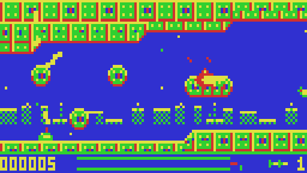
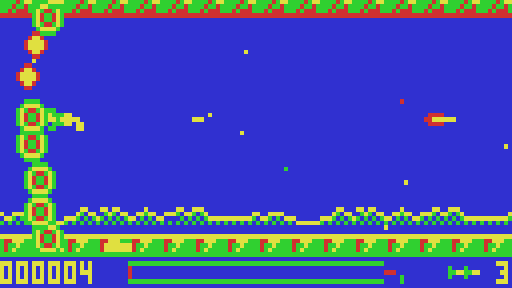

# VZ-TYPE

An original horizontally scrolling shoot-'em-up for the Dick Smith VZ300: eight stages, huge bosses, a charge beam, a detachable pod and helper satellites. Version 1.4.2.

Directed and playtested by BPM. Code, graphics and music by Claude (Anthropic). ViBED by BPM, 2026.

 

## You need
- A VZ300 with the BennVenn SD loader and 128K RAM expansion

## Loading
Copy `release/VZTYPE.VZ` to the SD card and run it from the BennVenn SD loader. It's a single file with no extra data files.

## Folders
- `release/`: the game
- `src/`: Z80 source and Python build tools (`build.sh` builds everything)
- `screenshots/`: the title screen and every stage and boss

## Original notes

```
VZ-TYPE  (v1.4.2)
=================
An original horizontally scrolling shoot-'em-up for the Dick Smith VZ300
with the BennVenn 128K RAM expansion and SD loader.

Directed and playtested by BPM - code, graphics and music by Claude (Anthropic)


VZ-TYPE? Is it a typing tutor? No! You can't even get an AI to copy R-Type,
so I had it make me my own instead!

VZ-TYPE is a brand-new horizontally scrolling shoot-'em-up for the Dick Smith
VZ300, made for the BennVenn 128K RAM expansion and SD loader. I directed the
design, playtested it on real hardware and called every tweak, from the bosses
and power-ups down to the size of the hit box. The Z80 code, graphics and music
were written to my direction by Claude, Anthropic's AI. Everything in it is
original: the code, the graphics, the eight stages, the bosses and the music.
It's a single .VZ file loaded straight from SD card, with no extra data files.

You pilot a lone fighter through eight stages of biomechanical trouble:
riveted space-station hulls, pulsing organic hives, boulder-strewn caverns,
crystal veins, gut-like tunnels and the deep field beyond. Each one has its own
colours and textured scenery, with a smooth-scrolling 128x64 playfield over a
parallax backdrop of distant skylines and drifting stars. Stage 5 is one long
fly-past of a giant enemy dreadnought, where you weave between its decks to
knock out turrets and pulsing reactor nodes. Every stage ends with a huge boss
that fills the screen: an armoured fortress, a brood mother, a crystal
colossus, the dreadnought's bridge tower, a horned maw, a plated leviathan, a
shelled overmind, and an armoured serpent that coils through the rocks until
you've smashed every plate off its back.

Hold fire to charge a beam that ploughs through whole formations. Shoot down
carriers for lettered power-ups. S, L and C arm your pod, a detachable orb that
fires with you and can be launched ahead to clear the way or called back as a
shield. + speeds up your ship, and H brings a pair of helper satellites that
ride alongside and add their own firepower. Your current weapon, speed and
helpers show in the status bar, and the ship banks and flares its engine as
you fly.

It all runs at a steady 25 frames per second, with gritty beeper music on the
title screens and plenty of in-game sound effects. The animated title sequence
shows off the ship's firepower, and there's a hall of fame to fight your way
onto. If you just want to see the later stages, press T on the title for
trainer mode with infinite lives (no high scores recorded).


CONTROLS
--------
  Q / A / O / P    up / down / left / right
  SPACE            fire (hold to charge the beam, release to fire it)
  M or Z           launch the pod / call it back
  H                pause      (X while paused: quit)
  RETURN           quit to the title
  T (on title)     trainer mode on/off
  Joystick         detected automatically: directions + FIRE, ARM = pod


FILES
-----
  VZTYPE.VZ                  the game - copy to the SD card and load it
  title_music_preview.wav    the title music as heard in the emulator
  screenshots\               title, attract pages and every stage + boss
  VZType_VZ300_source.zip    complete source and build tools


HARDWARE NOTES
--------------
  - Loads low at $8000 (25.8K, under the 31,200-byte .VZ limit). No DAT files.
  - Uses the BennVenn SRAM at $4000-$67FF: the home bank (port $37 = 1) holds
    the game's screen buffers; the front end (title, music, menus) lives in the
    second 10K bank (port $37 = 3). Port $37 bit 2 is never set.
  - Interrupts stay off; the game polls the field sync. The DOS is not called
    after loading, so $FA00-$FFFF is free.
  - Speaker driven push-pull on latch bits 0 and 5 (they must start opposite).
  - Joystick: directions read on $2C, FIRE on $2E, ARM on $2D.


BUILDING FROM SOURCE
--------------------
  Needs Python 3 (with Pillow for the preview tools) and the sjasmplus
  assembler on the PATH. Unzip and run:   sh build.sh
  That regenerates the data (gen.py, fgen.py), assembles main.asm, packs the
  front-end overlay and writes VZTYPE.VZ (identical to the one here).

  main.asm      memory map, boot, sound effects, input, overlay switching
  engine.asm    tiles, sprite cache, pre-shifted scrolling buffers, HUD
  game.asm      player, pod, satellites, shots, collisions, main loop
  enemy.asm     enemy behaviours        boss.asm   huge bosses + serpent
  parallax.asm  far band, star layers   front.asm  mode(1) title & screens
  music.asm     beeper music player     *.py       art, levels, bosses, tunes
  tools\emu.cpp the test harness (Spectrum/VZ300 emulator, needs kosarev's
                z80.h from github.com/kosarev/z80)
```
