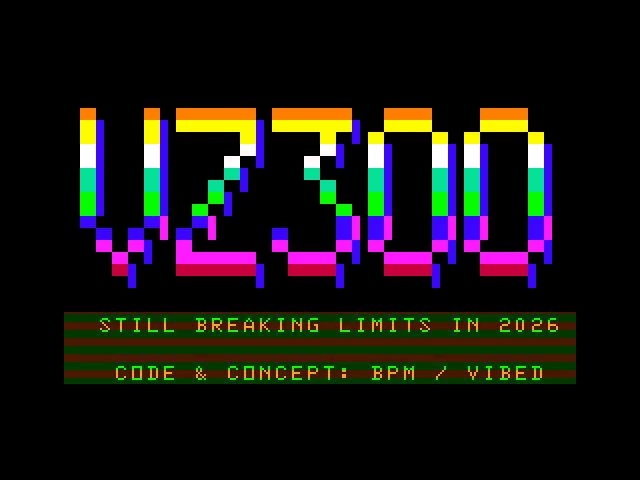

# VZ300 Megademo 2026

A demoscene megademo for the Dick Smith VZ300, about six minutes long. It has plasma, Kefrens bars, a synthwave picture, shaded 3D cube and octahedron, tunnel and torus, rotozoom, twister, transparency, music and speech.

**Version 1.4** · ViBED by BPM

## You need
- VZ300 (or VZ200) with the BennVenn SD loader and 128K SRAM

## Running it
Copy **everything** in `release/` to the root of the SD card. Each `.DAT` must sit next to its `.VZ`.

    LOAD"VZMEGA"      the full demo
    LOAD"RASTEST"     hardware test and calibration (run this first)
    LOAD"FXPLASMA"    single effects, which loop forever (also FXKEFREN, FX3DCUBE, FXTUNNEL, FXSEMIGR)

## Folders
- `release/`: the demo and the effect test programs
- `src/`: Z80 source and Python asset/music tools (`BUILD.TXT` explains the build)
- `screenshots/`: one picture per part
- `NOTES.TXT`: the full readme, including the RASTEST calibration steps
