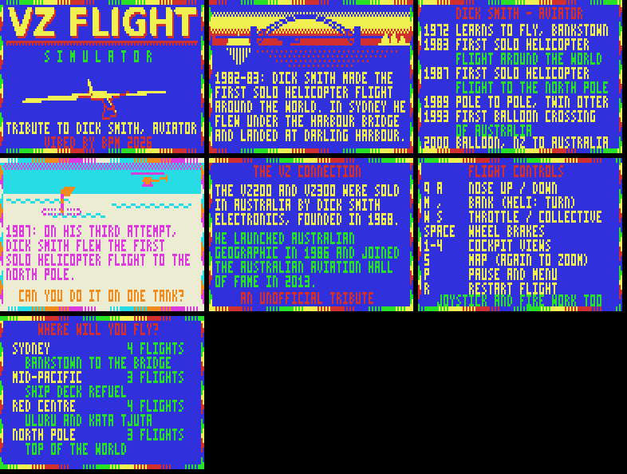

# VZ FLIGHT SIMULATOR

An FS1-style wireframe flight simulator for the Dick Smith **VZ300** with the **BennVenn SD loader + 128K**.
Mode 1 (128 × 64, four colours). VIBED BY BPM 2026.

It's an unofficial fan tribute to **Dick Smith, aviator**. The VZ200 and VZ300 were sold by Dick Smith
Electronics, and several missions recreate moments from his record flights. It isn't endorsed by him.

## Status: v0.3 (speed-up)

v0.3 is about 1.3 to 1.8 times faster than v0.2: **8 to 12 fields per frame (4 to 6 frames a second)**, down from 10 to 22.

| Scene | v0.2 | v0.3 |
|---|---|---|
| Bankstown runway | 22 fields | 12 fields |
| Sydney Harbour, looking east | 20 | 12 |
| Over the Sydney CBD | 14 | 11 |
| Mid-Pacific | 17 | 10 |
| North Pole | 15 | 11 |
| Red Centre | 10 | 8 |

How: distant objects switch to simplified shapes; vertex rotation uses product tables rebuilt once a frame; the perspective divide uses reciprocal tables; the ground grid is 6 + 6 lines (was 8 + 8).

### v0.2 features

| | |
|---|---|
| **Done** | Four locales, fourteen flights (ten missions plus a free flight in each locale), light plane and helicopter, attract sequence, menus, briefings, results with ratings and best scores. |
| **Completed by the robot pilot in the emulator** | First Solo (landing tested from final approach), Harbour Homecoming, Harbour Scenic, Kata Tjuta Hop, Top of the World. Gates also pass in Low Pass, Rock Circuit and Outback Strip; the robot can't yet fly the last landing in those, or chase the moving ship. |
| **Tested on the real VZ300** | Not yet. The v0.1 engine hasn't been on hardware either. |
| **Not started** | Saving best scores to the SD card, more locales |

Everything fits in one `.VZ` file (about 28 KB), so nothing is loaded from the SD card while you fly.

## Loading

Copy `release/VZFLIGHT.VZ` to the SD card and run it.
It loads at $8000 (to $EF6E) and makes no mapper writes. It doesn't call the DOS, and it uses the BennVenn SRAM at $4000-$4AFF for its maths tables, like the Cybernoid port, so it needs the BennVenn SD loader.

## The attract sequence

Title screen with a wireframe Cessna circling over the runway, then the tribute pages (Dick Smith's record
flights, the VZ connection), the controls, the locale list and a demo flight over Sydney Harbour.
Press SPACE or fire at any time to go to the menu.

## Locales and missions

| Locale | Flights |
|---|---|
| **Sydney** (CSS 0: blue sky, green ground) | First Solo (take off from Bankstown, fly the circuit gates, land), Harbour Homecoming (helicopter: under the Harbour Bridge, land at Darling Harbour, as he did in 1983), Harbour Scenic, Free Flight |
| **Mid-Pacific** (sunset sea, a moving cargo ship) | Ship Deck Refuel (helicopter: find the ship by the bearing arrow and land on its deck before the fuel runs out, as he did in 1983), Low Pass, Free Flight |
| **Red Centre** (CSS 1: buff desert, cyan sky) | Rock Circuit (round Uluru, don't overfly it), Kata Tjuta Hop, Outback Strip, Free Flight |
| **North Pole** (CSS 1: ice and pressure ridges) | Top of the World (helicopter to the Pole on one tank, as in 1987), Pole to Pole (Twin Otter-style landing beside the Pole, as in 1988-89), Free Flight |

Missions are strings of gates (fly through within the height band) and landings. The top line of the
3D view shows the next gate, a bearing arrow and the distance. Crashing isn't the end: you restart from the
last gate you passed and the time counts 15 seconds per crash.

## Controls

| Key | Plane | Helicopter |
|---|---|---|
| Q / A | nose up / down | slow down / fly forward |
| M / , | bank left / right | turn left / right |
| W / S | throttle | collective (up / down) |
| SPACE | wheel brakes | |
| 1 2 3 4 | look ahead, left, right, behind | |
| 5 | map view (press again to zoom out) | |
| P | pause (R restart, RETURN quit to the menu) | |
| R | restart the flight | |

Joystick 1 works too: stick to fly, fire for throttle up, second fire for throttle down.

## Facts used

The tribute pages and briefings were checked against the Australian Aviation Hall of Fame entry, the
Wikipedia article and Australian Geographic's "On this day" piece on the 1983 flight.

## Building

`python3 src/build.py` (pure Python: it includes its own Z80 assembler) makes `VZFLIGHT.VZ`.
`src/bot.py` flies a mission in the Python emulator with a robot pilot and saves screenshots,
e.g. `python3 bot.py 0 0 20` (locale, mission, seconds between screenshots).
