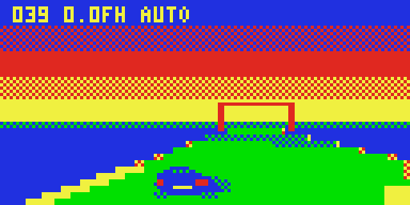

# VZ RACER 3D

Real-time solid-polygon 3D racing on the Dick Smith VZ300: an anti-gravity hover racer in the spirit of Wipeout and F-Zero.
Target: VZ300 + BennVenn SD loader + 128K RAM. Mode 1 (128x64, 4 colours).
VIBED BY BPM 2026

**Status: v0.4 engine demo** (Stage 4 of the brief). One track, gates, an animated craft and an autopilot. Gameplay (boost pads, energy shield, rivals) comes next.



## Loading

Copy `release/RACE3D.VZ` to the SD card and run it from the loader. The title screen shows for a few seconds, then the craft races on autopilot until you touch a key.

`release/BENCH.VZ` is the Stage 2 renderer benchmark.

## Controls

| Key | Action |
|---|---|
| `,` / `.` | Steer left / right |
| SPACE | Accelerate |
| N | Brake |
| M | Palette split on/off (sky in colour set 1, track in colour set 0). It looks great but costs about a field per frame |
| H | Half-rate rows on/off (on by default) |
| Joystick 1 | Steer, fire to accelerate |

The HUD at the top shows speed, average fields per frame (`4.3F` = 50 / 4.3 ≈ 11.6 fps), `H` when half-rate rows are on, and `AUTO` while the autopilot drives.

## How it works

- The track is a list of cross-sections, stepped along incrementally from the camera and projected with log/exp tables. Distant sections use lower detail.
- Each track strip is rasterised front to back into per-row run lists. Nearer strips hide farther ones, so every pixel is written exactly once.
- The composer turns the run lists into checker-dithered bytes in a back buffer. A field-sync interrupt copies the buffer to video RAM ahead of the beam, so there's no tearing.
- The static top sky and the HUD are only redrawn when they change.
- Every frame the Z80 renderer draws is checked byte for byte against a Python reference (`src/race/ref3.py`).

## Measured speed (v0.4, cycle-exact emulator, 40 s autopilot)

| Mode | Fields per frame | fps |
|---|---|---|
| Half-rate rows on (default) | 4.29 | 11.7 |
| Half-rate rows off | 4.78 | 10.5 |

The full development history and the measurements are in `docs/STAGE1.md` to `docs/STAGE4.md`.

## Building

Needs Python 3 and a C compiler.

```
cd src/tools && cc -O2 -o vzemu vzemu.c
cd ../race && python3 build_race.py           # writes RACE3D.VZ
python3 build_race.py test 14                 # byte-exact check against the reference
python3 gamerun.py                            # frame-rate measurement
```

`src/tools/z80asm.py` is the assembler and `src/tools/vzemu.c` is the cycle-exact VZ300 test emulator. Both were written for this project.
