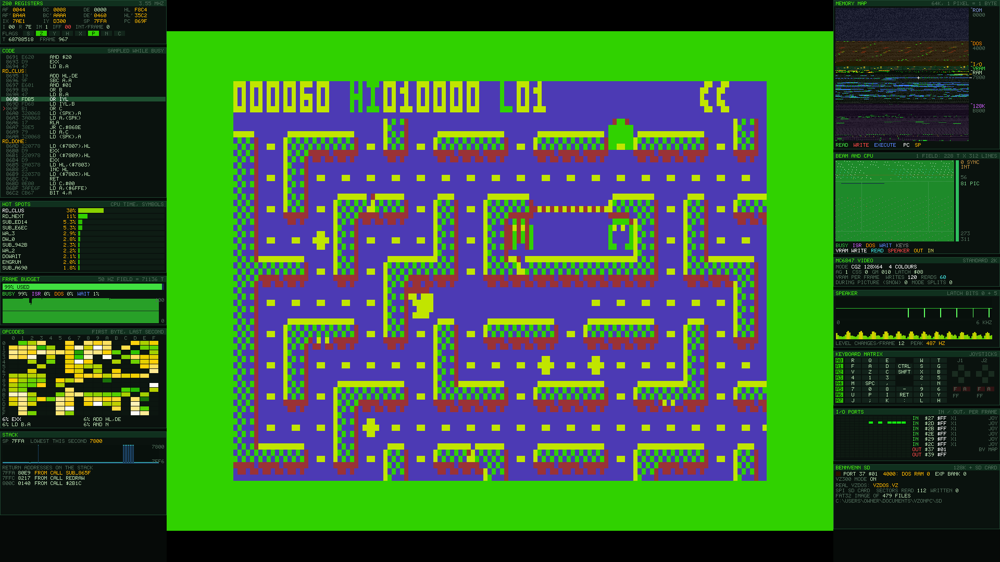

# VZonPC

**A Dick Smith VZ200 / VZ300 emulator for Windows, built for playing and making VZ games.**

VZonPC runs VZ software exactly as the real machine does, down to the T-state. Plug in the BennVenn
128K SD loader and it boots the real VZDOS from a folder on your PC: VZ-DECK comes up, you browse,
launch games and play music, and anything you save lands straight back in that folder. Press F10 in
fullscreen and the sides of the screen fill with live panels: the Z80's registers and code, a
heatmap of all 64K of memory, and a beam-by-beam view of where the CPU spends each frame. It's one
small `.exe` with nothing to install.

## Tech specs

**Machines**
- VZ200 (Z80 at 3.58 MHz, 8K RAM) and VZ300 (Z80 at 3.55 MHz, 18K RAM), also known as the VTech Laser 210 / 310
- Memory: none, the 16K RAM pack, or the **BennVenn SD loader with 128K** (paged DOS RAM and expansion banks, VZ300 mode)
- Joystick interface on ports `$20`–`$2F`, two joysticks with fire and arm buttons
- **Disk drive:** the DD20 controller with two 5.25" drives and the real DOS BASIC V1.2 ROM, emulated at the flux
  level (stepper phases, the flux flip-flop, the shift register, 85 RPM). `.dsk` images; `SAVE`, `LOAD` and `INIT` write back to the file
- **RTTY terminal pack** (DSE K-6318, 1984): receives AFSK RTTY from an audio file and transmits through the speakers

**CPU**
- Cycle-counted Z80 core, including the undocumented instructions and flags
- Level-triggered 50 Hz interrupt, held for the first 56 lines as on the real VZ
- PAL timing: 312 lines × 228 T-states per field, checked against RASTEST on a real VZ300

**Video**
- MC6847 timed to the pixel: mode and colour-set changes part-way along a line land on the right pixel, and the
  6847's own row counter is modelled, so line-hold tricks (Kefrens bars, FLD) work as on a real VZ
- Text, semigraphics and the 128×64 4-colour mode, in both colour sets
- **Australian super hi-res mod** (8K video RAM, all eight GM modes up to 256×192, 2K paging through `OUT 32`)
- **German hi-res mod** (256×192, following MAME's Laser 310 SHRG driver)
- Optional VRAM "snow", showing where a program touches video RAM while the 6847 is fetching
- 1:1 pixels, ×2 to ×5, free window sizing with whole-pixel or aspect-correct scaling, border on/off, monochrome TV, fullscreen

**Sound**
- The speaker, through the PC's sound card at 44.1 kHz

**BennVenn SD and VZDOS**
- Port `$37` mapper, port `$3A` VZ300 mode, and the SD card at the SPI byte level on port `$39`
  (CMD0/8/9/10/12/13/17/24/41/55/58, SDHC addressing), with sector reads at real-hardware speed
- **A PC folder is the SD card.** It is presented to VZDOS as a FAT32 card with subfolders, 8.3 names and file dates
- Power-on boots `VZDOS.VZ` from the card or from `roms\`, exactly like the real loader, so a VZDOS that starts
  VZ-DECK comes up in VZ-DECK. Holding B gives BASIC and SPACE gives the DOS command line
- **Saves go back to the PC.** New files, overwrites, folders, renames and deletes made by VZDOS are written to
  the folder. Deleted files go to the Recycle Bin
- Quick-load: F2, F3 or drag-and-drop runs any `.VZ` straight away, with a built-in DOS serving its files

**Input**
- USB joysticks and gamepads (two players, hot-plugging), or arrow keys + Right Ctrl
- The real 8×6 keyboard matrix, with BREAK, RUBOUT and INSERT mapped
- Paste the clipboard as typing, for BASIC listings

**Tape**
- Play a WAV, FLAC or MP3 into the cassette socket: `CLOAD`, `CRUN` and fast loaders work
- A stereo tape's other channel plays through the speakers. 2018 A.D. by Five Finger Punch runs from its
  original CD audio, with the data on the left channel into the VZ and the music on the right

**Live visualiser (F10)**
- A 6847 beam panel: every picture line at one pixel per T-state, coloured by mode, with mid-line changes in white
  and the 6847's row counter alongside, so Kefrens flicks, split screens and line holds can be seen as they happen
- Left: Z80 registers, a live disassembly with the game's own symbols, CPU hot spots, frame budget
  (busy / interrupt / DOS / waiting), an opcode heatmap and the stack
- Right: a 64K memory map glowing with reads, writes and fetches; a T-state view of the whole field
  showing VRAM access, speaker clicks and port I/O against the beam; 6847 mode; a speaker scope and spectrum;
  the keyboard matrix and joysticks; I/O ports; and BennVenn SD, disk drive (head, sectors, spinning disk) or RTTY activity
- Costs about 1.5 ms per frame, so games keep running at full speed

**For developers**
- `vzemu.exe`: the same core, headless. It runs scripts with scripted keys and joysticks, takes PNG and
  visualiser screenshots, and records WAV. It also profiles T-states per routine, measures frame rates and
  stack depth, catches crashes and soaks a game with random input
- Z80 assembler and `.VZ` wrapper included (Python)
- Warp speed, pause, reset, power cycle, F12 screenshots

**Size and requirements**
- Windows 10 or 11 (it uses the .NET Framework 4 built into Windows). Nothing to install
- `VZonPC.exe` is 182 KB, and `vzemu.exe` is 126 KB
- Bring your own VZ ROM for BASIC, and the disk or RTTY ROM for those cartridges. Machine-code games run without one

**Not emulated:** saving to cassette, the printer, the RS-232 and WordPro cartridges, and the light pen.

## Screenshots

All in `screenshots\promo\`. Each has a clean 4× shot with the border (1280×960) and a fullscreen visualiser shot (1920×1080, `-visualiser`).

| Shot | What it shows |
|---|---|
| `vzdeck-browser` | VZ-DECK 1.0 booted through the real VZDOS from the SD folder |
| `vzdeck-games-folder`, `vzdeck-arcade-folder` | browsing the games on the card |
| `vzdeck-launched-ghost-hunter-3d` | Ghost Hunter 3D in play, launched from VZ-DECK |
| `vzdeck-mod-player`, `vzdeck-mod-tracker`, `vzdeck-xm-tracker` | VZ-DECK playing Amiga MOD and XM music |
| `redline`, `zephyr-zone`, `hoppy2`, `bix`, `graves-gargoyles`, `red-dust-rumble`, `tennis2`, `southern-cross`, `ghost-hunter-3d`, `cybernoid` | games in play |
| `megademo-raster` | the megademo's raster effect, showing the line-by-line 6847 |
| `disk-drive` | Laserlink Extended BASIC loaded with `BRUN` from a `.dsk` through the emulated DD20 drive |
| `rtty` | the RTTY terminal pack receiving a 45-baud RTTY recording |
| `window-maxq`, `window-vzdeck` | the real VZonPC window, with Max-Q's attract mode and VZ-DECK |
